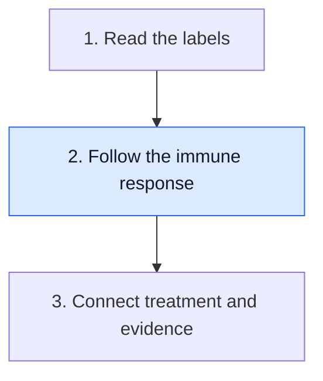

# Follow the route to immune recognition

**An immune cell has to encounter a suitable target and perform the needed job. Finding the cell in a sample establishes only part of that route.**

**Before you start:** The [immune-cell roster](/wiki/education/concepts/immunology/the-immune-system/immune-cell-roster) separates cell types and jobs. [Human leukocyte antigen (HLA)](/wiki/education/concepts/immunology/antigen-presentation/hla) explains peptide display. A [T-cell receptor (TCR)](/wiki/education/concepts/immunology/t-cells/t-cell-receptor) explains recognition of a peptide together with its display molecule.

## Where this step sits

This is step 2 of [Start here](/wiki/education/guides/start-here/index). You have separated the report's labels. Now follow one route an immune response needs. The final lesson asks what evidence supports changing treatment.

## Think of a team with different jobs

“The immune system” names many cells and signals. Some cells detect danger, some help start a response, and others can damage a recognized target. A count does not tell you which job was done or whether it helped.

For conventional T cells, recognition often involves a short protein fragment displayed by HLA. The TCR encounters that combined feature. A mutation in [deoxyribonucleic acid (DNA)](/wiki/education/concepts/biology-basics/genetics/central-dogma) is several steps upstream: it must contribute to a protein, a fragment must be produced and displayed, and a suitable T cell must recognize it. Each step has its own measurement.

This route is useful without being universal. Antibodies recognize accessible features differently. Natural killer cells use a different balance of activating and inhibitory signals. Do not force every immune treatment into the same diagram.

## Follow a route, then ask where it can fail

The [cancer-immunity cycle](/wiki/education/concepts/immunology/tumor-immunology/cancer-immunity-cycle) connects antigen availability, response initiation, movement into tissue and target-cell killing. Read it as a set of dependencies. Completing one step does not certify the next.

A response may fail because the relevant target is poorly displayed, a matching cell is scarce, cells cannot reach the right region or local signals impair function. These possibilities are different [immune-escape mechanisms](/wiki/education/concepts/immunology/tumor-immunology/immune-escape). The useful question is which one the evidence supports.

[Immune checkpoints](/wiki/education/concepts/immunology/immune-regulation/immune-checkpoint) help regulate responses. A [checkpoint inhibitor](/wiki/education/concepts/therapeutics/immunotherapy/immune-checkpoint-inhibitor) can interfere with a particular inhibitory pathway. It does not supply every missing target, matching receptor or route into a tumor. Its mechanism is one intervention at one part of a larger system.

## A worked comparison: equal counts, different routes

Two fictional tumor samples contain the same estimated number of T cells. In sample A, many cells sit near cancer nests. In sample B, many sit around the outer tissue and few enter those nests.

The counts match, but the spatial observations differ. They raise different access questions. Neither observation tells you whether those cells recognize cancer targets or kill the cancer cells. You would need evidence suited to those questions.

Now a researcher shows that blood T cells react to a proposed peptide in a laboratory assay. This supports a measured response under that assay's conditions. It does not prove the tumor displays the peptide or that the responding cells will reach it. The observations can be promising while leaving several dependencies open.

### Shared visual reference

*Fictional fields: inflamed and excluded have the same eight T-cell symbols, with different locations; desert has two. The outlines mark regions, not a proven wall. Counts are not a stromal-area lymphocyte score, and no clinical cutoff, receptor target, killing or treatment response follows.*

The first two fictional fields contain exactly eight symbols each; they compare locations, not a clinical count threshold or tracked cells moving between specimens. Presence and location leave natural target display, receptor specificity, access mechanisms and killing open.

## Use a question ladder

| Observation | A reasonable next question |
|---|---|
| Immune cells are present | Which cells, and where are they? |
| A candidate peptide is predicted | Is it made and displayed in the relevant setting? |
| A T-cell response is measured | What was recognized, with which controls? |
| Cells enter cancer tissue | Are they functional against the relevant targets? |
| A mechanism looks plausible | Does matched clinical evidence show benefit and acceptable risk? |

These are learning questions, not a required test menu. The clinical or research task determines which measurements are useful.

## What can go wrong at this step

- Counting all immune cells as tumor-killing cells erases different cell types and states.
- Equating predicted binding with displayed antigen skips processing and presentation.
- Equating a laboratory response with clinical benefit skips delivery, tissue function and outcomes.
- Assuming checkpoint blockade repairs every failure makes one mechanism carry too much weight.

## Try it

A fictional slide shows many T cells outside cancer nests. Someone proposes “more T cells” as the complete solution. What has not yet been established?

**Answer:** The observation leaves access, target recognition and function open. Increasing the total count might not resolve those dependencies. The next explanation should name and test the proposed failure.

## Explain it back

“Presence tells me ___; a useful response also needs ___.”

**One possible answer:** “Presence tells me cells were found; a useful response also needs suitable recognition, access and function.”

## Takeaway

**Follow the dependencies between an immune observation and a clinical effect.**

**Next:** [Connect treatment jobs with evidence](/wiki/education/guides/start-here/03-connect-treatment-and-evidence).

## Sources and scope

Foundation teaching about a conventional T-cell route, source-checked October 9, 2026; expert and learner review pending. Examples are fictional. Other immune cells and recognition formats have different requirements.

- [Chen and Mellman, 2013: the cancer-immunity cycle](https://doi.org/10.1016/j.immuni.2013.07.012), for dependencies in an antitumor immune response.
- [NCI: Immunotherapy](https://www.cancer.gov/about-cancer/treatment/types/immunotherapy), for immune treatment categories. The linked concepts provide the specialist sources.
