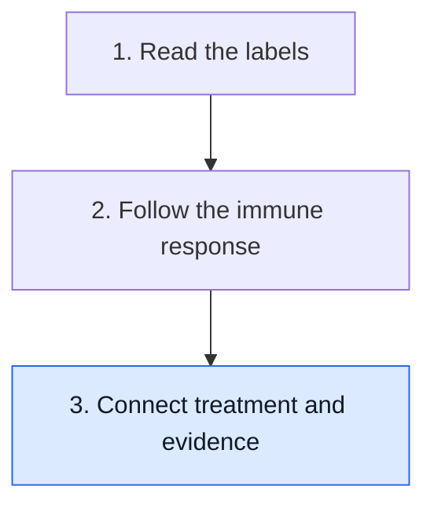
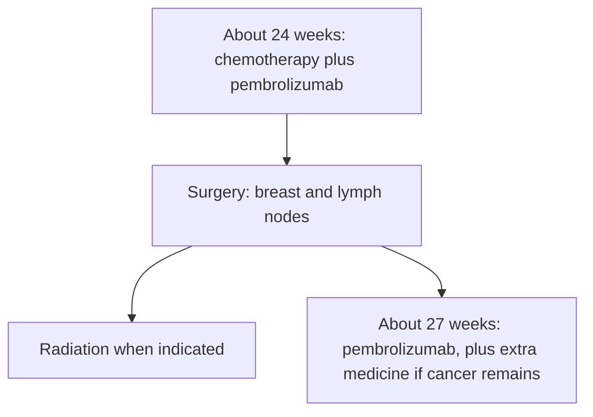

# Connect treatment jobs with evidence

**For stage II–III triple-negative breast cancer, chemotherapy with pembrolizumab comes first, surgery measures the response, and the result shapes what follows. A treatment has a job, a test has a question and a study has a comparison.**

**Before you start:** [Clinical actionability](/wiki/education/concepts/evidence-and-statistics/biomarkers/actionability) asks whether evidence supports an action in the relevant setting. [Prognostic versus predictive biomarkers](/wiki/education/concepts/evidence-and-statistics/biomarkers/prognostic-vs-predictive) separates information about outcome from evidence about a treatment difference.

## Where this step sits

This is the final lesson of [Start here](/wiki/education/guides/start-here/index). You have read the labels and followed the immune route. Now build a claim that says what its evidence can support.

## The standard sequence and why it runs in this order

Surgery and radiation act on the breast and nearby nodes. Medicines that travel through the body, called systemic treatment, reach cells that may have spread. For stage II–III triple-negative breast cancer (TNBC), the usual plan is the [KEYNOTE-522 regimen](/wiki/education/concepts/breast-cancer/treatment-setting/the-keynote-522-regimen) [1]:

Systemic treatment comes first, before surgery, which is called [neoadjuvant](/wiki/education/concepts/breast-cancer/treatment-setting/neoadjuvant-vs-adjuvant) treatment. It starts treating the whole body early, it can shrink the tumor, and it lets surgery show how well it worked. No invasive cancer left in the breast and nodes is called [pathologic complete response (pCR)](/wiki/education/concepts/breast-cancer/surgery-and-pathology-results/pcr). If cancer remains, there are tested options to add after surgery.

[Chemotherapy](/wiki/education/concepts/therapeutics/chemotherapy/chemotherapy) damages dividing cells. Pembrolizumab, a [checkpoint inhibitor](/wiki/education/concepts/therapeutics/immunotherapy/immune-checkpoint-inhibitor), releases a T-cell brake. The parts address different risks, so one part working well does not make the others unnecessary.

## Read one real number

The KEYNOTE-522 trial randomized 1,174 people with stage II–III TNBC to chemotherapy plus pembrolizumab or chemotherapy plus placebo [1, 2].

| Who, compared with what | Endpoint and time | Pembrolizumab | Placebo | Absolute difference |
|---|---|---|---|---|
| First 602 randomized | pCR at surgery | 64.8% | 51.2% | 13.6 points |
| All 1,174 | Alive at 5 years | 86.6% | 81.7% | About 5 points |

Both numbers are true. They answer different questions. Out of 100 people, about 5 more were alive at 5 years with pembrolizumab. That is the number to quote for survival, not the 13.6-point pCR difference. [Absolute and relative risk](/wiki/education/concepts/evidence-and-statistics/effect-measures/absolute-relative-risk-and-nnt) explains the rest of the habit.

## Move carefully between three kinds of evidence

| Evidence card | What it can establish | What still needs another kind of evidence |
|---|---|---|
| A drug blocks a pathway in a laboratory model | A mechanism under specified conditions | Benefit and risk in the clinical population |
| A person's scan improves after treatment | An observed change in that person's measured region | What caused the change and the added benefit over an alternative |
| A comparative clinical study measures outcomes | A treatment comparison in its studied setting | How well that setting matches the new question |

These cards are not interchangeable. A clinical study also needs scrutiny: the endpoint, follow-up, comparison and uncertainty matter. Start with [reading cancer evidence](/wiki/education/guides/reading-cancer-evidence/index) when you want to inspect those details.

## A worked claim: a favorable blood test

Imagine a fictional patient finishes treatment before surgery. A blood test reports no tumor DNA, and someone proposes skipping surgery because "the treatment worked." The blood test measured a sample of blood; it did not examine the breast and nodes, and no trial has compared skipping surgery on that basis. The observation and the proposal need different evidence. [Reading cancer evidence](/wiki/education/guides/reading-cancer-evidence/index) practises this in depth.

## Build one sentence you can check

Use this form: “In ___, compared with ___, the intervention changed ___, measured over ___.” For a study, fill in the population, alternative, endpoint and time. For a laboratory experiment, say so explicitly and name the controls.

If you cannot fill in the comparison, avoid words such as “better” without explaining better than what. If the evidence is one observation, keep it as an observation. You can still describe why it matters and what would test the next claim.

Risk and safety deserve the same precision. A response does not erase a serious toxicity. [Immune-related adverse events](/wiki/education/concepts/therapeutics/toxicities-and-supportive-care/immune-related-adverse-event) are one example of why an intervention's benefit and harm need separate assessment.

## What can go wrong at this step

- Confusing a mechanism with a clinical comparison overstates what the experiment tested.
- Using a test result to remove a treatment assumes that omission has been validated.
- Treating one person's response as a subgroup's expected benefit loses the denominator and alternative.
- Treating benefit as proof of safety merges two distinct outcomes.

## Try it

Which claim is supported by a fictional experiment showing cell killing in a dish: “the drug killed cells in this model,” “the drug will prevent recurrence,” or “the drug is safer than standard therapy”?

**Answer:** The first, if the experiment and controls support it. Recurrence prevention and comparative safety require clinical evidence in the relevant setting.

## Explain it back

“This evidence establishes ___; a bigger claim additionally requires ___.”

**One possible answer:** “This evidence establishes a 13.6-point higher pCR rate; claiming a survival benefit additionally requires the survival comparison, about 5 points at 5 years.”

## Takeaway

**Match the strength and setting of the evidence to the treatment claim.**

**Next:** [Understand how treatment is sequenced](/wiki/education/guides/treating-early-tnbc/index).

## Sources and scope

General teaching, source-checked November 7, 2026; expert and learner review pending. Cases are fictional and do not propose a treatment change.

1. [Schmid and colleagues, NEJM 2020: KEYNOTE-522](https://pubmed.ncbi.nlm.nih.gov/32101663/) — design, cycle counts and pCR.
2. [Schmid and colleagues, NEJM 2024: overall survival](https://pubmed.ncbi.nlm.nih.gov/39282906/).

- [NCI: Breast cancer treatment](https://www.cancer.gov/types/breast/treatment), for local and systemic roles.
- [NCI: Clinical trials](https://www.cancer.gov/about-cancer/treatment/clinical-trials), for clinical questions and comparison.
- [NCI: Pathology reports](https://www.cancer.gov/about-cancer/diagnosis-staging/diagnosis/pathology-reports-fact-sheet), for the question tissue examination answers.
