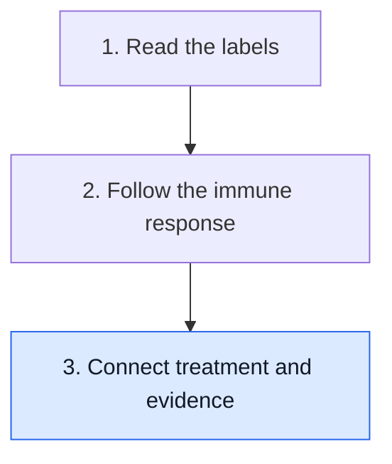

# Connect treatment jobs with evidence

**A treatment has a job, a test has a question and a study has a comparison. Keep all three visible when a result becomes a claim about what to do.**

**Before you start:** [Clinical actionability](/wiki/education/concepts/evidence-and-statistics/biomarkers/actionability) asks whether evidence supports an action in the relevant setting. [Prognostic versus predictive biomarkers](/wiki/education/concepts/evidence-and-statistics/biomarkers/prognostic-vs-predictive) separates information about outcome from evidence about a treatment difference.

## Where this step sits

This is the final lesson of [Start here](/wiki/education/guides/start-here/index). You have read the labels and followed the immune route. Now build a claim that says what its evidence can support.

## Put the jobs on a simple map

Surgery and external-beam radiation act on selected local or regional tissues. Systemic medicines can reach sites through the body, although distribution and biological effects differ among medicines and tissues. Tests collect information. They do not become treatment merely because their result is reassuring or worrying.

This distinction helps explain combination treatment. The parts may address different risks or mechanisms. One part working well does not establish that every other part is unnecessary. Conversely, several plausible mechanisms do not establish that combining them improves outcomes.

[Chemotherapy](/wiki/education/concepts/therapeutics/chemotherapy/chemotherapy) affects cellular processes such as replication or division. [Immune-checkpoint inhibition](/wiki/education/concepts/therapeutics/immunotherapy/immune-checkpoint-inhibitor) changes particular regulatory interactions in immune responses. Neither phrase names one universal drug, benefit or toxicity profile.

## Move carefully between three kinds of evidence

| Evidence card | What it can establish | What still needs another kind of evidence |
|---|---|---|
| A drug blocks a pathway in a laboratory model | A mechanism under specified conditions | Benefit and risk in the clinical population |
| A person's scan improves after treatment | An observed change in that person's measured region | What caused the change and the added benefit over an alternative |
| A comparative clinical study measures outcomes | A treatment comparison in its studied setting | How well that setting matches the new question |

These cards are not interchangeable. A clinical study also needs scrutiny: the endpoint, follow-up, comparison and uncertainty matter. Start with [reading cancer evidence](/wiki/education/guides/reading-cancer-evidence/index) when you want to inspect those details.

## A worked claim: a favorable test and an omission proposal

Imagine a fictional patient receives systemic treatment before breast surgery. A blood assay later reports no qualifying tumor signal. Someone proposes skipping surgery because “the treatment worked.”

The assay measured a blood sample under a detection rule. It did not examine the breast and nodes removed at surgery. It also did not compare surgery with omission of surgery in the relevant population. The favorable observation and the omission proposal therefore have different evidence requirements.

Now imagine a laboratory experiment finds that a new drug kills cells from that patient's sample. That supports an experimental finding in a model. To claim clinical benefit, you still need to consider exposure, normal tissues, the clinical setting and outcomes. A clear mechanism earns a better question; it does not finish the answer.

## Build one sentence you can check

Use this form: “In ___, compared with ___, the intervention changed ___, measured over ___.” For a study, fill in the population, alternative, endpoint and time. For a laboratory experiment, say so explicitly and name the controls.

If you cannot fill in the comparison, avoid words such as “better” without explaining better than what. If the evidence is one observation, keep it as an observation. You can still describe why it matters and what would test the next claim.

Risk and safety deserve the same precision. A response does not erase a serious toxicity. [Immune-related adverse events](/wiki/education/concepts/therapeutics/toxicities-and-supportive-care/immune-related-adverse-event) are one example of why an intervention's benefit and harm need separate assessment.

## What can go wrong at this step

- Confusing a mechanism with a clinical comparison overstates what the experiment tested.
- Using a test result to remove a treatment assumes that omission has been validated.
- Treating one person's response as a subgroup's expected benefit loses the denominator and alternative.
- Treating benefit as proof of safety merges two distinct outcomes.

## Try it

Which claim is supported by a fictional experiment showing cell killing in a dish: “the drug killed cells in this model,” “the drug will prevent recurrence,” or “the drug is safer than standard therapy”?

**Answer:** The first, if the experiment and controls support it. Recurrence prevention and comparative safety require clinical evidence in the relevant setting.

## Explain it back

“This evidence establishes ___; the proposed action additionally requires ___.”

**One possible answer:** “This evidence establishes a favorable blood-assay result; omitting local treatment additionally requires evidence for that omission strategy.”

## Takeaway

**Match the strength and setting of the evidence to the treatment claim.**

**Next:** [Understand how treatment is sequenced](/wiki/education/guides/treating-early-tnbc/index), or choose another question from [the learning paths](/wiki/education/index).

## Sources and scope

General teaching, source-checked October 9, 2026; expert and learner review pending. Cases are fictional and do not propose a treatment change.

- [NCI: Breast cancer treatment](https://www.cancer.gov/types/breast/treatment), for local and systemic roles.
- [NCI: Clinical trials](https://www.cancer.gov/about-cancer/treatment/clinical-trials), for clinical questions and comparison.
- [NCI: Pathology reports](https://www.cancer.gov/about-cancer/diagnosis-staging/diagnosis/pathology-reports-fact-sheet), for the question tissue examination answers.
