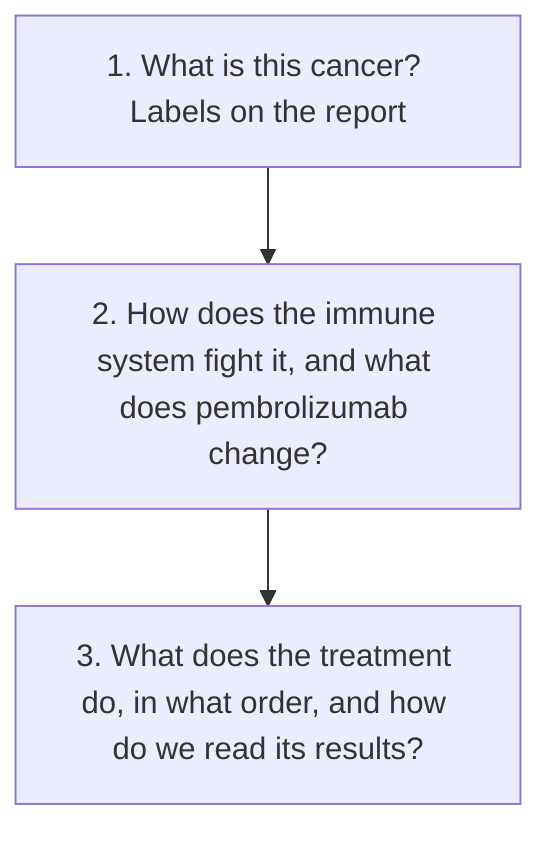

# Start here: triple-negative breast cancer in 30 minutes

**Triple-negative breast cancer (TNBC) is breast cancer that lacks the three targets most breast-cancer drugs aim at, so chemotherapy and immunotherapy carry treatment. For stage II–III disease, that treatment comes before surgery, and the surgery shows how well it worked.**

These three short lessons give a family member the core facts and one habit for reading the numbers that come with them.

## The big ideas

1. **Cancer is the body's own cells growing without normal controls**, able to invade nearby tissue and spread. A biopsy report describes what kind, how abnormal it looks (grade) and how far it has spread (stage); those are different labels.
2. **TNBC is negative for estrogen receptor (ER), progesterone receptor (PR) and human epidermal growth factor receptor 2 (HER2).** It makes up about 15% of breast cancers, is more often diagnosed at a younger age, in Black women and in carriers of *BRCA1* or *BRCA2* variants, and grows faster than other invasive breast cancers [1]. Hormone and HER2 drugs do not apply.
3. **The immune system can recognize cancer, and cancers learn to switch it off.** T cells read small protein fragments on a cell's surface. T cells also carry a brake receptor, programmed cell death protein 1 (PD-1), and many tumors display its partner, programmed death-ligand 1 (PD-L1), to press it. Pembrolizumab blocks PD-1 and releases the brake.
4. **The standard plan for stage II–III TNBC** is about six months of chemotherapy with pembrolizumab, then surgery, then radiation when indicated and about six more months of pembrolizumab. If cancer remains at surgery, more treatment may be added [2].
5. **Read every number as "who, compared with what, by when."** Adding pembrolizumab raised the share with no invasive cancer at surgery from 51% to 65%, but raised 5-year survival from about 82% to about 87% [2]. Those are different questions with different answers.

## The map

## Lessons

| Step | Lesson | The question it answers | Minutes | Learning aid |
|---|---|---|---|---|
| 1 | [Read each label as an answer to a question](/wiki/education/guides/start-here/01-read-the-labels) | What is TNBC, and what do grade and stage mean? | 10 | Fictional report and grade-versus-stage exercise |
| 2 | [Follow the route to immune recognition](/wiki/education/guides/start-here/02-follow-immune-recognition) | How do T cells find cancer, and what does a checkpoint inhibitor do? | 10 | Two-tumor comparison |
| 3 | [Connect treatment jobs with evidence](/wiki/education/guides/start-here/03-connect-treatment-and-evidence) | Why treatment comes before surgery, and how to read one trial number | 12 | Standard-plan timeline and one real trial number |

## Concepts you will use

**Reading a diagnosis:** [cancer](/wiki/education/concepts/cancer-biology/what-cancer-is/cancer), [triple-negative breast cancer](/wiki/education/concepts/breast-cancer/receptors-and-subtypes/tnbc), [histologic grade](/wiki/education/concepts/breast-cancer/grade-and-stage/histologic-grade) and [TNM staging](/wiki/education/concepts/breast-cancer/grade-and-stage/tnm-staging).

**Following immunity:** [human leukocyte antigen (HLA)](/wiki/education/concepts/immunology/antigen-presentation/hla), [T-cell receptor](/wiki/education/concepts/immunology/t-cells/t-cell-receptor) and [checkpoint inhibitors](/wiki/education/concepts/therapeutics/immunotherapy/immune-checkpoint-inhibitor).

**Treatment and numbers:** [neoadjuvant versus adjuvant therapy](/wiki/education/concepts/breast-cancer/treatment-setting/neoadjuvant-vs-adjuvant), [the KEYNOTE-522 regimen](/wiki/education/concepts/breast-cancer/treatment-setting/the-keynote-522-regimen), [pathologic complete response](/wiki/education/concepts/breast-cancer/surgery-and-pathology-results/pcr) and [absolute versus relative risk](/wiki/education/concepts/evidence-and-statistics/effect-measures/absolute-relative-risk-and-nnt).

## Applied to Diana

Use [the diagnosis record](/wiki/care/diagnosis) for current classification, [results](/wiki/care/results) for reported findings and [the treatment plan](/wiki/care/treatment-plan) for current care. This path explains the questions those pages answer.

## Where to go next

**Next:** [Understand how treatment is sequenced](/wiki/education/guides/treating-early-tnbc/index), which walks the standard plan step by step. Later, the [pathology](/wiki/education/guides/reading-pathology-and-surgery-results/index), [immune-system](/wiki/education/guides/how-the-immune-system-fights-cancer/index) and [evidence](/wiki/education/guides/reading-cancer-evidence/index) guides go deeper.

## What is still uncertain

Group results cannot say how one tumor will respond. Which added treatment helps most after cancer remains at surgery is still being tested. Expert and learner review of this path is pending.

## Sources and scope

Source-checked November 7, 2026. Practice cases in the lessons are fictional.

1. [NCI: Triple-negative breast cancer](https://www.cancer.gov/types/breast/breast-cancer-types/triple-negative) — definition, share of breast cancers and who is affected.
2. [Schmid and colleagues, NEJM 2020](https://pubmed.ncbi.nlm.nih.gov/32101663/) and [2024](https://pubmed.ncbi.nlm.nih.gov/39282906/) — KEYNOTE-522 schedule, pathologic complete response and 5-year overall survival.
- [NCI: Triple-negative breast cancer treatment](https://www.cancer.gov/types/breast/treatment/triple-negative-breast-cancer).
- [NCI: What is cancer?](https://www.cancer.gov/about-cancer/understanding/what-is-cancer).
