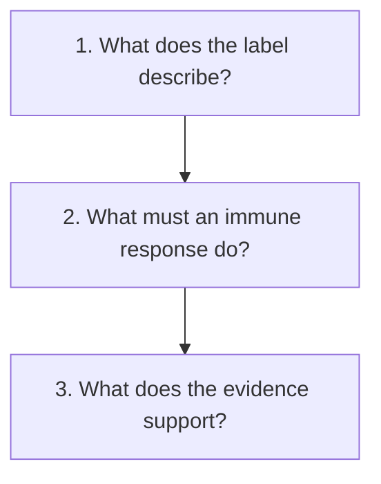

# Start here: read the biology, then the evidence

**Build a small, useful picture of cancer care in three lessons: read the labels, follow the immune response and ask what the evidence establishes.**

You do not need to memorize a report's vocabulary before you can ask a good question. Begin by giving each term a job. A receptor result describes a measured feature. A stage describes extent within a staging system. A trial result describes outcomes in a studied population. Each can matter without answering every other question.

This path is a starting point. Read the bold core idea at the top of each lesson, try its fictional example and use the answer to check yourself. The suggested ten-minute budgets include that practice. Pause at a concept link when you want the deeper explanation; returning to it later is fine.

## The big ideas

1. A diagnosis has several dimensions. Appearance, receptors, molecular patterns and extent are related, but their labels are not interchangeable.
2. An immune response needs more than immune cells being present. Recognition, access and function can each fail.
3. A treatment mechanism explains a possible route to an effect. Clinical evidence tests whether a treatment helps in a particular setting.
4. Local treatment, systemic treatment and tests have different jobs. A result from one does not automatically replace another.

## The map

## Lessons

| Step | Lesson | The question it answers | Minutes | Learning aid |
|---|---|---|---|---|
| 1 | [Read each label as an answer to a question](/wiki/education/guides/start-here/01-read-the-labels) | What is being described or measured? | 10 | Fictional report and sorting exercise |
| 2 | [Follow the route to immune recognition](/wiki/education/guides/start-here/02-follow-immune-recognition) | What must happen beyond finding immune cells? | 10 | Two-tumor comparison and missing-step exercise |
| 3 | [Connect treatment jobs with evidence](/wiki/education/guides/start-here/03-connect-treatment-and-evidence) | Which claim can this result support? | 10 | Treatment map and evidence cards |

## Concepts you will use

**Reading a diagnosis:** [Triple-negative breast cancer](/wiki/education/concepts/breast-cancer/receptors-and-subtypes/tnbc), [histologic grade](/wiki/education/concepts/breast-cancer/grade-and-stage/histologic-grade), [TNM staging](/wiki/education/concepts/breast-cancer/grade-and-stage/tnm-staging) and [tumor heterogeneity](/wiki/education/concepts/cancer-biology/what-cancer-is/tumor-heterogeneity).

**Following immunity:** [Immune-cell roster](/wiki/education/concepts/immunology/the-immune-system/immune-cell-roster), [antigen presentation](/wiki/education/concepts/immunology/antigen-presentation/hla), [T-cell receptor](/wiki/education/concepts/immunology/t-cells/t-cell-receptor) and [immune escape](/wiki/education/concepts/immunology/tumor-immunology/immune-escape).

**Reading a claim:** [Prognostic versus predictive biomarkers](/wiki/education/concepts/evidence-and-statistics/biomarkers/prognostic-vs-predictive) and [clinical actionability](/wiki/education/concepts/evidence-and-statistics/biomarkers/actionability).

## Applied to Diana

Use [the diagnosis record](/wiki/care/diagnosis) for current classification, [results](/wiki/care/results) for reported findings and [the treatment plan](/wiki/care/treatment-plan) for current care. This learning path explains the questions those pages answer.

## Where to go next

Follow [standard-treatment sequencing](/wiki/education/guides/treating-early-tnbc/index), then [pathology and surgery results](/wiki/education/guides/reading-pathology-and-surgery-results/index). Use [the immune-system path](/wiki/education/guides/how-the-immune-system-fights-cancer/index) for a deeper mechanism or [reading cancer evidence](/wiki/education/guides/reading-cancer-evidence/index) for trial results.

## What is still uncertain

A foundation course cannot establish how an individual tumor will respond or whether a new combination will help. Those questions require the relevant findings, clinical setting and evidence. Expert and learner review of this curriculum remain pending.

## Sources and scope

General teaching, source-checked October 9, 2026. All practice cases are fictional. The linked concepts and lessons provide the scoped sources for their mechanisms.

- [NCI: What is cancer?](https://www.cancer.gov/about-cancer/understanding/what-is-cancer).
- [NCI: Types of cancer treatment](https://www.cancer.gov/about-cancer/treatment/types).
