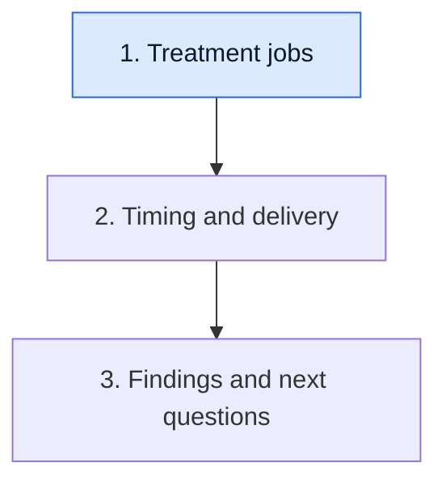

# Read the jobs in the treatment plan

**Read a combination as several jobs that need clinical evidence and compatible delivery. A list of mechanisms alone does not establish a useful regimen.**

**Before you start:** [Chemotherapy](/wiki/education/concepts/therapeutics/chemotherapy/chemotherapy) introduces medicines that affect cellular processes. [Immune-checkpoint inhibitors](/wiki/education/concepts/therapeutics/immunotherapy/immune-checkpoint-inhibitor) explains intervention in particular immune-regulatory interactions.

## Where this step sits

This is step 1 of [Understand how treatment is sequenced](/wiki/education/guides/treating-early-tnbc/index). Name the jobs before interpreting their calendar. The final lesson connects findings with the next questions.

## A team does not have one universal tool

Imagine a plan containing systemic medicines, an operation and planned radiation. Medicines can reach tissues through the body. Surgery removes selected tissue. External-beam radiation delivers energy to planned volumes. These jobs can work together while asking different questions about benefit and risk.

“Systemic” does not mean every cancer cell receives the same exposure or is sensitive to the medicine. “Local” does not mean unimportant to the whole treatment goal. The terms describe reach and roles; they are not a ranking of importance.

[Triple-negative breast cancer (TNBC)](/wiki/education/concepts/breast-cancer/receptors-and-subtypes/tnbc) helps frame the receptor classification. It does not supply disease extent, previous treatment, eligibility or safety assessment.

## Build a regimen card

| Field | The question to ask |
|---|---|
| Setting and goal | What disease setting and treatment goal is this plan addressing? |
| Mechanism | Which cellular or immune process does each medicine affect? |
| Clinical evidence | Which population and comparison support this use? |
| Delivery | What route, cadence and sequence were planned? |
| Safety | Which risks, monitoring and supportive care accompany that delivery? |
| Local treatment | What tissue or regional question does surgery or radiation address? |

This card is a reading aid. It does not replace orders, consent or clinical assessment. It helps a reader notice when a proposed change supplies a mechanism but leaves the other fields blank.

## Distinct mechanisms can bring distinct constraints

Chemotherapy is a broad category, rather than one cell process. Use a short class map to translate drug names into jobs:

| Family and example | What the mechanism helps explain |
|---|---|
| [Taxane](/wiki/education/concepts/therapeutics/chemotherapy/taxanes), such as paclitaxel | Disrupted reorganization of microtubules, the protein structures used in division and cellular transport |
| [Platinum agent](/wiki/education/concepts/therapeutics/chemotherapy/platinum-agents), such as carboplatin | Chemical attachments and cross-links in DNA (deoxyribonucleic acid) |
| [Anthracycline](/wiki/education/concepts/therapeutics/chemotherapy/anthracyclines), such as doxorubicin | Several injury mechanisms, including disruption of an enzyme's DNA cut-and-reseal process |
| [Classic alkylating agent](/wiki/education/concepts/therapeutics/chemotherapy/alkylating-agents), such as cyclophosphamide | Activation to metabolites that chemically modify DNA |

This is a mechanism map, not a required drug list. Platinum and classic alkylating agents can have related consequences through different chemistry. Another class, [fluoropyrimidines such as capecitabine](/wiki/education/concepts/therapeutics/chemotherapy/capecitabine-and-fluoropyrimidines), can arise in separate postoperative evidence questions. Oral delivery does not make that medicine mild, and its mechanism does not establish that it should be added to every plan.

Checkpoint inhibition has another job: changing a specified regulatory interaction in immune responses. A treatment can combine cellular injury with immune modulation. Whether that combination helps is tested clinically.

Read delivery separately from mechanism. [Dose and dose intensity](/wiki/education/concepts/therapeutics/how-drugs-work/dose-and-dose-intensity) distinguish amount from amount over time. [Dose-dense scheduling](/wiki/education/concepts/therapeutics/chemotherapy/dose-dense-scheduling) names shorter intervals relative to a specified comparison schedule. The [therapeutic index](/wiki/education/concepts/therapeutics/how-drugs-work/therapeutic-index) asks about useful effects relative to harm. These concepts help fill the card; none supplies a personal dose or proves that more frequent delivery always helps.

Distinct mechanisms can also bring overlapping harms. A side effect may interrupt one component while another can continue. The clinician must consider the actual drugs, their interactions and the purpose of each component. Adding a medicine is therefore more than adding a box to a diagram.

Normal tissues remain part of the picture. A drug's activity against cancer cells does not establish cancer-only activity. Local treatment also needs a normal-tissue assessment: a radiation plan considers nearby structures as well as its intended target volume.

Give supportive care and toxicity their own rows on the card:

| Question | Concept that helps you read the plan |
|---|---|
| Could immune activity harm a healthy organ? | [Immune-related adverse events (irAEs)](/wiki/education/concepts/therapeutics/toxicities-and-supportive-care/immune-related-adverse-event), including [pneumonitis](/wiki/education/concepts/therapeutics/toxicities-and-supportive-care/pneumonitis), require clinical attribution rather than a symptom-only diagnosis |
| Could blood-cell recovery affect safe delivery? | [Neutropenia and granulocyte colony-stimulating factor (G-CSF)](/wiki/education/concepts/therapeutics/toxicities-and-supportive-care/neutropenia-and-g-csf) distinguish a low neutrophil count, infection risk and selected growth-factor support |
| What symptoms need prevention and reporting? | [Chemotherapy-induced nausea](/wiki/education/concepts/therapeutics/toxicities-and-supportive-care/chemotherapy-induced-nausea) distinguishes nausea from vomiting and their acute, delayed and anticipatory patterns |

These questions explain different jobs, not one universal side-effect plan. A supportive medicine can improve tolerability without directly treating the cancer. A symptom occurring during combination treatment can also have more than one possible cause.

## A worked proposal: fill in the missing fields

Consider a fictional proposal to add a new pathway inhibitor to an established preoperative regimen. It includes a convincing mechanism diagram and cell-killing data from a laboratory model.

Those observations belong in the mechanism and experimental-evidence fields. The proposal still needs evidence about the clinical population, combination, achievable exposure and toxicity. It also needs an explanation of where the intervention fits around surgery and the other medicines.

The next statement is “this raises a combination question.” It is too early to conclude that adding a mechanism necessarily adds benefit. A pathway can matter biologically while the intervention is ineffective or difficult to deliver.

## What can go wrong at this step

- Calling every infusion chemotherapy hides differences among drug classes and immune treatment.
- Calling systemic treatment a replacement for local treatment assumes an omission strategy has been established.
- Borrowing a safety profile from one drug ignores the combination and schedule.
- Borrowing supportive care from another regimen ignores its dose, route and risk profile.

## Try it

A fictional combination is described as “better because it attacks three mechanisms.” What would make that an assessable clinical claim?

**Answer:** The population, comparator, outcome, follow-up, actual delivery and harms. Three mechanisms explain a rationale; a relevant study tests the benefit.

## Explain it back

“I can explain each part's job, then check ___ before judging the combination.”

**One possible answer:** “I can explain each part's job, then check matched clinical evidence and compatible safety and delivery before judging the combination.”

## Takeaway

**A useful regimen needs more than a plausible collection of mechanisms.**

**Next:** [Read timing around surgery](/wiki/education/guides/treating-early-tnbc/02-read-timing-around-surgery).

## Sources and scope

General teaching, source-checked October 9, 2026; expert and learner review pending. The proposal is fictional.

- [NCI: Chemotherapy](https://www.cancer.gov/about-cancer/treatment/types/chemotherapy), for systemic and normal-tissue roles.
- [NCI: Breast cancer surgery](https://www.cancer.gov/types/breast/treatment/surgery), for removal and node examination.
- [NCI: Radiation for breast cancer](https://www.cancer.gov/types/breast/treatment/radiation), for external-beam treatment and normal-tissue risk.
- [NCI: Organ-related inflammation and immunotherapy](https://www.cancer.gov/about-cancer/treatment/side-effects/organ-inflammation) — symptoms need clinical assessment and treatment-specific reporting.
- [NCI: Infection and neutropenia](https://www.cancer.gov/about-cancer/treatment/side-effects/infection) — count changes and infection risk.
- [NCI: Nausea and vomiting](https://www.cancer.gov/about-cancer/treatment/side-effects/nausea) — symptoms and communication with the care team.
