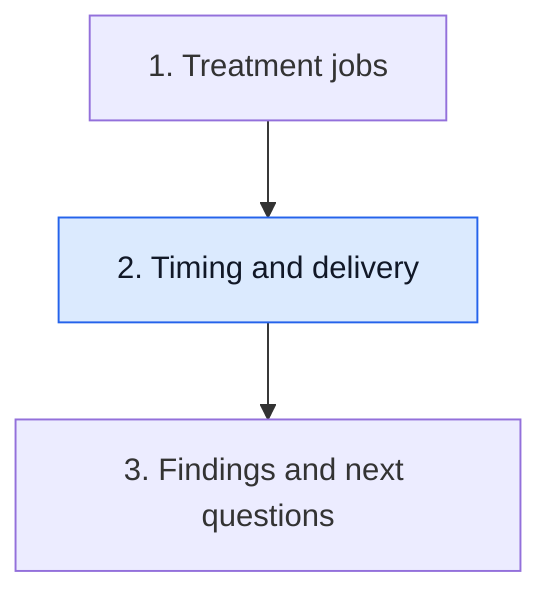

# Read timing around surgery

**Timing around surgery changes the task and the evidence available. A treatment calendar must also say what was actually delivered.**

**Before you start:** [Neoadjuvant versus adjuvant therapy](/wiki/education/concepts/breast-cancer/treatment-setting/neoadjuvant-vs-adjuvant) names treatment before or after the main local treatment. [TNM staging](/wiki/education/concepts/breast-cancer/grade-and-stage/tnm-staging) describes tumor, regional nodes and distant metastasis, including clinical and pathologic prefixes.

## Where this step sits

This is step 2 of [Understand how treatment is sequenced](/wiki/education/guides/treating-early-tnbc/index). You have named the jobs. Now attach timing and actual delivery to the plan.

## The operation is a landmark, not the whole timeline

Treatment before surgery can begin systemic care and reduce disease in the breast or regional nodes. It also creates an opportunity to examine response in later surgical tissue. Treatment after surgery addresses a different moment: the primary local operation has happened, and its findings can inform further care.

These terms describe timing, rather than one drug or a guarantee of success. A medicine can have uses before and after surgery. Surgery first can be appropriate in some settings; a preoperative approach can be appropriate in others. Read the stage, clinical question and tested strategy before assuming a universal order.

For nonmetastatic [triple-negative breast cancer (TNBC)](/wiki/education/concepts/breast-cancer/receptors-and-subtypes/tnbc), disease extent and risk help frame sequencing. A strategy studied for a defined higher-risk population does not automatically apply unchanged to every small tumor or to metastatic disease.

## Keep three clocks separate

The first clock is **biological sampling**: when the biopsy, scan or blood draw occurred. The second is **treatment delivery**: when doses, surgery or radiation happened. The third is **reporting**: when a result or addendum became available.

A report issued after surgery may describe a sample collected before it. A later appointment may review an earlier scan. Attaching only the reporting date can create a false sequence of response and treatment.

Next separate the tested trial schedule, the clinician's planned adaptation and the delivered course. These can be related without being identical. Retain holds or changes and their documented reasons. Expected visits are not proof of completed doses.

## A worked calendar

This example uses fictional blocks, not a drug schedule.

| Event | Plan | Delivered record | What the reader can conclude |
|---|---|---|---|
| Systemic block A | Four scheduled visits | Three visits documented, one held | Delivery differed; the reason remains relevant |
| Interim imaging | After block A | Scan acquired before the held visit was rescheduled | The scan reflects its acquisition date |
| Systemic block B | Follow block A | Substitution documented after a safety review | The medicine and exposure changed |
| Surgery | After preoperative treatment | Operative date and specimen collection recorded | Pathology can be read in that treatment context |

This record supports the observations. It does not establish that a delayed visit caused a later outcome or that a substitution preserved the original regimen's exact benefit. Those are additional questions.

## A response still needs the right assessment

An imaging response measures a region. A blood assay measures circulating material. [Pathologic complete response (pCR)](/wiki/education/concepts/breast-cancer/surgery-and-pathology-results/pcr) is a tissue endpoint with a specified definition. These results can be related without being substitutes.

A trial evaluating treatment omission must establish that strategy in the relevant population. A favorable interim test alone does not do so. It also cannot decide an individual's operation date or the timing of other treatment.

## What can go wrong at this step

- Equating “before surgery” with “only to shrink the tumor” loses systemic and response-assessment roles.
- Equating “after surgery” with “visible cancer is left” misreads adjuvant treatment's risk-reduction purpose.
- Treating an expected calendar as completed loses holds, substitutions and dose changes.
- Treating report dates as sample dates creates a false response sequence.

## Try it

A fictional calendar lists six planned doses. Five administration records are present and one visit was cancelled. Can you record six completed doses because six weeks have elapsed?

**Answer:** No. Planned visits and elapsed time do not establish administration. Keep the five documented doses and the cancelled or unresolved event separate.

## Explain it back

“Before and after surgery describe ___; the delivered record tells me ___.”

**One possible answer:** “Before and after surgery describe timing; the delivered record tells me what happened, with its changes and reasons.”

## Takeaway

**Read the strategy, sample dates and actual delivery before interpreting response.**

**Next:** [Use the findings in the next conversation](/wiki/education/guides/treating-early-tnbc/03-use-the-findings-in-the-next-conversation).

## Sources and scope

Source-checked October 9, 2026; expert and learner review pending. The calendar is fictional.

- [NCI: Breast cancer treatment by stage](https://www.cancer.gov/types/breast/treatment/by-stage).
- [NCI: Triple-negative breast cancer treatment](https://www.cancer.gov/types/breast/treatment/triple-negative-breast-cancer).
- [KEYNOTE-522 primary trial](https://pubmed.ncbi.nlm.nih.gov/32101663/), for one studied strategy, not a personal delivery record.
- [CTNeoBC pooled analysis](https://pubmed.ncbi.nlm.nih.gov/24529560/), for defined pathologic response and outcome association.
