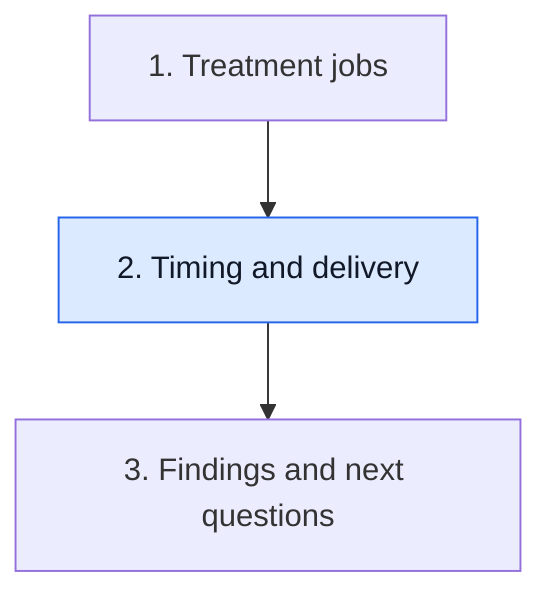

# Read timing around surgery

**In stage II–III triple-negative breast cancer (TNBC), treatment usually starts before surgery so that surgery can measure the response and the response can choose what follows. A treatment calendar must also say what was actually delivered.**

**Before you start:** [Neoadjuvant versus adjuvant therapy](/wiki/education/concepts/breast-cancer/treatment-setting/neoadjuvant-vs-adjuvant) names treatment before or after the main local treatment. [TNM staging](/wiki/education/concepts/breast-cancer/grade-and-stage/tnm-staging) describes tumor, regional nodes and distant metastasis, including clinical and pathologic prefixes.

## Where this step sits

This is step 2 of [Understand how treatment is sequenced](/wiki/education/guides/treating-early-tnbc/index). You have named the jobs. Now attach timing and actual delivery to the plan.

## Why treatment usually comes before surgery

For stage II–III [TNBC](/wiki/education/concepts/breast-cancer/receptors-and-subtypes/tnbc), systemic treatment usually comes first, for three reasons.

1. **It treats the whole body early.** Chemotherapy and immunotherapy reach cells that may already have left the breast.
2. **Surgery then measures the response.** The surgical specimen shows whether [pathologic complete response (pCR)](/wiki/education/concepts/breast-cancer/surgery-and-pathology-results/pcr) was reached. In a pooled analysis of 11,955 patients, people with TNBC who reached pCR had a much lower hazard of recurrence or death (hazard ratio 0.24) than those who did not [1].
3. **The response chooses what comes next.** Residual cancer opens options tested in that group, such as capecitabine, and olaparib for people who also carry a germline *BRCA1* or *BRCA2* variant. See [post-neoadjuvant escalation](/wiki/education/concepts/breast-cancer/treatment-setting/post-neoadjuvant-escalation).

Shrinkage can also make a smaller operation possible. pCR was also the first primary endpoint of [KEYNOTE-522](/wiki/education/concepts/breast-cancer/treatment-setting/the-keynote-522-regimen), the trial behind the usual sequence: about 24 weeks of chemotherapy with pembrolizumab, surgery, then up to 9 more three-weekly pembrolizumab cycles [2].

The operation also opens a short immune period of its own. Surgical stress, anesthesia, pain control and wound healing change immune function for days to weeks; see the [perioperative immune window](/wiki/education/concepts/immunology/tumor-immunology/perioperative-immune-window).

Surgery first can still be appropriate in some settings. A strategy studied in higher-risk disease does not automatically apply to every small tumor or to metastatic disease.

## Surgery and radiation have their own evidence

- **Breast surgery.** In randomized trials, lumpectomy plus radiation gave the same long-term survival as mastectomy for eligible early breast cancer. See [lumpectomy versus mastectomy](/wiki/education/concepts/breast-cancer/surgery-and-pathology-results/lumpectomy-vs-mastectomy).
- **Node surgery after preoperative treatment.** Removing a previously clipped positive node with the sentinel nodes lowers the chance of missing residual cancer. See [sentinel-node biopsy and axillary dissection](/wiki/education/concepts/breast-cancer/surgery-and-pathology-results/sentinel-node-and-axillary-dissection).
- **Radiation** is a separate local decision that considers disease extent before treatment as well as the surgical findings. See [radiation basics](/wiki/education/concepts/therapeutics/local-therapies/radiation-therapy-basics), [regional nodal irradiation after neoadjuvant therapy](/wiki/education/concepts/therapeutics/local-therapies/regional-nodal-irradiation-after-neoadjuvant-therapy) and, when margins or nodes need more surgery, [completion surgery](/wiki/education/concepts/therapeutics/local-therapies/completion-surgery).

## Keep the trial schedule and the delivered course apart

A trial's schedule is evidence about that regimen and population. The clinician's plan adapts it; the delivered record shows what happened, including holds and substitutions. The planned blocks are not separate [lines of therapy](/wiki/education/concepts/breast-cancer/treatment-setting/line-of-therapy). For sample, treatment and report dates, use [place the specimen in time](/wiki/education/guides/reading-pathology-and-surgery-results/01-place-the-specimen-in-time).

## A worked calendar

This example uses fictional blocks, not a drug schedule.

| Event | Plan | Delivered record | What the reader can conclude |
|---|---|---|---|
| Systemic block A | Four scheduled visits | Three visits documented, one held | Delivery differed; the reason remains relevant |
| Interim imaging | After block A | Scan acquired before the held visit was rescheduled | The scan reflects its acquisition date |
| Systemic block B | Follow block A | Substitution documented after a safety review | The medicine and exposure changed |
| Surgery | After preoperative treatment | Operative date and specimen collection recorded | Pathology can be read in that treatment context |

This record supports the observations. It does not establish that a delayed visit caused a later outcome or that a substitution preserved the original regimen's exact benefit. Those are additional questions.

## A response still needs the right assessment

An imaging response needs the modality, examined region and [response definition](/wiki/education/concepts/measurement/imaging/response-criteria). A change in one lesion is not automatically a complete patient-level response assessment. A blood assay measures circulating material. [Pathologic complete response (pCR)](/wiki/education/concepts/breast-cancer/surgery-and-pathology-results/pcr) is a tissue endpoint with a specified definition. These results can be related without being substitutes.

[Response-adapted therapy](/wiki/education/concepts/breast-cancer/treatment-setting/response-adapted-therapy) needs a defined assessment, timing and decision rule. A trial evaluating treatment omission, such as skipping breast surgery when a [biopsy after neoadjuvant therapy](/wiki/education/concepts/measurement/specimens/biopsy-after-neoadjuvant-therapy) finds no cancer, must establish that strategy in the relevant population. A favorable interim test alone does not do so. It also cannot decide an individual's operation date or the timing of other treatment.

## What can go wrong at this step

- Equating “before surgery” with “only to shrink the tumor” loses the systemic, response-measuring and next-step-choosing roles.
- Equating “after surgery” with “visible cancer is left” misreads adjuvant treatment's risk-reduction purpose.
- Treating an expected calendar as completed loses holds, substitutions and dose changes.
- Treating report dates as sample dates creates a false response sequence.

## Try it

A fictional calendar lists six planned doses. Five administration records are present and one visit was cancelled. Can you record six completed doses because six weeks have elapsed?

**Answer:** No. Planned visits and elapsed time do not establish administration. Keep the five documented doses and the cancelled or unresolved event separate.

## Explain it back

“Before and after surgery describe ___; the delivered record tells me ___.”

**One possible answer:** “Before and after surgery describe timing; the delivered record tells me what happened, with its changes and reasons.”

## Takeaway

**Read the strategy, sample dates and actual delivery before interpreting response.**

**Next:** [Use the findings in the next conversation](/wiki/education/guides/treating-early-tnbc/03-use-the-findings-in-the-next-conversation).

## Sources and scope

Source-checked November 7, 2026 against the primary abstracts; expert and learner review pending. The calendar is fictional.

1. [Cortazar and colleagues, Lancet 2014: CTNeoBC pooled analysis](https://pubmed.ncbi.nlm.nih.gov/24529560/) — pCR and long-term outcome by subtype.
2. [Schmid and colleagues, NEJM 2020: KEYNOTE-522](https://pubmed.ncbi.nlm.nih.gov/32101663/) — sequence and cycle counts.
3. [NCI: Triple-negative breast cancer treatment](https://www.cancer.gov/types/breast/treatment/triple-negative-breast-cancer).
4. [NCI: Breast cancer treatment by stage](https://www.cancer.gov/types/breast/treatment/by-stage).
