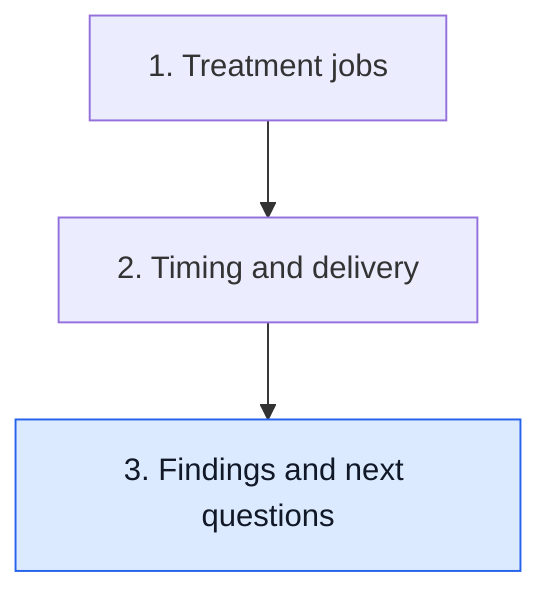

# Use the findings in the next conversation

**Postoperative findings inform several connected decisions. Name each decision before asking which evidence should change it.**

**Before you start:** [Pathologic complete response (pCR)](/wiki/education/concepts/breast-cancer/surgery-and-pathology-results/pcr) is a defined tissue endpoint. [Residual cancer burden (RCB)](/wiki/education/concepts/breast-cancer/surgery-and-pathology-results/residual-cancer-burden) summarizes residual breast and node findings. [Margins](/wiki/education/concepts/breast-cancer/surgery-and-pathology-results/surgical-margins) concerns evaluated edges. [Prognostic versus predictive evidence](/wiki/education/concepts/evidence-and-statistics/biomarkers/prognostic-vs-predictive) separates risk information from a treatment comparison.

## Where this step sits

This is the final lesson of [Understand how treatment is sequenced](/wiki/education/guides/treating-early-tnbc/index). You have read jobs and delivery. Now connect findings with the next clinical questions.

## Begin with what the report establishes

The surgical report describes submitted tissue after its particular treatment history. Read invasive disease in breast and nodes, in situ disease, margins and residual categories separately. A short response label cannot carry all those details.

A favorable tissue response is meaningful. It is not a guarantee that recurrence cannot occur. Residual invasive disease is also meaningful. It does not establish inevitable recurrence or that every component of earlier treatment had no benefit.

Use [the pathology path](/wiki/education/guides/reading-pathology-and-surgery-results/index) for the report-reading steps. Here the task is to sort the next questions and name the tested options, not to prescribe a postoperative regimen.

## Put the questions on three cards

| Card | Question | Evidence to keep beside it |
|---|---|---|
| Local completion | What remains to establish local or regional control? | Operative details, margins, distribution and relevant radiation evidence |
| Systemic treatment | Does an additional or continuing medicine improve outcomes here? | Prior therapy, receptor and genetic criteria, matched comparisons and eligibility |
| Safety and delivery | Can the plan be delivered with an acceptable balance of benefit and harm? | Toxicity history, recovery, organ assessment, interactions and clinical review |

The cards connect. Recovery can affect timing, and local treatment can affect a systemic plan. Keeping the questions distinct makes those connections easier to explain; they remain coordinated clinical decisions.

## The systemic card has named options

After [KEYNOTE-522](/wiki/education/concepts/breast-cancer/treatment-setting/the-keynote-522-regimen)-style treatment, the systemic card usually starts from these branches. [Post-neoadjuvant escalation](/wiki/education/concepts/breast-cancer/treatment-setting/post-neoadjuvant-escalation) gives the evidence for each.

| Finding at surgery | Options with randomized evidence | Still open |
|---|---|---|
| pCR | Complete the postoperative pembrolizumab phase, up to 9 cycles | Whether everyone with pCR needs every remaining cycle |
| Residual invasive cancer | Continue pembrolizumab; capecitabine (CREATE-X triple-negative subgroup: 5-year disease-free survival 69.8% vs 56.1%) | Adding capecitabine **to** pembrolizumab has no reported randomized test; antibody-drug conjugate trials are ongoing |
| Germline *BRCA1* or *BRCA2* variant, high risk | 1 year of olaparib (OlympiA) | Adding olaparib to pembrolizumab has no reported randomized test |

Platinum instead of capecitabine (EA1131) and sequencing-matched drugs (BRE12-158) were tested for residual TNBC and were not better.

## A worked case: one report, several questions

Imagine a fictional report after KEYNOTE-522-style treatment: a small amount of invasive cancer in the breast, one involved node and an involved margin. Germline testing found no *BRCA1* or *BRCA2* variant. Earlier, an inflammatory side effect paused the immune medicine.

- **Local card.** The margin raises a re-excision or radiation question, and the node feeds the radiation plan.
- **Systemic card.** Residual disease means no pCR. The tested branches are continuing pembrolizumab and adding capecitabine, whose evidence predates pembrolizumab. Olaparib's evidence does not apply without a germline variant. A trial of an antibody-drug conjugate may be worth asking about.
- **Safety card.** The earlier inflammatory event is its own question: can pembrolizumab resume safely?

Now add a negative [circulating tumor DNA (ctDNA)](/wiki/education/concepts/measurement/liquid-biopsy/cfdna-vs-ctdna) test. It does not erase the residual tissue or the margin. In people with residual TNBC, a positive ctDNA test was linked to higher risk, but no trial has shown that changing treatment because of ctDNA improves survival.

## Risk and added benefit ask different questions

A [residual cancer burden (RCB)](/wiki/education/concepts/breast-cancer/surgery-and-pathology-results/residual-cancer-burden) class is prognostic: it says who is at higher risk. To claim that an added drug helps, find a randomized comparison in a matching population, after a matching earlier regimen. [Response-adapted therapy](/wiki/education/concepts/breast-cancer/treatment-setting/response-adapted-therapy) explains why a high-risk group does not automatically benefit from every added treatment.

[Immune-related adverse events](/wiki/education/concepts/therapeutics/toxicities-and-supportive-care/immune-related-adverse-event) illustrates why safety remains explicit. An intended immune effect does not establish that inflammatory harm is acceptable or restarting treatment is appropriate.

## What can go wrong at this step

- Using a response label to answer a margin question loses local findings.
- Turning cohort risk into a personal forecast overstates transfer from that cohort.
- Treating eligibility as proof of benefit skips the comparison and uncertainty.
- Treating response as permission to ignore toxicity merges benefit with safety.

## Try it

A fictional person reached pCR after KEYNOTE-522-style treatment. A relative asks whether she should now add capecitabine, because it helped after surgery in CREATE-X. Does CREATE-X answer that?

**Answer:** No. CREATE-X enrolled only people with residual invasive cancer, so it says nothing about adding capecitabine after pCR. The tested branch after pCR is completing postoperative pembrolizumab.

## Explain it back

“The finding informs ___; choosing the next treatment also requires ___.”

**One possible answer:** “Residual disease informs the systemic card; choosing capecitabine also requires knowing it was tested without pembrolizumab, plus a safety assessment.”

## Takeaway

**Separate what was found, the decision it informs and the evidence for action.**

**Next:** [Read pathology and surgery results](/wiki/education/guides/reading-pathology-and-surgery-results/index), or inspect [the clinical comparison](/wiki/education/guides/reading-cancer-evidence/index).

## Sources and scope

Source-checked November 7, 2026 against the primary abstracts; expert and learner review pending. The fictional case is not a treatment recommendation.

- [Schmid and colleagues, NEJM 2022: KEYNOTE-522 event-free survival](https://pubmed.ncbi.nlm.nih.gov/35139274/) — postoperative pembrolizumab phase.
- [Masuda and colleagues, NEJM 2017: CREATE-X](https://pubmed.ncbi.nlm.nih.gov/28564564/).
- [Tutt and colleagues, NEJM 2021: OlympiA](https://pubmed.ncbi.nlm.nih.gov/34081848/).
- [Mayer and colleagues, JCO 2021: EA1131](https://pubmed.ncbi.nlm.nih.gov/34092112/).
- [Radovich and colleagues, JAMA Oncology 2020](https://pubmed.ncbi.nlm.nih.gov/32644110/) — ctDNA within residual TNBC.
- [Symmans and colleagues, 2007: residual cancer burden](https://doi.org/10.1200/JCO.2007.10.6823).
