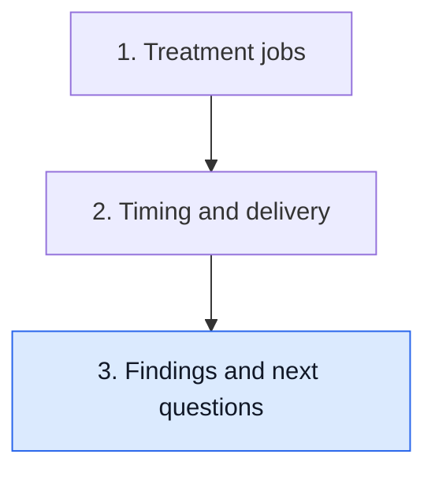

# Use the findings in the next conversation

**Postoperative findings inform several connected decisions. Name each decision before asking which evidence should change it.**

**Before you start:** [Pathologic complete response (pCR)](/wiki/education/concepts/breast-cancer/surgery-and-pathology-results/pcr) is a defined tissue endpoint. [Residual cancer burden (RCB)](/wiki/education/concepts/breast-cancer/surgery-and-pathology-results/residual-cancer-burden) summarizes residual breast and node findings. [Margins](/wiki/education/concepts/breast-cancer/surgery-and-pathology-results/surgical-margins) concerns evaluated edges. [Prognostic versus predictive evidence](/wiki/education/concepts/evidence-and-statistics/biomarkers/prognostic-vs-predictive) separates risk information from a treatment comparison.

## Where this step sits

This is the final lesson of [Understand how treatment is sequenced](/wiki/education/guides/treating-early-tnbc/index). You have read jobs and delivery. Now connect findings with the next clinical questions.

## Begin with what the report establishes

The surgical report describes submitted tissue after its particular treatment history. Read invasive disease in breast and nodes, in situ disease, margins and residual categories separately. A short response label cannot carry all those details.

A favorable tissue response is meaningful. It is not a guarantee that recurrence cannot occur. Residual invasive disease is also meaningful. It does not establish inevitable recurrence or that every component of earlier treatment had no benefit.

Use [the pathology path](/wiki/education/guides/reading-pathology-and-surgery-results/index) for the report-reading steps. Here the task is to sort the next questions, rather than calculate a response score or prescribe a postoperative regimen.

## Put the questions on three cards

| Card | Question | Evidence to keep beside it |
|---|---|---|
| Local completion | What remains to establish local or regional control? | Operative details, margins, distribution and relevant radiation evidence |
| Systemic treatment | Does an additional or continuing medicine improve outcomes here? | Prior therapy, receptor and genetic criteria, matched comparisons and eligibility |
| Safety and delivery | Can the plan be delivered with an acceptable balance of benefit and harm? | Toxicity history, recovery, organ assessment, interactions and clinical review |

The cards connect. Recovery can affect timing, and local treatment can affect a systemic plan. Keeping the questions distinct makes those connections easier to explain; they remain coordinated clinical decisions.

## A worked case: one report, several questions

Imagine a fictional report shows sparse invasive cancer in the breast, one involved regional node and an involved margin. During preoperative treatment, an inflammatory toxicity interrupted an immune medicine.

The invasive findings prevent the common combined pCR endpoint. The bed and node measurements contribute to residual burden and residual staging. The margin creates a local completion question. The earlier inflammatory event creates a separate safety question about further immune treatment.

None of these observations alone identifies the best added medicine. A higher-risk finding may justify a conversation about additional treatment, but proposed benefit needs evidence in the relevant setting. Safety history can also change feasible options.

Now add a negative blood assay. It does not erase the invasive tissue findings or the margin. It is another observation from another sampling method. Changing care based on it needs evidence for that decision strategy.

## Risk and added benefit ask different questions

An RCB category can be associated with outcomes in studied groups: prognostic evidence. To claim that an added treatment helps, identify a study with the relevant population, prior therapy, comparator and endpoint. To claim it helps especially in that category, inspect the subgroup evidence and uncertainty.

[Response-adapted therapy](/wiki/education/concepts/breast-cancer/treatment-setting/response-adapted-therapy) tests a defined next step after an assessed response. A high-risk group does not automatically respond to every intervention. A promising mechanism also does not establish benefit after a particular prior regimen. Eligibility for access, evidence for benefit and the choice to use treatment are separate steps.

[Immune-related adverse events](/wiki/education/concepts/therapeutics/toxicities-and-supportive-care/immune-related-adverse-event) illustrates why safety remains explicit. An intended immune effect does not establish that inflammatory harm is acceptable or restarting treatment is appropriate.

## What can go wrong at this step

- Using a response label to answer a margin question loses local findings.
- Turning cohort risk into a personal forecast overstates transfer from that cohort.
- Treating eligibility as proof of benefit skips the comparison and uncertainty.
- Treating response as permission to ignore toxicity merges benefit with safety.

## Try it

A fictional report assigns a residual-burden category. A proposed drug has laboratory activity against a related pathway. Does that establish postoperative benefit in this category?

**Answer:** No. The report establishes residual findings; the experiment establishes activity under its conditions. Postoperative benefit needs relevant clinical evidence, with safety and prior treatment considered.

## Explain it back

“The finding informs ___; choosing the next treatment also requires ___.”

**One possible answer:** “The margin informs local completion; choosing the next treatment also requires relevant clinical evidence and safety assessment.”

## Takeaway

**Separate what was found, the decision it informs and the evidence for action.**

**Next:** [Read pathology and surgery results](/wiki/education/guides/reading-pathology-and-surgery-results/index), or inspect [the clinical comparison](/wiki/education/guides/reading-cancer-evidence/index).

## Sources and scope

Source-checked October 9, 2026; expert and learner review pending. The fictional case is not a treatment recommendation.

- [NCI: Pathology reports](https://www.cancer.gov/about-cancer/diagnosis-staging/diagnosis/pathology-reports-fact-sheet).
- [Symmans and colleagues, 2007: residual cancer burden](https://doi.org/10.1200/JCO.2007.10.6823).
- [CTNeoBC pooled analysis](https://pubmed.ncbi.nlm.nih.gov/24529560/), for response-outcome association and the distinct surrogacy question.
- [NCI: Breast cancer treatment by stage](https://www.cancer.gov/types/breast/treatment/by-stage).
