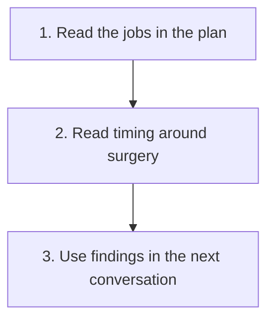

# Understand how treatment is sequenced

**Understand why a plan combines different treatment jobs, why treatment may begin before surgery and what the surgical findings contribute afterward.**

The path focuses on nonmetastatic [triple-negative breast cancer (TNBC)](/wiki/education/concepts/breast-cancer/receptors-and-subtypes/tnbc), including locally advanced disease. “Early” in a trial or treatment discussion can include a broader nonmetastatic population than everyday usage suggests. Read the actual population and stage criteria.

There is no single schedule that every person with this receptor category follows. Disease extent, clinical evidence, prior treatment and safety affect the plan. The lessons teach how to read those decisions. Actual drugs, doses, appointment dates and changes belong in the clinical plan.

## The big ideas

1. Systemic medicines and local treatments have different jobs. Combining them requires a reason and evidence for the clinical setting.
2. Neoadjuvant and adjuvant describe timing around surgery; they do not identify one drug class or guarantee an outcome.
3. A planned course and delivered treatment are different records. Holds and substitutions deserve their own explanations.
4. Surgery supplies tissue evidence about response, margins and nodes. That evidence informs distinct local and systemic conversations.

## The map

## Lessons

| Step | Lesson | The question it answers | Minutes | Learning aid |
|---|---|---|---|---|
| 1 | [Read the jobs in the treatment plan](/wiki/education/guides/treating-early-tnbc/01-read-the-jobs-in-the-plan) | What does each part attempt to do? | 11 | Fictional regimen card |
| 2 | [Read timing around surgery](/wiki/education/guides/treating-early-tnbc/02-read-timing-around-surgery) | Why treat before or after an operation? | 11 | Planned-versus-delivered calendar |
| 3 | [Use the findings in the next conversation](/wiki/education/guides/treating-early-tnbc/03-use-the-findings-in-the-next-conversation) | Which question does each postoperative finding inform? | 11 | Local, systemic and safety cards |

## Concepts you will use

**Classification and timing:** [TNBC](/wiki/education/concepts/breast-cancer/receptors-and-subtypes/tnbc), [TNM staging](/wiki/education/concepts/breast-cancer/grade-and-stage/tnm-staging) and [neoadjuvant versus adjuvant therapy](/wiki/education/concepts/breast-cancer/treatment-setting/neoadjuvant-vs-adjuvant).

**Mechanism and safety:** [Chemotherapy](/wiki/education/concepts/therapeutics/chemotherapy/chemotherapy), [checkpoint inhibitors](/wiki/education/concepts/therapeutics/immunotherapy/immune-checkpoint-inhibitor) and [immune-related adverse events](/wiki/education/concepts/therapeutics/toxicities-and-supportive-care/immune-related-adverse-event).

**Response:** [Pathologic complete response](/wiki/education/concepts/breast-cancer/surgery-and-pathology-results/pcr), [residual cancer burden](/wiki/education/concepts/breast-cancer/surgery-and-pathology-results/residual-cancer-burden) and [margins](/wiki/education/concepts/breast-cancer/surgery-and-pathology-results/surgical-margins).

**Purpose and sequence:** [Curative intent](/wiki/education/concepts/breast-cancer/treatment-setting/curative-intent) names the goal. [Breast surgery basics](/wiki/education/concepts/therapeutics/local-therapies/breast-surgery-basics) explains removal, sampling and reconstruction. [The KEYNOTE-522 regimen](/wiki/education/concepts/breast-cancer/treatment-setting/the-keynote-522-regimen) illustrates one studied sequence; [lines of therapy](/wiki/education/concepts/breast-cancer/treatment-setting/line-of-therapy) and [response-adapted treatment](/wiki/education/concepts/breast-cancer/treatment-setting/response-adapted-therapy) answer different questions about treatment history and changes.

## Understand the calendar

A trial's tested schedule is evidence about that regimen and population. It is not a record of what a particular person received. The actual record must retain route, dose, dates, holds, substitutions and supportive care. The second lesson shows this distinction without turning a general course into a personal schedule.

## Applied to Diana

[The treatment plan](/wiki/care/treatment-plan), [medication reference](/wiki/treatment/medications) and [checkpoint-rechallenge question](/wiki/questions/pembrolizumab-rechallenge) own current delivery and safety decisions. [Results](/wiki/care/results) owns the findings that inform those conversations.

## What is still uncertain

A mechanism cannot establish whether adding, omitting or combining treatments improves outcomes. Those changes require matched evidence and clinical assessment of benefit and harm. Research about an assay or a proposed pathway does not remove that requirement.

## Sources and scope

General teaching, source-checked October 9, 2026; expert and learner review pending. Practice cases are fictional.

- [NCI: Breast cancer treatment by stage](https://www.cancer.gov/types/breast/treatment/by-stage).
- [NCI: Triple-negative breast cancer treatment](https://www.cancer.gov/types/breast/treatment/triple-negative-breast-cancer).
- [KEYNOTE-522 primary trial](https://pubmed.ncbi.nlm.nih.gov/32101663/), for one studied strategy; its schedule is not an individual administration record.
