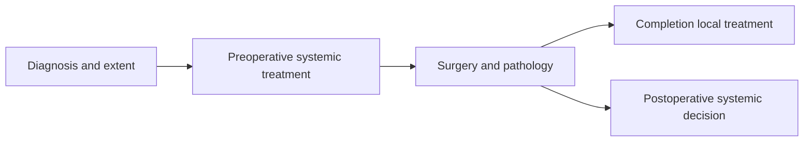

# Understand how standard treatment works

**Explain the distinct jobs of chemotherapy, immunotherapy, surgery and radiation in a curative-intent TNBC plan.**

This guide teaches the roles of treatment. Actual drug choices, dose changes and appointment dates belong in the clinical plan. Understanding the purpose of each part helps explain why a blood result or a molecular hypothesis cannot choose the whole regimen.

## The big ideas

1. Systemic medicines and local treatments address different parts of the problem.
2. Combining drug classes can attack different cell processes while adding distinct risks.
3. A trial schedule and a person’s delivered schedule must be kept separate.
4. Response, side effects and eligibility each affect the next decision.

## The map

*The map explains the questions; a clinician’s plan determines their actual order and timing.*

## What each part does

| Treatment | Plain-language mechanism | Important boundary |
|---|---|---|
| Paclitaxel, a taxane | Interferes with microtubule dynamics needed for cell division | Neuropathy and other toxicities can limit delivery |
| Carboplatin, a platinum | Forms DNA lesions that make replication and repair difficult | Blood counts and other toxicity matter |
| Doxorubicin, an anthracycline | Disrupts topoisomerase II-related DNA processes and creates cellular stress | Cumulative cardiac risk needs monitoring |
| Cyclophosphamide | Produces DNA-damaging metabolites | Dose and schedule determine supportive-care requirements |
| Pembrolizumab | Blocks PD-1 inhibitory signaling in immune responses | Can cause immune inflammation, including pneumonitis |
| Surgery | Removes selected local tissue for control and examination | Margins and nodes inform completion questions |
| Radiation | Deposits ionizing energy in planned tissue volumes | Normal-organ exposure and prior treatment constrain dose |

Mesna is not routine support for standard breast-cancer AC. It is used with particular high-dose cyclophosphamide or ifosfamide regimens. Loratadine research concerning growth-factor bone pain does not establish routine paclitaxel bone-pain prophylaxis. Supportive care should follow the actual prescribed regimen.

## Understand the calendar

KEYNOTE-522 used approximately 12 weeks of taxane/carboplatin followed by 12 weeks of anthracycline/cyclophosphamide with pembrolizumab, surgery, then nine adjuvant pembrolizumab cycles. Dose-dense AC adaptations can use a shorter interval. Holds, substitutions and toxicity can change an individual’s delivery. Do not infer completed doses from an expected calendar.

Pembrolizumab is given intravenously in the regimen. Capecitabine is an oral chemotherapy used in relevant postoperative discussions; olaparib is an oral PARP inhibitor with its own germline-BRCA eligibility gate. Routes, cycles and duration matter, but a general education page cannot set a personal schedule.

## Response and toxicity are different axes

A treatment can help and still cause a serious side effect. Pneumonitis is lung inflammation that can occur with checkpoint therapy, while infection, tumor and other causes may produce overlapping symptoms. The evaluation and any rechallenge decision require medical assessment. A promising assay or proposed combination does not eliminate that safety gate.

## Lessons and try it

Read [[wiki/education/guides/reading-pathology-and-surgery-results/index|pathology]] to understand the postoperative findings, then [[wiki/education/guides/reading-cancer-evidence/index|trial evidence]] to inspect added-treatment claims.

A negative blood assay arrives before surgery. Does it prove that surgery and radiation are unnecessary?

**Answer:** No. It does not establish pCR (pathologic complete response) or validate omission of indicated local treatment.

**Explain it back:** “Medicines treat systemically; surgery and radiation have local roles; pathology and clinical evidence guide what comes next.”

## Applied to Diana

[[wiki/care/treatment-plan|The treatment plan]], [[wiki/treatment/medications|medications]] and [[wiki/questions/pembrolizumab-rechallenge|the rechallenge question]] own current delivery and safety decisions.

**Takeaway:** Understand each treatment’s job, then read the actual plan for dose, route, cadence and duration.

## Sources and scope

Source check: October 8, 2026; expert and learner review pending.

- [NCI chemotherapy](https://www.cancer.gov/about-cancer/treatment/types/chemotherapy).
- [NCI radiation](https://www.cancer.gov/about-cancer/treatment/types/radiation-therapy).
- [KEYNOTE-522 primary trial](https://pubmed.ncbi.nlm.nih.gov/32101663/).

## Concepts you will use

- [[wiki/education/concepts/evidence-and-statistics/biomarkers/actionability|Clinical actionability]]
- [[wiki/education/concepts/breast-cancer/surgery-and-pathology-results/pcr|Pathologic complete response (pCR)]]
