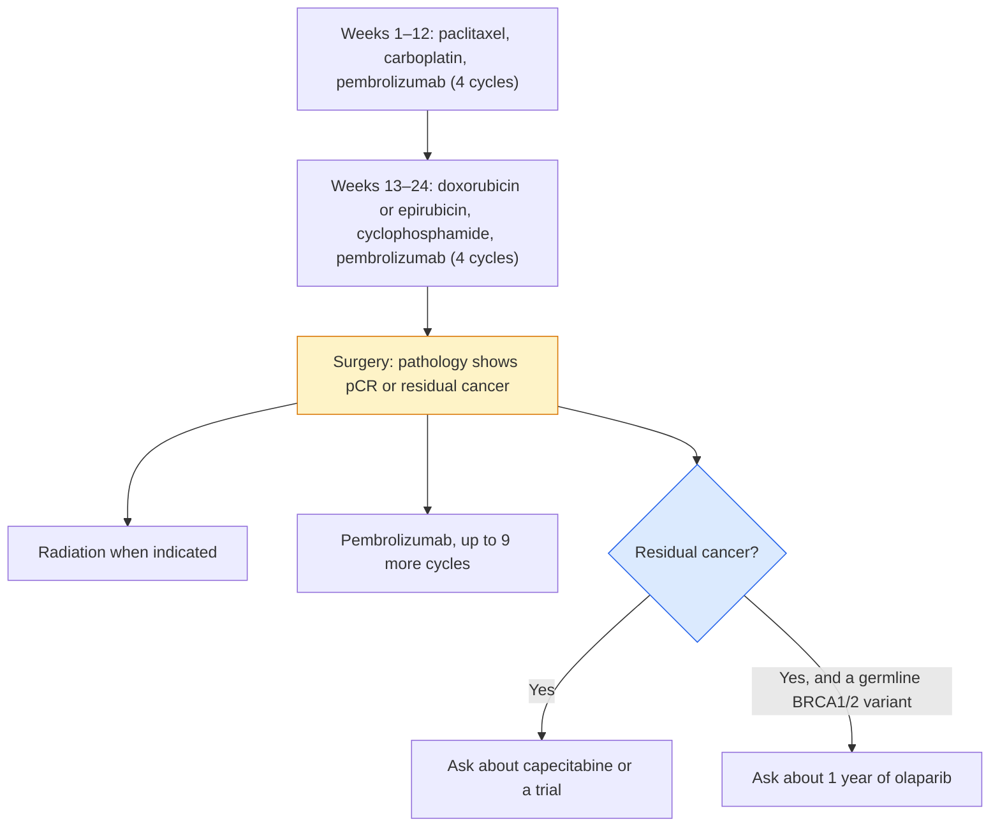

# Understand how treatment is sequenced

**For most stage II–III triple-negative breast cancer, treatment runs in one order: about six months of chemotherapy with the immunotherapy drug pembrolizumab, then surgery, then radiation when indicated, then about six more months of pembrolizumab, with extra medicine if cancer remains at surgery.**

This guide explains that sequence and why it runs in that order. It covers nonmetastatic [triple-negative breast cancer (TNBC)](/wiki/education/concepts/breast-cancer/receptors-and-subtypes/tnbc), including locally advanced disease. Individual plans change with disease extent, side effects and genetics, so the lessons also show how to read the plan you are given.

## The standard plan at a glance

*The KEYNOTE-522 schedule, with cycles every 3 weeks, and the main branches after surgery. Radiation and the extra medicines depend on findings; they are not given to everyone.*

This is the [KEYNOTE-522 regimen](/wiki/education/concepts/breast-cancer/treatment-setting/the-keynote-522-regimen). In the trial of 1,174 people, adding pembrolizumab raised [pathologic complete response (pCR)](/wiki/education/concepts/breast-cancer/surgery-and-pathology-results/pcr) from 51.2% to 64.8% and 5-year overall survival from 81.7% to 86.6%.

## The big ideas

1. **Systemic treatment comes first** because it treats the whole body early, lets surgery measure the response, and lets that response choose what follows.
2. **Surgery is also a test.** No invasive cancer in the breast and nodes (pCR) predicts a much better outlook; residual cancer opens extra options.
3. **What follows surgery depends on the findings.** Pembrolizumab continues either way. Residual cancer adds capecitabine as a tested option; residual cancer in someone with a germline *BRCA1* or *BRCA2* variant also adds olaparib, which OlympiA tested in that high-risk group.
4. **Breast, node and radiation choices have their own evidence.** Lumpectomy with radiation matches mastectomy for survival in eligible patients.
5. **A planned course and the delivered course are different records.** Holds and substitutions need their own explanations.

## Lessons

| Step | Lesson | The question it answers | Minutes | Learning aid |
|---|---|---|---|---|
| 1 | [Read the jobs in the treatment plan](/wiki/education/guides/treating-early-tnbc/01-read-the-jobs-in-the-plan) | What does each drug and procedure do? | 11 | KEYNOTE-522 regimen card |
| 2 | [Read timing around surgery](/wiki/education/guides/treating-early-tnbc/02-read-timing-around-surgery) | Why treat before surgery, and what decides the operation and radiation? | 12 | Planned-versus-delivered calendar |
| 3 | [Use the findings in the next conversation](/wiki/education/guides/treating-early-tnbc/03-use-the-findings-in-the-next-conversation) | What are the options after pCR, after residual disease and for *BRCA* carriers? | 12 | Options table and three cards |

## Concepts you will use

**Classification and timing:** [TNBC](/wiki/education/concepts/breast-cancer/receptors-and-subtypes/tnbc), [TNM staging](/wiki/education/concepts/breast-cancer/grade-and-stage/tnm-staging), [neoadjuvant versus adjuvant therapy](/wiki/education/concepts/breast-cancer/treatment-setting/neoadjuvant-vs-adjuvant) and [curative intent](/wiki/education/concepts/breast-cancer/treatment-setting/curative-intent).

**Medicines and safety:** [Chemotherapy](/wiki/education/concepts/therapeutics/chemotherapy/chemotherapy), [checkpoint inhibitors](/wiki/education/concepts/therapeutics/immunotherapy/immune-checkpoint-inhibitor) and [immune-related adverse events](/wiki/education/concepts/therapeutics/toxicities-and-supportive-care/immune-related-adverse-event).

**Surgery and radiation:** [Lumpectomy versus mastectomy](/wiki/education/concepts/breast-cancer/surgery-and-pathology-results/lumpectomy-vs-mastectomy), [sentinel-node biopsy and axillary dissection](/wiki/education/concepts/breast-cancer/surgery-and-pathology-results/sentinel-node-and-axillary-dissection) and [radiation basics](/wiki/education/concepts/therapeutics/local-therapies/radiation-therapy-basics).

**After surgery:** [pCR](/wiki/education/concepts/breast-cancer/surgery-and-pathology-results/pcr), [residual cancer burden](/wiki/education/concepts/breast-cancer/surgery-and-pathology-results/residual-cancer-burden), [post-neoadjuvant escalation](/wiki/education/concepts/breast-cancer/treatment-setting/post-neoadjuvant-escalation), [germline testing](/wiki/education/concepts/breast-cancer/hereditary-risk/germline-testing) and [response-adapted therapy](/wiki/education/concepts/breast-cancer/treatment-setting/response-adapted-therapy).

## Applied to Diana

[The treatment plan](/wiki/care/treatment-plan), [medication reference](/wiki/treatment/medications) and [checkpoint-rechallenge question](/wiki/questions/pembrolizumab-rechallenge) own current delivery and safety decisions. [Results](/wiki/care/results) owns the findings that inform those conversations.

## What is still uncertain

- Whether adding capecitabine or olaparib to postoperative pembrolizumab helps; neither combination has a reported randomized trial.
- Whether antibody-drug conjugates beat standard options after residual disease; three phase 3 trials are under way.
- How much the postoperative pembrolizumab phase adds by itself, since KEYNOTE-522 randomized the whole strategy.

**Start with:** [Read the jobs in the treatment plan](/wiki/education/guides/treating-early-tnbc/01-read-the-jobs-in-the-plan). Then read [pathology and surgery results](/wiki/education/guides/reading-pathology-and-surgery-results/index).

## Sources and scope

Source-checked November 7, 2026 against primary abstracts; expert and learner review pending. Practice cases are fictional.

- [Schmid and colleagues, NEJM 2020](https://pubmed.ncbi.nlm.nih.gov/32101663/) and [2024](https://pubmed.ncbi.nlm.nih.gov/39282906/) — KEYNOTE-522 schedule, pCR and overall survival.
- [Fisher and colleagues, NEJM 2002](https://pubmed.ncbi.nlm.nih.gov/12393820/) and [Veronesi and colleagues, NEJM 2002](https://pubmed.ncbi.nlm.nih.gov/12393819/) — breast-conserving surgery versus mastectomy.
- [NCI: Triple-negative breast cancer treatment](https://www.cancer.gov/types/breast/treatment/triple-negative-breast-cancer).
