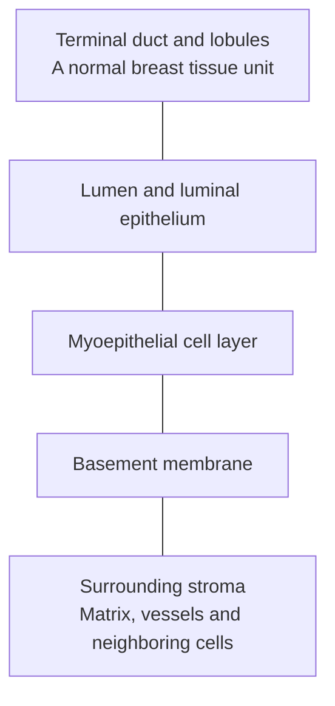

# See what is inside a tissue sample

**A tumor specimen is a neighborhood, not a jar of pure cancer cells. Before reading any signal, ask who is in the sample, what kind of cell each one is, what it is doing and how the cancer is clinically classified.**

**Before you start:** [Genes, messages and products](/wiki/education/concepts/biology-basics/genetics/central-dogma) separates the measured layers. [Tumor heterogeneity](/wiki/education/concepts/cancer-biology/what-cancer-is/tumor-heterogeneity) explains why one region may not represent every cancer cell. [Epithelium and stroma](/wiki/education/concepts/biology-basics/cells/epithelium-and-stroma) names the two main tissue compartments. [Intrinsic subtype](/wiki/education/concepts/breast-cancer/receptors-and-subtypes/intrinsic-subtype) explains expression labels such as basal-like.

## Where this step sits

This is step 2 of [What does multi-omics tell us about a tumor?](/wiki/education/guides/what-multi-omics-tells-us/index) Lesson 1 named the molecules. This lesson names the cells that supply them. Every later layer inherits the answer.

## Picture the breast duct from the inside out

In [breast anatomy](/wiki/education/concepts/breast-cancer/anatomy-and-histology/breast-anatomy), small milk-producing lobules and their terminal duct form a **terminal duct lobular unit (TDLU)**. Luminal cells line the inner space, the lumen. [Myoepithelial cells and the basement membrane](/wiki/education/concepts/breast-cancer/anatomy-and-histology/myoepithelial-cells-and-basement-membrane) surround them. Outside lies stroma: fibroblasts, vessels, immune cells and [extracellular matrix](/wiki/education/concepts/cancer-biology/tumor-microenvironment/extracellular-matrix).

*A simplified normal breast unit. It is not a diagnostic image or a path of invasion.*

Carcinoma is a cancer of epithelial origin, so cancer cells and normal lining cells share a cell family. A pathologist decides whether malignant cells have invaded; an epithelial label alone cannot.

## The sample is a neighborhood

| Component | What it can contribute to a molecular report |
|---|---|
| Malignant epithelial cells | Cancer-cell messages, proteins and acquired DNA changes |
| Normal epithelial cells | Many of the same lineage markers and normal tissue functions |
| Fibroblasts and other supporting cells | Matrix, signaling and connective-tissue programs |
| Vessel cells | Vascular markers and proteins |
| Immune cells | Antibody, inflammation and immune-response messages |

A bulk assay combines contributions from the piece it receives. RNA contribution need not be proportional to cell number: a small population with abundant messages can dominate a gene's signal.

## A worked example: choose the normal neighbor

A fictional gene is high in cancer cells and low in fibroblasts. “Higher than fibroblasts” is accurate if the measurements are sound.

Now measure normal luminal epithelial cells. The gene is similarly high there. “Cancer-selective” no longer follows: the original contrast mainly captured an epithelial-versus-supporting-cell difference. If the normal epithelial group is tiny or contaminated, say the normal comparison is unresolved. The next step is a better-matched comparator with compatible preparation and clear cell labels.

## Name the identity, then the state

A job title does not tell you what someone is doing this minute. Cells work the same way.

- [Lineage and differentiation](/wiki/education/concepts/biology-basics/cells/cell-lineage-and-differentiation) describe a cell's family and specialization.
- A **cell state** is a pattern of current activity, such as division, stress response or secretion.
- A **marker** helps identify cells without necessarily being unique to one family.
- A computational **cluster** groups similar measured profiles. It depends on assay resolution, chosen features and settings, so it does not prove a separate lineage or genetic clone.

| Label | Question it answers | What it does not establish |
|---|---|---|
| Epithelial | Which broad cell family? | Malignancy |
| Malignant | Is there evidence this cell is cancerous? | A specific treatment response |
| Proliferating | Is a cell-division program prominent? | Permanent identity |
| Luminal-progenitor-like | Which reference program does the RNA resemble? | The exact cell the tumor began in |
| RNA cluster | Which profiles were grouped together? | Shared acquired DNA ancestry |

One marker can have two explanations. High vimentin RNA in a mixed specimen could come from fibroblasts or from cancer cells in a more mesenchymal state ([epithelial–mesenchymal transition](/wiki/education/concepts/biology-basics/cells/epithelial-mesenchymal-transition)). Cell-specific measurement distinguishes them; neither establishes invasion or drug resistance.

## How are malignant cells identified in single-cell data?

There is no universal “cancer RNA” marker. Start with tissue context, a panel of cell-family markers and suitable normal reference cells. Check profile quality: two cells captured together or RNA from broken neighbors can confuse a label.

Then look for tumor-associated evidence. One research approach averages expression across neighboring genes on each chromosome to **infer large-scale copy-number changes** from RNA. Patel and colleagues used this in primary glioblastoma to separate probable normal from malignant cells ([Patel et al., 2014](https://pubmed.ncbi.nlm.nih.gov/24925914/)). It is an inference from RNA, not a DNA count. A flat profile does not prove a cell is benign, and an apparent change needs corroboration from matched DNA, pathology or spatial evidence. Keep uncertain cells uncertain.

## Clinical classification has its own evidence

[Triple-negative breast cancer (TNBC)](/wiki/education/concepts/breast-cancer/receptors-and-subtypes/tnbc) is a clinical category defined by validated receptor tests. **Basal-like** is a [PAM50 intrinsic expression subtype](/wiki/education/concepts/breast-cancer/receptors-and-subtypes/intrinsic-subtype). The two overlap heavily but are not the same. In the expression datasets Prat and colleagues analyzed, 21.4% of 412 triple-negative tumors were not basal-like, and 31.5% of 473 basal-like tumors were not triple-negative ([Prat et al., 2013](https://pubmed.ncbi.nlm.nih.gov/23404817/)).

Names that sound contradictory usually answer different questions. **Basal** can name a normal outer epithelial cell, while **basal-like** names a cancer expression pattern. **Luminal** can describe a normal lining cell without making a tumor hormone-receptor-positive. In one study, basal tumors and breast tissue from BRCA1 carriers both resembled normal luminal progenitor cells more than any other subset, including the stem-cell-enriched population ([Lim et al., 2009](https://pubmed.ncbi.nlm.nih.gov/19648928/)). A resemblance like that does not rewrite the signed receptor diagnosis or name the cell of origin.

## What can go wrong at this step

- Treating “tumor sample” as meaning every measured cell is malignant.
- Using fibroblasts as the only normal comparison for an epithelial target.
- Turning “resembles” into “originated from,” or one marker into a definitive identity.
- Counting each RNA cluster as a genetically distinct clone.
- Turning an expression subtype into a treatment indication.

A **tumor mask** is an image-based assignment of cells to the malignant compartment. It is an analysis aid that can include normal epithelium, not a validated label.

## Try it

1. A tissue profile contains a strong antibody-production signal. Does that establish that the cancer cells produce antibodies?
2. A report calls the malignant cells luminal-progenitor-like, while clinical receptor testing is triple-negative. Must one result be wrong?

**Answers:** (1) No. [Plasma cells](/wiki/education/concepts/immunology/antibodies-and-b-cells/b-cells-and-plasma-cells) and other immune cells can supply that RNA; ask which cells produced it. (2) No. One is an RNA resemblance and the other a clinical receptor category. Check both methods; the labels can coexist.

## Explain it back

“The sample contains ______. Identity tells me ______; state tells me ______; clinical classification tells me ______.”

One answer: “cancer cells and normal neighbors; the cell family; its current measured program; the category defined by validated clinical tests.”

## Takeaway

**Name the cells, then their identity, state and clinical category, before interpreting what any of them expressed.**

**Next:** [Read DNA: coverage, calls, copies and cell fractions](/wiki/education/guides/what-multi-omics-tells-us/03-read-dna).

## Sources and scope

Source check: November 8, 2026. The normal-neighbor and marker examples are fictional and teach interpretation rather than a treatment choice. Expert and learner review remain pending.

- [Kumar et al., 2023: adult human breast cell atlas](https://www.nature.com/articles/s41586-023-06252-9): normal breast cell families and states.
- [Prat et al., 2013](https://pubmed.ncbi.nlm.nih.gov/23404817/): gene-expression datasets; discordance between triple-negative and basal-like definitions.
- [Patel et al., 2014](https://pubmed.ncbi.nlm.nih.gov/24925914/): single-cell profiles and inferred chromosome patterns in primary glioblastoma; a research method, not a breast-cancer diagnostic rule.
- [Lim et al., 2009](https://pubmed.ncbi.nlm.nih.gov/19648928/): sorted epithelial subsets from BRCA1-carrier and normal breast tissue; basal tumors resembled luminal progenitors.
- [NCI SEER: epithelial tissue](https://training.seer.cancer.gov/anatomy/cells_tissues_membranes/tissues/epithelial.html) and [NCI: stroma](https://www.cancer.gov/publications/dictionaries/cancer-terms/def/stroma).
