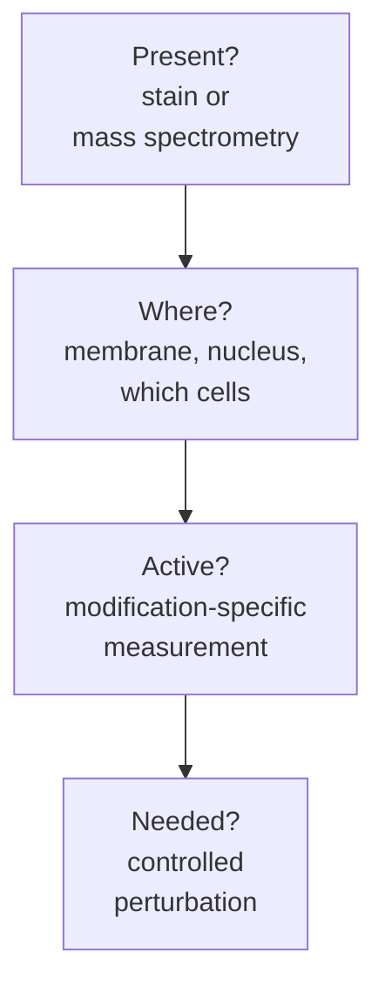

# Read protein: presence, place and activation

**Protein presence, cellular location, activation and dependence are separate questions. Choose the assay that fits the proposed mechanism.**

**Before you start:** [DNA, RNA and protein](/wiki/education/concepts/biology-basics/genetics/central-dogma) supplies the layers. [Immunohistochemistry (IHC)](/wiki/education/concepts/measurement/pathology-readouts/immunohistochemistry) explains localized staining. [Human epidermal growth factor receptor 2 (HER2)](/wiki/education/concepts/breast-cancer/receptors-and-subtypes/her2) is this lesson's worked receptor. [Bulk RNA](/wiki/education/concepts/measurement/transcriptomics/bulk-rna-seq) explains why a message cannot replace a protein measurement.

## Where this step sits

This is step 6 of [What does multi-omics tell us about a tumor?](/wiki/education/guides/what-multi-omics-tells-us/index) A workshop may contain a tool without using it, and the tool may be stored where a visitor cannot reach it. A protein can similarly be present but inactive or inaccessible. The comparison is useful until we need a molecular mechanism: proteins have specific structures, modifications and interactions.

## Four different questions

*Each box needs its own assay. A strong answer to one leaves the next open.*

| Question | A useful approach | What it leaves open |
|---|---|---|
| Is protein present? | Validated staining or [mass spectrometry proteomics](/wiki/education/concepts/measurement/proteins-and-spatial/mass-spectrometry-proteomics) | Cell origin and useful location in a mixed sample |
| Where is it? | Tissue staining with morphology and localization | Accessibility to the proposed medicine |
| Is a component activated? | Suitable modification-specific measurement | Whole-pathway dependence |
| Does the model need it? | Controlled perturbation | Benefit and toxicity in patients |

[Phosphorylation](/wiki/education/concepts/biology-basics/signaling/phosphorylation) can change a protein's behavior; the consequence depends on the site and context. [Phosphoproteomics](/wiki/education/concepts/measurement/proteins-and-spatial/phosphoproteomics) measures phosphorylated molecules and supported sites. Its interpretation needs the source protein's amount, the exact site and specimen-handling context. A phospho-signal is not a universal on/off switch for an entire pathway.

[Reverse-phase protein array (RPPA)](/wiki/education/concepts/measurement/proteins-and-spatial/rppa) measures selected targets in sample lysates. It does not preserve original cell coordinates. Common bottom-up mass spectrometry workflows digest [proteins into peptides](/wiki/education/concepts/biology-basics/molecules/protein-and-peptide). Their peptide evidence does not automatically establish an intact protein form. A [targeted proteomics assay](/wiki/education/concepts/measurement/proteins-and-spatial/targeted-proteomics-and-loq) also measures selected analytes rather than every protein.

## Read a unit without changing its denominator

An abundance per mass of assayed protein is not molecules per malignant cell or surface receptors per cell. Read the method's [limit of quantification (LOQ)](/wiki/education/concepts/measurement/proteins-and-spatial/targeted-proteomics-and-loq) before interpreting a numerical change. **Not detected** must be read with the analyte list and threshold; the marker may be absent, below detection or not assayed.

For staining, retain which cells were scored, intensity, proportion and location. A membrane stain can answer a different question from nuclear or cytoplasmic staining. Clinical receptor categories use marker-specific rules; research RNA cannot quietly replace them.

## Clinical scores answer marker-specific questions

[Triple-negative breast cancer (TNBC)](/wiki/education/concepts/breast-cancer/receptors-and-subtypes/tnbc) combines negative classifications for [estrogen receptor (ER)](/wiki/education/concepts/breast-cancer/receptors-and-subtypes/estrogen-receptor), [progesterone receptor (PR)](/wiki/education/concepts/breast-cancer/receptors-and-subtypes/progesterone-receptor) and [human epidermal growth factor receptor 2 (HER2)](/wiki/education/concepts/breast-cancer/receptors-and-subtypes/her2). These are marker-specific pathology interpretations, rather than three absent RNA signals.

Keep the nuclear staining context for ER and PR, and the integrated immunohistochemistry/in situ hybridization (IHC/ISH) workup for HER2. The linked receptor explanations hold their specific criteria and low-expression categories. A generic [H-score or Allred score](/wiki/education/concepts/measurement/pathology-readouts/immunohistochemistry) cannot replace those marker-specific rules; RNA cannot replace a validated receptor test.

[PD-L1 (programmed death-ligand 1) scoring](/wiki/education/concepts/measurement/pathology-readouts/pd-l1-scoring) illustrates another denominator: the combined positive score and tumor proportion score count different eligible cells. Neither is a universal measure of immune effectiveness. For current repair behavior, [RAD51 foci](/wiki/education/concepts/cancer-biology/genome-instability-and-repair/homologous-recombination-and-hrd#how-it-is-measured) need their own damage and cell-state controls. A protein total, a receptor category and a controlled repair readout answer different questions.

## A worked finding: HER2-low as a delivery address

HER2-positive cancers depend on HER2 signaling, and HER2-blocking antibodies treat them. A much larger group of breast cancers carries only a little HER2 on the membrane: IHC 1+, or 2+ without gene amplification on ISH. These **HER2-low** tumors are classed as HER2-negative, and many are also triple-negative.

The antibody–drug conjugate trastuzumab deruxtecan uses HER2 differently: as an address for delivering a chemotherapy payload, not as a growth driver to switch off. In the DESTINY-Breast04 trial (557 people with previously treated HER2-low metastatic breast cancer), median progression-free survival was 9.9 months with trastuzumab deruxtecan and 5.1 months with chemotherapy of the physician's choice, and median overall survival 23.4 versus 16.8 months ([Modi et al., 2022](https://pubmed.ncbi.nlm.nih.gov/35665782/)). Only 63 participants had hormone-receptor-negative disease, so evidence specific to TNBC there is limited.

The result changed what a stain had to distinguish. HER2 IHC was built to separate overexpression (3+) from the rest, not 0 from 1+. When 18 pathologists scored the same set of 170 breast cancer biopsies, concordance between 0 and 1+ was only 26%, against 58% between 2+ and 3+ ([Fernandez et al., 2022](https://pubmed.ncbi.nlm.nih.gov/35113160/)). A protein measurement is only as useful as its validation for the decision it now supports.

Two more lessons follow. Abundance is not dependence: a delivery target need not drive growth, and a signaling inhibitor needs pathway behavior, not surface density. And a gene-level signal does not identify every protein **isoform**, or molecular version; normal-tissue expression and access remain part of the [drug mechanism](/wiki/education/concepts/therapeutics/how-drugs-work/drug-target-and-mechanism).

For a repair protein, the bridge is similar. Reduced staining in malignant cells supports a cell-specific difference, but an antibody may recognize a fragment or one of several forms, and staining does not measure repair. The [integrated ledger](/wiki/education/guides/what-multi-omics-tells-us/10-integrate-the-evidence) carries that example forward.

[Immunopeptidomics](/wiki/education/concepts/measurement/proteins-and-spatial/immunopeptidomics) asks a different protein-related question: which peptides were recovered from human leukocyte antigen complexes? Presentation is closer to an immune-target question than total gene expression, but does not establish recognition by itself.

## What can go wrong at this step

- Treating a bulk protein quantity as a surface density.
- Treating one modification as a whole-pathway dependency.
- Treating unassayed or below-limit as biological absence.
- Assigning a vessel-cell signal to cancer cells without localization.

## Try it

A bulk proteomics panel detects HER2 peptides in a tumor sample, but no assay identifies which cells or whether the protein is on the membrane. Has it shown that an antibody can bind the cancer cells?

**Answer:** No. Protein presence in the mixture is established under that assay. Cell-specific location and access need further evidence.

## Explain it back

“The protein assay measured ______. For this mechanism, the unanswered question is ______.”

One answer: “total abundance; whether the relevant product lies at an accessible cancer-cell surface.”

## Takeaway

**The useful protein assay measures the part of the mechanism that RNA left open.**

**Next:** [Add geography and immune context](/wiki/education/guides/what-multi-omics-tells-us/07-map-cells-and-immune-context).

## Sources and scope

Source check: November 8, 2026. The HER2-low numbers come from the cited trial and concordance study; the exercises are fictional and teach interpretation rather than a treatment choice. Expert and learner review remain pending.

- [ASCO/CAP ER/PR guideline, 2020](https://www.cap.org/cap-guidelines/estrogen-and-progesterone-receptor-testing-in-breast-cancer-guideline-update/) — nuclear staining thresholds and ER low-positive reporting.
- [ASCO/CAP HER2 guideline, 2023](https://www.cap.org/cap-guidelines/her2-testing-in-breast-cancer-2023-guideline-update/) — integrated IHC/ISH workup; preserves the marker-specific testing algorithm.
- [Modi et al., 2022 (DESTINY-Breast04)](https://pubmed.ncbi.nlm.nih.gov/35665782/): phase 3; 557 patients with previously treated HER2-low metastatic breast cancer.
- [Fernandez et al., 2022](https://pubmed.ncbi.nlm.nih.gov/35113160/): College of American Pathologists surveys and an 18-pathologist concordance study of HER2 IHC 0 versus 1+.
- [Carr et al., targeted peptide assays and fit-for-purpose validation (2014)](https://pmc.ncbi.nlm.nih.gov/articles/PMC3945918/).
- [Beausoleil et al., phosphorylation-site localization (2006)](https://doi.org/10.1038/nbt1240).
- [Mertins et al., specimen ischemia and phosphoprotein interpretation (2014)](https://pubmed.ncbi.nlm.nih.gov/24719451/).
