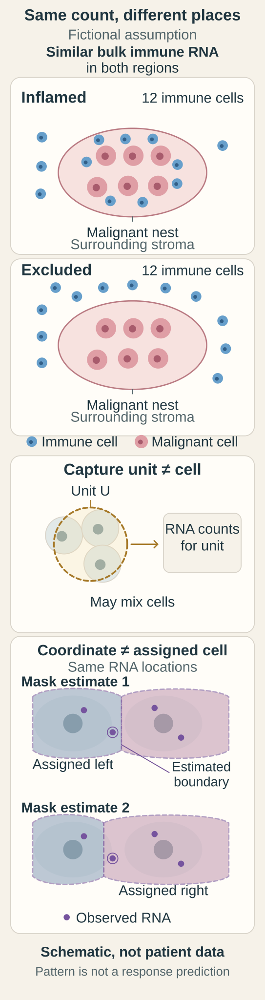

# Add geography and immune context

**Spatial methods keep location attached to a measurement, so you can see which cells sit next to which. Immune cells being nearby is useful information; recognizing and killing cancer cells needs further evidence.**

**Before you start:** [Stromal tumor-infiltrating lymphocyte (sTIL) scoring](/wiki/education/concepts/measurement/pathology-readouts/stil-scoring) defines the tissue denominator. [Hot, excluded and cold tumor patterns](/wiki/education/concepts/immunology/tumor-immunology/hot-excluded-cold-tumor) owns the pattern definitions. [Spatial transcriptomics](/wiki/education/concepts/measurement/proteins-and-spatial/spatial-transcriptomics) explains RNA measured in place. [Binding, presentation and recognition](/wiki/education/concepts/immunology/antigen-presentation/binding-presentation-and-recognition) separates the immune evidence rungs.

## Where this step sits

This is step 7 of [What does multi-omics tell us about a tumor?](/wiki/education/guides/what-multi-omics-tells-us/index) A head count and a seating chart describe the same room differently. Earlier lessons counted messages and proteins; this one asks where they were.

## Immune abundance is a real signal

Lymphocytes in the stroma around a breast cancer are scored on a routine hematoxylin and eosin (H&E) slide as a percentage of stromal area. In a pooled analysis of 2,148 people with early triple-negative breast cancer (TNBC) treated with anthracycline-based chemotherapy, each 10% increase in sTILs went with a lower risk of invasive disease or death (hazard ratio 0.87) and of death (hazard ratio 0.84) ([Loi et al., 2019](https://pubmed.ncbi.nlm.nih.gov/30650045/)).

That makes sTILs **prognostic**: they forecast outcome. It does not make them a test of whether a particular immunotherapy will work, and the score is not the fraction of all cells that are CD8 T cells.

## A map answers a new question

An **inflamed** (hot) pattern has immune cells among malignant cells. An **excluded** pattern has them at a boundary or in surrounding stroma. An **immune-desert** pattern has few in the examined region. “Cold” usually means desert, though some authors include excluded tumors too, so check [the canonical definitions](/wiki/education/concepts/immunology/tumor-immunology/hot-excluded-cold-tumor#how-it-works) and say which you mean. An inflamed and an excluded region can contain the same number of immune cells in different places.

Each method below keeps location, but they differ in what they measure and at what resolution; [spatial methods compared](/wiki/education/concepts/measurement/proteins-and-spatial/spatial-methods-compared) sets protein and RNA methods side by side.

| Method | What it measures | Main interpretation issue |
|---|---|---|
| H&E microscopy | Morphology and stromal inflammatory-cell area | Does not identify immune subtypes |
| [Immunohistochemistry (IHC)](/wiki/education/concepts/measurement/pathology-readouts/immunohistochemistry) | Selected proteins with location | Antibody, scoring and cell assignment |
| [Multiplex immunofluorescence](/wiki/education/concepts/measurement/proteins-and-spatial/multiplex-immunofluorescence) | Several protein markers with coordinates | Marker quality and segmentation |
| Spatial transcriptomics | RNA captured or imaged at locations | Target coverage, capture unit and resolution |
| Model inferred from an image | A predicted feature | Validation in the intended population |

[Cell segmentation](/wiki/education/concepts/measurement/proteins-and-spatial/cell-segmentation) assigns image regions to cells. If a boundary is wrong, a message or stain lands in the wrong neighbor. Some sequencing-based capture spots span several cells, so assigning molecules to individual cells is another analysis step. Two methods may use the same section, adjacent sections or different blocks; adjacent sections are similar, not identical.

## A worked apparent contradiction

A fictional specimen has strong immune RNA. Spatial staining places most T cells outside the malignant nests. These findings agree. The bulk profile says immune cells contributed messages; the map says where they sat.

<em>Similar bulk immune RNA can come from cells inside or outside the cancer nests. Capture units and estimated cell boundaries are different from observed RNA locations. These fictional regions are not a patient map, an sTIL score or a response prediction.</em>

The next question might concern access, presentation or clinical association. It should not become an automatic instruction to add a treatment. Location can also change attribution: a protein seen mainly in vessels is a weak candidate for a tumor-cell delivery target, though the bulk measurement was correct.

## Presence is not recognition

| Question | Useful observation | What remains open |
|---|---|---|
| Are immune cells present? | Tissue review or cell-specific markers | Which cells, and what they recognize |
| Where are they? | Spatial staining or localized RNA | Whether they reach malignant cells |
| Is a tumor peptide displayed? | [Immunopeptidomics](/wiki/education/concepts/measurement/proteins-and-spatial/immunopeptidomics) or another presentation assay | Whether a T-cell receptor recognizes it |
| Do T cells respond to it? | A controlled immune-response assay | Whether they kill actual tumor cells |
| Does treatment help? | A clinical study in the intended setting | Whether it applies to this decision |

A conventional [T-cell receptor](/wiki/education/concepts/immunology/t-cells/t-cell-receptor) reads a peptide displayed on [human leukocyte antigen (HLA)](/wiki/education/concepts/immunology/antigen-presentation/hla). Display needs a source protein, processing, [beta-2-microglobulin (B2M)](/wiki/education/concepts/immunology/antigen-presentation/b2m) and an intact HLA molecule. Losing one copy of a display gene does not switch off all presentation. A cytotoxic-looking RNA program does not identify a receptor's target or prove killing. [Measure each part of a T-cell response](/wiki/education/guides/how-the-immune-system-fights-cancer/08-measure-a-response) chooses the assay for each rung.

## What can go wrong at this step

- Converting an sTIL score into a CD8-cell percentage, or a prognostic score into a treatment test.
- Calling a high stromal score “immune cells inside every cancer nest.”
- Calling image-inferred RNA a measured transcript count.
- Treating adjacent sections as the same cells, or ignoring an uncertain tumor mask.
- Replacing presentation or recognition evidence with immune-cell abundance.

## Try it

1. A machine-learning model predicts a high gene value from an H&E image. Can the report call it a direct RNA measurement?
2. A fictional specimen has high immune RNA, a stain placing most T cells outside malignant nests and many T cells in a separate blood sample. No peptide-display or receptor result is supplied. Which claims can you carry forward?

**Answers:** (1) No. It is a model prediction; state its training, validation and uncertainty. (2) An immune signal, and the measured cells' location in that section. The blood count does not show tissue entry or matching receptors, and nothing here shows a displayed tumor peptide, recognition or killing. These are missing measurements, not contradictions.

## Explain it back

“Abundance tells me ______; the map tells me ______; recognition would need ______.”

One answer: “how many immune cells or messages were measured; where they were measured or assigned; displayed peptide, a matching receptor and a response against tumor cells.”

## Takeaway

**A tissue map adds location while keeping observation, assignment and prediction apart, and immune presence never stands in for recognition.**

**Next:** [Choose the comparison before interpreting the signal](/wiki/education/guides/what-multi-omics-tells-us/08-choose-the-comparison).

## Sources and scope

Source check: November 8, 2026. The worked examples are fictional and teach interpretation rather than a treatment choice. Expert and learner review remain pending.

- [Loi et al., 2019](https://pubmed.ncbi.nlm.nih.gov/30650045/): pooled individual-patient analysis of 2,148 patients with early TNBC treated with anthracycline-based chemotherapy.
- [Salgado et al., 2015: sTIL-scoring recommendations](https://pubmed.ncbi.nlm.nih.gov/25214542/).
- [Kumar et al., 2023: spatial human breast atlas](https://www.nature.com/articles/s41586-023-06252-9).
- [McGranahan et al., 2017: allele-specific HLA loss in lung cancer](https://pmc.ncbi.nlm.nih.gov/articles/PMC5720478/).
- [Zhao et al., 2023: single-cell morphological and topological breast-cancer atlas](https://www.nature.com/articles/s41467-023-42504-y).
