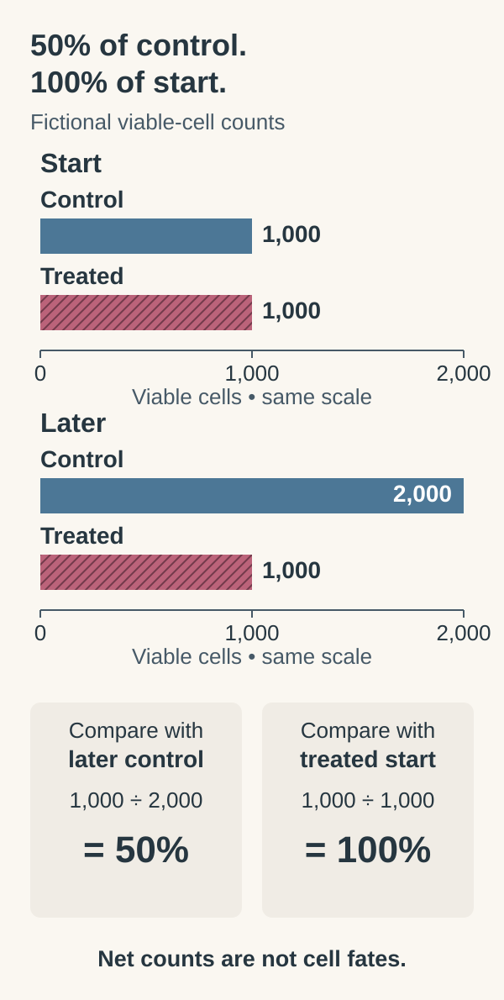

# Test a mechanism in a living model

**A functional experiment changes one thing and observes the response. Its meaning depends on what the model preserves, what it leaves out and which denominator the result uses.**

**Before you start:** [Perturbation and controls](/wiki/education/concepts/evidence-and-statistics/study-design/perturbation-and-controls) explains a controlled change. [Organoids](/wiki/education/concepts/measurement/functional-models/organoid) are three-dimensional cultures that reproduce selected tissue features. [Heterogeneity](/wiki/education/concepts/cancer-biology/what-cancer-is/tumor-heterogeneity) explains what culture can select. [Actionability](/wiki/education/concepts/evidence-and-statistics/biomarkers/actionability) keeps a model result separate from clinical benefit.

## Where this step sits

This is step 9 of [What does multi-omics tell us about a tumor?](/wiki/education/guides/what-multi-omics-tells-us/index) A parts list suggests how a machine works; changing one part tests that suggestion. DNA, RNA, protein and location described the tumor. A living model lets researchers perturb it, as long as the model contains the components the question requires.

## Match the model to the question

| Model | What researchers do | Useful feature | Main limitation |
|---|---|---|---|
| Dissociated cells or [cell lines](/wiki/education/concepts/measurement/functional-models/cell-lines) | Separate or maintain a selected population, then perturb it | Controlled cell measurements | Tissue interactions lost; populations selected |
| Organoids or spheroids | Grow cells in three dimensions | Some organization and cell diversity | Culture selects cells; immune components vary |
| [Ex vivo tumor fragments](/wiki/education/concepts/measurement/functional-models/ex-vivo-tumor-fragments) | Test pieces of the sampled tissue | Some original neighbors and structure | Viability, attribution and drug penetration vary |
| [Patient-derived xenograft (PDX)](/wiki/education/concepts/measurement/functional-models/patient-derived-xenograft) | Grow human tumor in an animal | Whole-animal exposure | Host biology differs; usually no intact human immune system |

A tumor-only culture cannot reproduce an immune medicine's full mechanism. Specialized [co-cultures](/wiki/education/concepts/measurement/functional-models/co-culture) can add selected immune cells; patient-derived organoids that kept their native immune cells have been used to model checkpoint blockade in research ([Neal et al., 2018](https://doi.org/10.1016/j.cell.2018.11.021)). A PDX experiment is **in vivo**, inside a living animal. A culture removed from a tumor is tested **ex vivo**, outside its original organism.

## Design the comparison before reading the score

Here is a fictional plan to test drug A's proposed direct effect on tumor cells in a tumor-only organoid. Every condition and number is invented. For a fuller walk-through of model choice, see [the prediction guide](/wiki/education/guides/predicting-response-before-treating/01-choose-a-model).

| Worksheet field | Completed plan |
|---|---|
| Biological unit | One donor and one characterized preparation, with malignant identity verified |
| Replicate unit | Three wells per condition; keep each well's value and layout |
| Exposure | Drug A at 0.1, 0.3 and 1 micromoles per liter for 48 hours; matched carrier and handling |
| Primary measurement | Viable tumor-cell count at the start and at 48 hours |
| Controls | Vehicle without A; a positive control with a prespecified response; a target perturbation or rescue |
| Missing components | No immune cells, full human metabolism or healthy-organ toxicity |

Vehicle controls separate the carrier from A. Positive controls show the system can respond. Mechanism controls separate target effects from nonspecific injury. Three wells estimate variation within one preparation: they are still **one donor**, not three people. A dish exposure may be unachievable safely in a person. [BH3 profiling](/wiki/education/concepts/measurement/functional-models/bh3-profiling) asks a narrower question, mitochondrial readiness for cell death, not whole-drug benefit.

## Compare with the starting cells as well as the control

Imagine each condition starts with 1,000 viable cells per well. Later, the vehicle well has 2,000 and the treated well 1,000. The treated count is half the control, yet unchanged from the start.

Half the later control can equal the full starting count. These fictional counts show no net increase under treatment, not 50% cell killing; division and death need separate measurements.

[Reduction is not regression](/wiki/education/concepts/evidence-and-statistics/reasoning-tools/reduction-is-not-regression): the endpoint does not show that half the cells died. Slower division is one explanation; division balanced by death is another. Growth-rate methods correct for control growth under stated assumptions ([Hafner et al., 2016](https://pmc.ncbi.nlm.nih.gov/articles/PMC4887336/)). [Apoptosis](/wiki/education/concepts/cancer-biology/cell-death-and-survival/apoptosis-and-bcl2-family), [necrosis](/wiki/education/concepts/cancer-biology/cell-death-and-survival/necrosis) and [senescence](/wiki/education/concepts/cancer-biology/cell-death-and-survival/senescence) also need their own evidence; a lower signal cannot assign a death mechanism.

## A worked experiment with three readouts

Suppose earlier layers suggested drug A acts on a repair defect. [Genetic dependency mapping](/wiki/education/concepts/measurement/functional-models/dependency-mapping-crispr) could test a related genetic change. Here are invented summaries at 0.3 micromoles per liter: counts are medians of three wells, and mass and metabolic signal come from matched parallel aliquots.

| Quantity | Start, both groups | Vehicle at 48 hours | Treated at 48 hours |
|---|---|---|---|
| Viable tumor-cell count per well | 1,000 | 2,000 | 1,000 |
| Mean buoyant mass | 20 picograms per measured cell | 21 | 16 |
| Metabolic signal | 100 arbitrary units | 190 | 70 |

[Single-cell mass assays](/wiki/education/concepts/measurement/functional-models/single-cell-mass-assays) measure a cell's mass relative to the displaced fluid. That depends on volume and density, not on whether the cell is alive, and this is a population mean ([Godin et al., 2010](https://pmc.ncbi.nlm.nih.gov/articles/PMC2862099/)).

**Resolve the disagreement:** Do these measurements establish 50%, 20% or 63.2% killing?

**Answer:** None does. The count is 50% of later control and 100% of the start. Mean mass is 80% of its starting value. The metabolic signal is 36.8% of later control. Those are three quantities with three denominators. A metabolic readout called “viability” is not a live-cell count, and division and death still need direct measurement.

A controlled response supports a laboratory hypothesis. It does not establish achievable exposure or patient benefit, and two drugs scoring differently in one well do not justify a regimen switch. For drug combinations and interaction models, use [Read a functional experiment](/wiki/education/guides/from-variant-to-drug/07-reading-a-functional-experiment).

## Ask how failed models were counted

A study may report agreement only among models that grew. Failed specimens may differ systematically, so a reported agreement rate needs its population, establishment rule, endpoint and design attached. Agreement with past outcomes is useful validation. Showing that model-guided decisions improve outcomes needs a clinical study.

## What can go wrong at this step

- Missing the immune cells the treatment's mechanism needs.
- Culture selecting an easier-growing subset of cells.
- Using unrealistic exposure or an ambiguous viability endpoint.
- Excluding failed cultures from a headline without saying so.
- Turning a model effect into an approved indication.

## Try it

A tumor-only organoid does not respond to a checkpoint-blocking antibody. Has the experiment shown that the patient's immune system cannot respond?

**Answer:** No. The model lacks the immune components the drug acts through. Even a suitable co-culture would still need controls and clinical validation.

## Explain it back

“The model responded under ______. To connect that with patient benefit, I need ______.”

One answer: “defined cells, exposure and readout; model relevance, reproducibility, achievable exposure and clinical evidence.”

## Takeaway

**A controlled model response tests a mechanism within the model's scope; translation to patients is the next evidence question.**

**Next:** [Integrate the evidence and meet the clinical gate](/wiki/education/guides/what-multi-omics-tells-us/10-integrate-the-evidence).

## Sources and scope

Source check: November 8, 2026. All worksheet values are invented. This is a model-interpretation exercise, not a response prediction for a patient.

- [Neal et al., 2018](https://doi.org/10.1016/j.cell.2018.11.021): patient-derived organoids retaining native immune cells; a research model.
- [Hafner et al., 2016: growth-rate inhibition metrics](https://pmc.ncbi.nlm.nih.gov/articles/PMC4887336/): control growth can confound endpoint drug-response scores.
- [Godin et al., 2010: single-cell buoyant mass](https://pmc.ncbi.nlm.nih.gov/articles/PMC2862099/).
- [DeRose et al., 2011: tumor grafts from women with breast cancer](https://pmc.ncbi.nlm.nih.gov/articles/PMC3553601/): patient-derived xenografts that kept tumor pathology and growth features.
