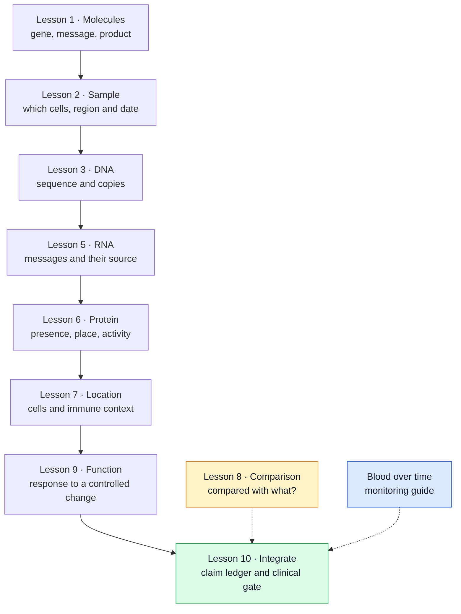

# What does multi-omics tell us about a tumor?

**Learn what each molecular layer measures, once, then combine compatible observations into a claim you can explain and check.** You do not need to memorize genes. For each result, name the object measured, the cells and sample it came from, and the question it can answer.

“Omics” means measuring many molecules of one kind at once: the genome (DNA), transcriptome (RNA) or proteome (protein). [Multi-omic integration](/wiki/education/concepts/measurement/computational-analysis/multi-omic-integration) combines layers, often with location and functional tests, to answer one defined question.

## The big ideas

1. **Each layer answers its own question.** [DNA, RNA and protein](/wiki/education/concepts/biology-basics/genetics/central-dogma) are related objects, not interchangeable evidence. In 104 primary triple-negative breast cancers (TNBC), only about 36% of the DNA mutations found were detectably expressed in RNA ([Shah et al., 2012](https://pubmed.ncbi.nlm.nih.gov/22495314/)).
2. **A sample is a mixture at one place and time.** Cancer cells share the tissue with normal neighbors, and [tumor heterogeneity](/wiki/education/concepts/cancer-biology/what-cancer-is/tumor-heterogeneity) means one region may not represent all of them. Which cells, which sample and which date belong to every result.
3. **“High” needs a comparison.** A value means something only against a stated reference. Several reports built from the same sample or the same variant call are not independent votes.
4. **A persuasive mechanism is not a treatment result.** Benefit needs evidence in the intended setting with a validated test. Adjuvant olaparib, for example, was tested in early breast cancer with an inherited (germline) BRCA1 or BRCA2 variant, not in any tumor with a repair-gene finding ([Tutt et al., 2021](https://pubmed.ncbi.nlm.nih.gov/34081848/)).

## The map

*Each arrow is a question to investigate, not a guarantee: a measured DNA change does not show that its message or protein was made. The comparison applies at every layer, and blood adds repeated snapshots over time.*

## Lessons

Lessons 1–10, apart from optional lesson 4, are the core path, about 104 minutes; plan two or three sittings. Optional lessons extend a step and can be skipped.

| # | Lesson | Question it answers | Minutes | Learning aid |
|---|---|---|---|---|
| 1 | [Start with genes, RNA and protein](/wiki/education/guides/what-multi-omics-tells-us/01-genes-rna-and-protein) | What are genes, messages and products? | 8 | HER2 from gene to membrane |
| 2 | [See what is inside a tissue sample](/wiki/education/guides/what-multi-omics-tells-us/02-what-is-inside-a-tissue-sample) | Which cells share the sample, and what is each one? | 12 | Normal-neighbor comparator; identity/state table |
| 3 | [Read DNA: coverage, calls, copies and cell fractions](/wiki/education/guides/what-multi-omics-tells-us/03-read-dna) | Could the assay detect this change, and how many cancer cells carry it? | 14 | Assay card; 25% versus 33% read fraction |
| 4 | Optional: [Test a copy-aware clone model](/wiki/education/guides/what-multi-omics-tells-us/04-test-a-copy-aware-clone-model) | Why can one read fraction fit different cell fractions? | 12 | Solve backwards to an impossible 160% |
| 5 | [Read RNA: counts, preparation and splice products](/wiki/education/guides/what-multi-omics-tells-us/05-read-rna) | Which message was made, in which form, by which cells? | 14 | Count units; splice-junction example |
| 6 | [Read protein: presence, place and activation](/wiki/education/guides/what-multi-omics-tells-us/06-read-protein) | Is the product present, placed and active? | 10 | HER2-low as a delivery address |
| 7 | [Add geography and immune context](/wiki/education/guides/what-multi-omics-tells-us/07-map-cells-and-immune-context) | Where are the cells, and do immune cells recognize the tumor? | 12 | Same RNA, two maps |
| 8 | [Choose the comparison before interpreting the signal](/wiki/education/guides/what-multi-omics-tells-us/08-choose-the-comparison) | Compared with what, using which evidence? | 10 | Enrichment, selectivity, dependency |
| 9 | [Test a mechanism in a living model](/wiki/education/guides/what-multi-omics-tells-us/09-test-function-in-a-model) | What happens under a controlled change? | 10 | Starting count versus control |
| 10 | [Integrate the evidence and meet the clinical gate](/wiki/education/guides/what-multi-omics-tells-us/10-integrate-the-evidence) | What does the combined evidence support, and what is missing? | 14 | Six-row claim ledger; three intended-use cards |
| 11 | Optional: [Read one report with the six-question card](/wiki/education/guides/what-multi-omics-tells-us/11-read-one-report) | How do I apply this to the report in front of me? | 10 | Annotated sample report |
| 12 | Optional: [Read single-cell data after treatment](/wiki/education/guides/what-multi-omics-tells-us/12-profile-residual-tumor) | What can cell-resolved data say about residual tumor? | 12 | Recovered-profile denominators |
| Blood | [Read the blood result before reading the trend](/wiki/education/guides/monitoring-residual-disease/01-read-the-blood-result) (monitoring guide) | What did this blood sample detect, and when? | 11 | Result ledger near the detection limit |

**Shorter routes.** Reading a DNA finding: 1 → 2 → 3 → 10. Judging a surface target: 2 → 5 → 6 → 8 → 10. Reading an immune-rich biopsy: 2 → 7, then [the immune-system guide](/wiki/education/guides/how-the-immune-system-fights-cancer/index). Checking a test or company claim: [judging a test or vendor claim](/wiki/education/guides/judging-a-test-or-vendor-claim/index). Asking whether a gene alteration plus a named drug is a real option: [from a variant to a drug claim](/wiki/education/guides/from-variant-to-drug/index).

## Concepts you will use

**Foundations:** [central dogma](/wiki/education/concepts/biology-basics/genetics/central-dogma), [germline versus somatic](/wiki/education/concepts/biology-basics/genetics/germline-vs-somatic), [epithelium and stroma](/wiki/education/concepts/biology-basics/cells/epithelium-and-stroma) and [tumor heterogeneity](/wiki/education/concepts/cancer-biology/what-cancer-is/tumor-heterogeneity).

**Measurements:** [variant calling](/wiki/education/concepts/measurement/sequencing-basics/variant-calling), [variant allele fraction versus cancer cell fraction](/wiki/education/concepts/measurement/sequencing-basics/variant-allele-fraction-and-cancer-cell-fraction), [counts and normalization](/wiki/education/concepts/measurement/transcriptomics/counts-normalization), [immunohistochemistry](/wiki/education/concepts/measurement/pathology-readouts/immunohistochemistry), [stromal tumor-infiltrating lymphocyte (TIL) scoring](/wiki/education/concepts/measurement/pathology-readouts/stil-scoring) and [perturbation and controls](/wiki/education/concepts/evidence-and-statistics/study-design/perturbation-and-controls). Each lesson links its other concepts at the point of use.

**Reasoning:** [prognostic versus predictive](/wiki/education/concepts/evidence-and-statistics/biomarkers/prognostic-vs-predictive), [actionability](/wiki/education/concepts/evidence-and-statistics/biomarkers/actionability) and [the evidence chain from variant to benefit](/wiki/education/concepts/evidence-and-statistics/reasoning-tools/evidence-chain-variant-to-benefit).

## Applied to Diana

Diana's team uses this reading method when a new tissue or research report arrives: name the layer, the sample and the comparison, then ask which bridge is still missing. [The molecular profile](/wiki/care/molecular-profile) owns her integrated findings, [the specimen map](/wiki/omics/specimen-to-sample-map) keeps each result attached to its sample, and [the decision pages](/wiki/questions/index) own the clinical questions.

## What is still uncertain

- **How to weigh layers that disagree.** A gene's RNA and protein can differ because of translation, turnover or sampling, and no general rule says which to trust.
- **Whether integration improves outcomes.** Most multi-omic scores are research tools that have not been tested prospectively against a single validated biomarker.
- **How well models and maps represent the patient.** Cultures select cells, spatial methods sample small regions and single-cell preparation loses some cell types.

## Sources and scope

Source check: November 8, 2026. Individual lessons keep their own scoped sources. Expert and learner review remain pending.

- [Shah et al., 2012](https://pubmed.ncbi.nlm.nih.gov/22495314/): 104 primary TNBCs; about 36% of mutations were expressed in RNA.
- [Tutt et al., 2021 (OlympiA)](https://pubmed.ncbi.nlm.nih.gov/34081848/): adjuvant olaparib in HER2-negative early breast cancer with germline BRCA1 or BRCA2 variants.
- [NCI: biomarker testing for cancer treatment](https://www.cancer.gov/about-cancer/treatment/types/biomarker-testing-cancer-treatment).
- [NHGRI: central dogma](https://www.genome.gov/genetics-glossary/Central-Dogma).
