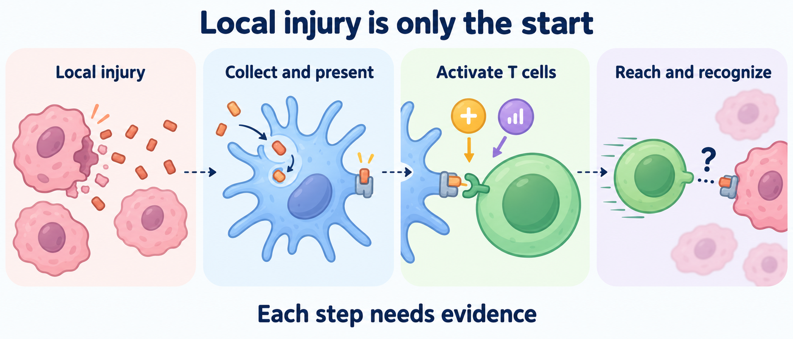

# Separate local injury from immune learning

**You will learn to distinguish killing a treated tumor from teaching the immune system to recognize cancer elsewhere.** Read the short [cancer-immunity cycle](/wiki/education/concepts/immunology/tumor-immunology/cancer-immunity-cycle) and [human leukocyte antigen (HLA)](/wiki/education/concepts/immunology/antigen-presentation/hla) pages first if antigen presentation is unfamiliar.

## The intuition: damage is an opening, not a promise

Imagine a library after a storm. Scattered pages contain information, but someone still has to collect them, understand them and deliver the right message. Injured tumor cells can supply material for immune learning. The presence of that material does not tell us whether the rest of the process worked.

[Ablation](/wiki/education/concepts/therapeutics/local-therapies/ablation) destroys tissue at a selected site, for example through freezing or heating. [Radiation therapy](/wiki/education/concepts/therapeutics/local-therapies/radiation-therapy-basics) deposits energy that can damage cells and impair their ability to reproduce. These physical effects can act without a T cell recognizing a cancer antigen. Antigen-specific T-cell killing has additional requirements.

## How immune learning could follow injury

*Local injury opens a possible route to immune learning. Presentation, activation, access and recognition each need evidence; the simplified drawing does not establish a distant response.*

The useful sequence is conditional:

1. Injury makes tumor material available, with a signal context that supports an immune response.
2. Cells such as [dendritic cells](/wiki/education/concepts/immunology/the-immune-system/immune-cell-roster) collect and process that material. [Cross-presentation](/wiki/education/concepts/immunology/antigen-presentation/cross-presentation) can display acquired protein fragments on class-I HLA.
3. [T-cell priming](/wiki/education/concepts/immunology/t-cells/t-cell-priming-three-signals) requires recognition and supporting activation signals; displaying a fragment alone is insufficient.
4. Activated cells must reach other tumors and function there.
5. A distant cancer cell must display a recognizable fragment. Antigen-specific CD8 T cells, a T-cell population carrying the CD8 coreceptor, recognize a peptide–HLA combination rather than loose tumor debris.

[Immunogenic cell death](/wiki/education/concepts/cancer-biology/cell-death-and-survival/immunogenic-cell-death) is defined by the ability of dying cells to provoke an adaptive immune response in an appropriate setting. A danger signal or a dead-cell stain is evidence about part of that process, not proof of the full response. The consensus guidance on detecting it makes this distinction explicit. [Galluzzi and colleagues, 2020](https://pubmed.ncbi.nlm.nih.gov/32209603/).

[In-situ vaccination](/wiki/education/concepts/immunology/tumor-immunology/in-situ-vaccination) describes an attempt to use tumor material within the body to stimulate immune learning. An [immune-checkpoint inhibitor](/wiki/education/concepts/therapeutics/immunotherapy/immune-checkpoint-inhibitor) may help some immune responses function, but it does not replace missing presentation, recognition or tumor access. Neither phrase guarantees a vaccine-like protective result.

## Worked example: the treated site and the distant site

**Fictional example.** Leah has two imageable tumors in a research study. One is treated locally; the other receives no local treatment. The treated tumor becomes smaller. A blood test also finds more T cells recognizing a tumor-derived fragment.

That supports local activity and a measured immune change. It does not yet establish that those cells entered the untreated tumor or recognized its cancer cells. Suppose the untreated tumor has lost the relevant HLA display. Local treatment could still injure the first tumor while antigen-specific T cells struggle to recognize the second.

Now imagine the untreated tumor also shrinks while Leah receives a systemic drug. That is a distant response worth studying. A comparison is still needed to estimate how much adding local treatment contributed beyond the drug. For radiation, an [abscopal effect](/wiki/education/concepts/immunology/tumor-immunology/abscopal-effect) concerns a response outside the irradiated field. For ablation, describe the distant response and name the procedure; calling it abscopal-like still leaves its cause unresolved. Shrinkage of the treated lesion is a local response. Local control concerns keeping that site from progressing during follow-up.

## Where the story can break

Material can be released without useful presentation. T cells can be primed without reaching a tumor. A tumor can be reached without being recognized. Physical treatment can also damage nearby normal tissue or immune cells. These are different failure modes, so “more injury” is a poor substitute for measuring the relevant gate.

In experimental cell and mouse models, sufficiently high single radiation doses induced a DNA-degrading enzyme that reduced a DNA-sensing immune signal. Here DNA means deoxyribonucleic acid. Thresholds varied across models. This is a reason to test schedules, not a universal clinical dose ceiling or proof that one schedule best stimulates immunity. [Vanpouille-Box and colleagues, 2017](https://pubmed.ncbi.nlm.nih.gov/28598415/).

## Try it

A study reports complete destruction of a treated lesion and increased danger signals in that tissue. Has it demonstrated a systemic antitumor immune response? Name two observations that would strengthen the claim.

**Answer:** No. It demonstrated local injury and measured signals. Useful additional evidence could include tumor-specific T-cell function and response at untreated sites, with controls that help distinguish local treatment's contribution from concurrent drugs. Even these observations need appropriate sampling and follow-up.

## Explain it back

Complete this sentence: “Local injury may make immune learning possible, but a distant response also needs ___.” Try naming presentation, priming, tumor access and recognition without looking above.

## Takeaway

Local control, immune learning and distant tumor response are separate achievements. Follow the gates between them before calling a treatment an in-situ vaccine.

Next: [put the disease setting before the timing question](/wiki/education/local-treatment-modalities/02-timing).

## Sources and scope

Source check: 2026-10-09. Leah and her measurements are fictional. Mechanisms do not establish a clinical regimen; expert and learner review pending.

- [Galluzzi et al., 2020: definition and detection of immunogenic cell death](https://pubmed.ncbi.nlm.nih.gov/32209603/) — consensus framework for distinguishing signals from demonstrated immunity.
- [Vanpouille-Box et al., 2017: radiation dose and DNA sensing](https://pubmed.ncbi.nlm.nih.gov/28598415/) — experimental models, not a patient dosing rule.
- [Chen and Mellman, 2013: the cancer-immunity cycle](https://pubmed.ncbi.nlm.nih.gov/23890059/) — conceptual framework for the intervening immune steps.
- [National Cancer Institute: radiation therapy](https://www.cancer.gov/about-cancer/treatment/types/radiation-therapy) — physical treatment effects and normal-tissue exposure.
