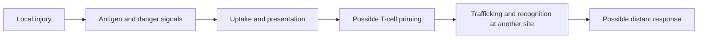

# How local injury can create immune signals

**Killing tumor cells and producing a useful immune response are separate biological events.**

**Before you start:** an antigen is material an immune receptor can recognize. [[wiki/education/oncology-101/2-dendritic-cells|Dendritic cells]] can collect protein fragments and present them to T cells. [[wiki/education/concepts/immunology/antigen-presentation/hla|HLA]] is the peptide-display system.

## Three ways to deliver injury

Ablation places a probe into or beside a selected lesion. Cryoablation freezes tissue. Radiofrequency and microwave ablation heat it. External-beam radiation directs energy from outside the body into a planned target. A radioligand carries a radionuclide on a targeting molecule through the bloodstream; its distribution determines exposure.

Ablation and radiation damage tumor and normal cells within their treatment volume. Radioligands also expose normal tissues through uptake, clearance and emitted radiation. The intended target is only one contributor to the delivered dose.

## Freezing is a temperature field

Cryoablation uses rapid freezing, slower thawing and repeated cycles in common protocols. Equipment and organ protocols differ. Argon probes can reach approximately −140 to −185 °C at the tip; this is different from the **roughly −20 to −40 °C lethal temperature region inside the visible ice ball**. The outer edge is warmer and is not proof of complete cell killing.

The visible ice ball, required treatment margin and nearby nerves, vessels or organs guide planning. Three centimeters is a common selection threshold in particular studies, not a universal physical ceiling. Multiple probes can alter geometry. Larger or hazardous lesions require a different assessment rather than an automatic next modality.

Heat ablation causes protein damage and coagulative necrosis. Blood flow can remove heat, and different systems interact differently with tissue. Antigen preservation is a mechanistic consideration; it does not establish a universal cryo > radiofrequency > microwave ranking for systemic clinical benefit.

## From damage to a possible immune response

*Each arrow is a gate; injury alone does not establish the final outcome.*

Damage-associated molecular patterns (DAMPs) include signals released or exposed by stressed cells. Their timing, location and surrounding immune populations affect whether priming or suppression follows. Apoptosis is not always silent, and necrosis is not always beneficial.

The cGAS–STING pathway senses misplaced DNA and can trigger type I interferon signals. Radiation-induced cytosolic DNA may activate it in relevant models. **More dose does not mean more activation:** in a primary preclinical study, doses above roughly 12–18 Gy per fraction induced the DNA-degrading enzyme TREX1 in the tested models and reduced the signal. That range is model-dependent, not a universal clinical prescription. A gray (Gy) is one joule of absorbed energy per kilogram.

## Why distant effects are harder

A distant CD8 T-cell response needs relevant targets, presentation, immune-cell access and functional effectors. The local physical injury can occur even when these are absent. An **abscopal effect** means a response outside the irradiated field; convincing attribution requires attention to concurrent systemic therapy and disease history. It is uncommon and cannot be promised.

## Try it

The ice ball covers a lesion and a blood cytokine rises. Does that prove complete local kill and a distant immune benefit?

**Answer:** Neither follows automatically. Margins and later local assessment address control; appropriately designed immune and clinical measurements address systemic effects.

## Explain it back

“The probe or radiation supplies injury. Antigen release may support priming, but distant killing needs several additional steps.”

## Takeaway

**Physical destruction is established locally; immune benefit must be measured separately.**

**Next:** [[wiki/education/local-treatment-modalities/02-timing|Timing and disease setting]].

**Vocabulary:** HLA means human leukocyte antigen.

## Sources and scope

General teaching, source-checked October 8, 2026. Expert and learner review remain pending. These lessons explain mechanisms and study interpretation; current choices are owned by [[wiki/care/treatment-plan|the care plan]] and [[wiki/questions/abscopal-effect|the local-priming question]].

- [BOOSTER randomized ablation-plus-immunotherapy trial in advanced NSCLC](https://www.nature.com/articles/s41392-025-02460-z).
- [Primary TREX1 radiation-dose study](https://pubmed.ncbi.nlm.nih.gov/28598415/).
- [PACIFIC: durvalumab after chemoradiotherapy in unresectable stage III NSCLC](https://www.nejm.org/doi/full/10.1056/NEJMoa1709937).
- [CURB randomized trial; benefit in NSCLC, no demonstrated benefit in the breast cohort](https://doi.org/10.1016/S0140-6736(23)01857-3).
