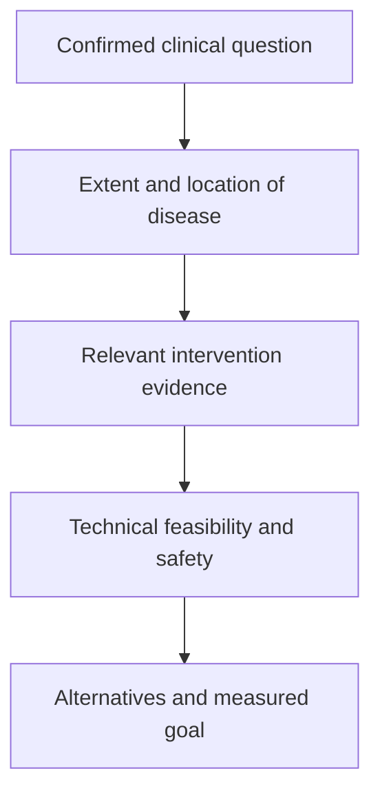

# Read a local-treatment proposal

**A useful proposal states the goal, evidence, anatomy and safety requirements before naming a preferred procedure.**

**Before you start:** [[wiki/education/local-treatment-modalities/02-timing|Disease setting]] explains why one blood result can lead to different questions. [[wiki/education/local-treatment-modalities/03-overlap-and-sequencing|Combination evidence]] explains which comparisons matter.

## Five gates to inspect

*This is a reading framework, not an automatic treatment algorithm.*

First, ask what the proposal aims to accomplish: symptom relief, local control or improvement in a broader outcome. Next, determine how disease was confirmed and staged. A molecular signal alone is not the same as a localizable lesion or proven radiographic progression.

Third, identify supporting evidence in the same cancer, setting and prior-treatment context. A protocol, label or randomized comparison answers a different question from an animal mechanism paper. Fourth, check technical feasibility and safety. Finally, ask how success and failure will be measured and what alternatives exist.

## Questions specific to each tool

| Tool | Questions that clarify the proposal |
|---|---|
| Ablation | Can the operator cover tumor plus a margin while protecting nearby structures? What imaging verifies coverage? What anesthesia and recovery are needed? |
| SBRT (stereotactic body radiation therapy) | What target volume and motion are included? What prior radiation and cumulative organ constraints apply? Why this fractionation? |
| Radioligand | What exact ligand and radionuclide are proposed? Is access established for this setting? What imaging, organ function and dosimetry are required by the protocol? |
| Checkpoint combination | Is benefit supported in this setting? What sequence was tested? What prior immune toxicity changes feasibility? |

A diagnostic PET tracer can show uptake. Uptake can reflect expression, vascularity, delivery, clearance or background. It does not independently predict cell-therapy safety or therapeutic absorbed dose. A paired diagnostic and therapeutic ligand can support theranostics, but the pair, kinetics and protocol need validation.

## Avoid one-variable rules

“One lesion means ablation” ignores anatomy, pathology, disease elsewhere and systemic options. “Many lesions means SBRT” ignores volume and organ limits. “Invisible disease means radioligand” assumes uptake and benefit that have not been demonstrated. Size thresholds are protocol-specific selection criteria, rather than universal branches.

Likewise, a surface-antigen engager and a TCR (T-cell receptor)-based engager are not interchangeable HLA (human leukocyte antigen)-bypass strategies. The latter requires its peptide–HLA complex. A proposed alternative must bypass the actual failed step and have evidence for its own benefit and safety.

## A worked proposal

A patient has one growing lung lesion after prior systemic treatment. A proposal says “local control,” names a biopsy/staging basis, compares continued systemic care with a local addition, and includes pulmonary dose limits. That is assessable. A proposal saying “small lesion → SBRT → immune cure” hides the clinical goal, comparator and uncertainty.

The question set should also include what might be lost: delaying systemic therapy, damaging tissue needed for diagnosis, limiting later radiation or surgery, and adding toxicity. These are concrete tradeoffs, not reasons to reject every local procedure.

## Try it

A target PET is positive. A proposal treats that as proof of safe radioligand treatment and future safe CAR (chimeric antigen receptor)-T against the same target. Which gate is missing?

**Answer:** The imaging result does not validate either product’s delivered dose, normal-tissue toxicity or clinical benefit. Each format needs its own evidence.

**Explain it back:** “I can assess a proposal when I know what it aims to improve, what evidence applies, and what limits the treatment.”

## Explain it back

Ask for a concrete, evidence-matched proposal instead of following a modality-only decision tree.

## Takeaway

**Ask for a concrete, evidence-matched proposal instead of following a modality-only decision tree.**

**Next:** [[wiki/education/local-treatment-modalities/05-tissue-and-sample-budget|Measure the result]].

## Sources and scope

General teaching, source-checked October 8, 2026. Expert and learner review remain pending. These lessons explain mechanisms and study interpretation; current choices are owned by [[wiki/care/treatment-plan|the care plan]] and [[wiki/questions/abscopal-effect|the local-priming question]].

- [BOOSTER randomized ablation-plus-immunotherapy trial in advanced NSCLC](https://www.nature.com/articles/s41392-025-02460-z).
- [Primary TREX1 radiation-dose study](https://pubmed.ncbi.nlm.nih.gov/28598415/).
- [PACIFIC: durvalumab after chemoradiotherapy in unresectable stage III NSCLC](https://www.nejm.org/doi/full/10.1056/NEJMoa1709937).
- [CURB randomized trial; benefit in NSCLC, no demonstrated benefit in the breast cohort](https://doi.org/10.1016/S0140-6736(23)01857-3).
