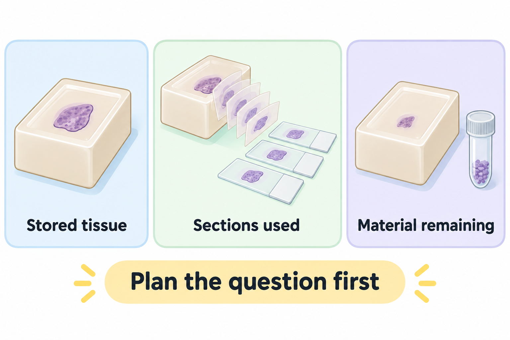

# Match each measurement to its claim

**You will learn to ask what an imaging or tissue result actually measured before using it to explain a treatment response.** Start with [immunohistochemistry](/wiki/education/concepts/measurement/pathology-readouts/immunohistochemistry), which stains selected proteins in tissue, and [bulk RNA sequencing](/wiki/education/concepts/measurement/transcriptomics/bulk-rna-seq), which measures a sample's combined ribonucleic acid messages.

## The intuition: choose the evidence for the question

A photograph, a head count and a conversation tell you different things about a classroom. The same is true of a tumor. A scan can locate a lesion. A stain can show cells and proteins in one piece of tissue. A functional experiment can test a specified activity. None is a complete substitute for the others.

First name the claim: “The treated site is controlled,” “immune cells entered this sampled area,” “these T cells recognize tumor material,” or “adding the treatment improves outcomes.” Then choose the measurements and comparison that could address it.

## What each measurement can contribute

| Measurement | Useful question | What it cannot establish alone |
|---|---|---|
| Anatomical imaging, such as [computed tomography (CT)](/wiki/education/concepts/measurement/imaging/pet-ct) or [magnetic resonance imaging (MRI)](/wiki/education/concepts/measurement/imaging/breast-mri) | Where is disease detected, and how does a lesion change? | Which immune mechanism caused the change |
| [Positron emission tomography with computed tomography (PET/CT)](/wiki/education/concepts/measurement/imaging/pet-ct), with a specified tracer | Where was that tracer detected under the scan conditions? | Effective therapeutic radiation dose or complete coverage of unseen disease |
| Immunohistochemistry | Which cells stain for a selected protein, where, and using what scoring method? | Whole-body expression or T-cell killing capacity |
| Bulk RNA sequencing | Which messages were captured from this tissue mixture? | Accessible surface protein or the activity of each individual cell |
| [T-cell receptor sequencing](/wiki/education/concepts/measurement/immune-monitoring/tcr-sequencing) | Which sampled receptor sequences are present and change in abundance? | Which target every sequence recognizes or whether those cells can kill |
| A specified functional immune assay, such as a [target-cell killing assay](/wiki/education/concepts/measurement/immune-monitoring/functional-cytotoxicity-assays) | Can sampled cells perform the tested recognition or killing activity? | That the same activity occurs throughout the person's tumors |

RNA is ribonucleic acid; it participates in the [path from genetic information to protein](/wiki/education/concepts/biology-basics/genetics/central-dogma). RNA abundance, protein staining and accessible binding sites are related but different measurements.

For [target PET and theranostic imaging](/wiki/education/concepts/measurement/imaging/target-pet-and-theranostic-imaging), record the tracer, binding component and radionuclide. [Immuno-PET](/wiki/education/concepts/measurement/imaging/immuno-pet) uses a radiolabeled antibody or antibody-derived binding component. The detected signal still needs cell origin and distribution context.

For a [radioligand](/wiki/education/local-treatment-modalities/06-comparisons), dosimetry estimates absorbed radiation dose. Uptake, retention and normal-organ exposure need product-specific interpretation. A diagnostic image does not replace that work. Joint guidance from the European Association of Nuclear Medicine and the Medical Internal Radiation Dose Committee describes quantitative imaging for dosimetry of lutetium-177 therapies; its method scope does not establish a treatment's benefit in breast cancer. [Ljungberg and colleagues, 2016](https://pubmed.ncbi.nlm.nih.gov/26471692/).

## Worked example: the percentage rose, but what changed?

**Fictional counting exercise.** A research assay counts cells in two equal-sized sampled areas using the same method. Before treatment it finds 10 immune cells among 50 total cells. Afterwards it finds 10 immune cells among 20 total cells.

The immune-cell fraction rose from 20% to 50%, but the immune-cell count stayed at 10. Loss of other cells can explain the fraction change without additional immune-cell entry. The conclusion is narrower than “treatment recruited more immune cells.”

Now suppose the second sample came from a different lesion or a different-sized area. Even the count comparison needs more caution. Ask about site, viable tissue area, timing and assay comparability. This exercise uses a simple cell fraction; it is not the clinical [stromal tumor-infiltrating lymphocyte scoring method](/wiki/education/concepts/measurement/pathology-readouts/stil-scoring), which has a different denominator.

**Choose the comparable report.** All counts, areas and locations here are invented. Suppose the assay identifies the same immune-cell class with the same counting method. The baseline count is **10 cells in 1 mm² of viable edge from lesion L**. Both follow-up reports use the same later timepoint.

| Follow-up report | Raw count and sampled area | Comparison available |
|---|---|---|
| A | 10 cells in 1 mm² of viable edge from lesion L | Matched site, region, area, timepoint convention and method |
| B | 10 cells in 0.2 mm² from the injured center of lesion M | Different lesion, tissue region and area |

Which baseline/follow-up pair can support a sampled density comparison? Does either establish recruitment or function?

**Answer:** Baseline plus A supports the more comparable description: `10 ÷ 1 = 10 cells/mm²` at both times, assuming the stated sampling and method match. B yields `10 ÷ 0.2 = 50 cells/mm²`, but its different place and region do not establish an increase within L. Equal area does not make separate tissue pieces identical, and matched sampling still cannot by itself establish recruitment causation. Density, the cell fraction above, tumor-specific recognition and killing are different quantities. A [functional cytotoxicity assay](/wiki/education/concepts/measurement/immune-monitoring/functional-cytotoxicity-assays) would address specified killing under its own conditions, not prove function throughout every tumor.

## How tissue planning changes the answer

*Sectioning and extraction consume finite archive material. Shapes and amounts are schematic; diagnostic needs and assay requirements govern allocation.*

A specimen records a place and time. The center of an injured lesion, its viable edge and an untreated lesion can answer different questions. An early sample may capture transient injury signals; a later sample may capture a changed mixture of surviving cells.

Collection and handling also matter. [Fixed, fresh-frozen and viable preparations](/wiki/education/concepts/measurement/specimens/ffpe-vs-fresh-frozen-vs-viable) support different questions. Ask which input the actual assay accepts before allocating material. A label such as “frozen” cannot guarantee living cells or compatibility.

Diagnostic needs, patient safety and consent come before an exploratory sample wish list. Research planning should specify the question, accepted material, minimum usable amount, processing timeline, assay controls and what remains for other needs. There is no universal number of biopsy cores that can be allocated from an educational checklist. Archive [tissue is finite](/wiki/education/concepts/measurement/specimens/tissue-is-non-renewable): cutting sections and extracting material consume it. [Repeat blood sampling](/wiki/education/concepts/measurement/specimens/blood-as-a-renewable-sample) can provide later observations, but it collects a new timepoint and requires its own safety, volume and method planning. [National Cancer Institute best practices, fourth edition 2026](https://dctd.cancer.gov/data-tools-biospecimens/biospecimens-biobanks/resources/best-practices/biospecimen-resources/appendices/2026-4th-edition-best-practices.pdf).

## From a signal to a mechanism

[Immunogenic cell death](/wiki/education/concepts/cancer-biology/cell-death-and-survival/immunogenic-cell-death) cannot be established by calling any increase in inflammation “vaccination.” Signals from dying cells need interpretation alongside evidence about the immune response.

Formenti and colleagues combined clinical response observations with blood, receptor-sequence and functional analyses in a lung-cancer study of radiation plus checkpoint treatment. Those complementary measurements were informative about mechanism. Their findings did not turn a single stain or a receptor-sequence increase into a universal response test. [Formenti and colleagues, 2018](https://pubmed.ncbi.nlm.nih.gov/30397353/).

## Common failure modes

Watch for a tissue percentage reported without its denominator, a new sample compared with an incompatible old one, or a blood response described as proof of activity inside every tumor. A measurement may be accurate while the conclusion attached to it is too broad.

## Try it

A fictional study finds more copies of a T-cell receptor sequence after local treatment. It concludes that those cells killed the untreated tumor. What evidence is missing?

**Answer:** The sequence's target specificity, relevant recognition and killing activity, tumor access and a comparison supporting the clinical attribution remain unresolved. Sequencing measures sampled receptor abundance; it does not directly observe all those steps.

## Explain it back

Explain how 20% can become 50% without adding an immune cell. Then name one sampling difference that would make even that comparison harder.

## Takeaway

Keep the sample's location, timing, handling and denominator beside the result. Match evidence to the claim rather than asking one test to stand in for the whole immune response.

Next: [compare delivery and recognition separately](/wiki/education/local-treatment-modalities/06-comparisons).

## Sources and scope

Focused sampling exercise: October 13, 2026; the linked public denominator, stromal-score and functional-assay concepts distinguish these readouts. Earlier primary-source checks remain as dated below. Expert and learner review remain pending.

Source check: 2026-10-10. All counting numbers and practice studies are fictional; expert and learner review pending.

- [NCI 2026: Best Practices for Biospecimen Resources, fourth edition](https://dctd.cancer.gov/data-tools-biospecimens/biospecimens-biobanks/resources/best-practices/biospecimen-resources/appendices/2026-4th-edition-best-practices.pdf) — targeted sections C.2.1 and C.2.4.1.2: application compatibility, medical-care priority and collection/handling variables.
- [Galluzzi et al., 2020: immunogenic cell death guidance](https://pubmed.ncbi.nlm.nih.gov/32209603/) — distinguishing signals from demonstrated adaptive immunity.
- [Formenti et al., 2018: radiation plus checkpoint blockade in lung cancer](https://pubmed.ncbi.nlm.nih.gov/30397353/) — complementary clinical and immune measurements in a specific study.
- [Ljungberg et al., 2016: joint EANM/MIRD quantitative lutetium-177 imaging guidance](https://pubmed.ncbi.nlm.nih.gov/26471692/) — activity measurements and absorbed-dose estimates for that radiopharmaceutical-therapy method.
- [FDA 2019: oncology therapeutic radiopharmaceutical nonclinical guidance](https://www.fda.gov/media/129547/download) — animal biodistribution, dosimetry and development-program scope; it is not a clinical dosing protocol.
