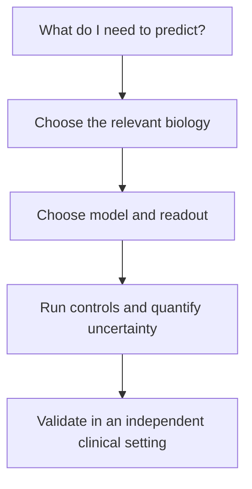

# Modeling tumor response

**You will be able to:** Match a prediction question to a model and identify the biology it leaves out.

A model is a deliberately incomplete representation of a tumor. Its usefulness depends on the question, the measurements and validation against independent outcomes. More elaborate construction does not automatically make a model more accurate.

**Before starting:** [What multi-omics measures](/wiki/education/reading-a-tumor/omics-and-multi-omics) explains DNA, RNA, protein and tissue location. [Actionability](/wiki/education/concepts/evidence-and-statistics/biomarkers/actionability) distinguishes a measurable signal from a useful treatment decision.

## Start with the question

*Choose the model for the question; validate the prediction for its intended use.*

| Approach | What is measured or estimated | What can be missing |
|---|---|---|
| Molecular profiling and computational models | A mutation, expression pattern or predicted response | Protein activity, delivery, immune interactions and biology absent from the training data |
| Short-term ex vivo assays | A response of sampled living cells to a perturbation | Long-term evolution, systemic exposure and the patient's complete immune environment |
| Organoids and immune co-cultures | Responses in a three-dimensional culture; immune effects when the design includes relevant cells | Some stromal populations, circulation and stable immune composition |
| Patient-derived xenografts (PDX) | Human tumor growth in an animal and response to treatment | Human immunity in conventional immunodeficient hosts; human stroma is progressively replaced |
| Engineered tissue and organ-on-chip systems | Selected architecture, matrix, flow or tissue interactions | The rest of the body and any omitted cell populations |
| Patient imaging and blood monitoring | Tracer uptake, structure, metabolism or tumor DNA over time | A counterfactual response to a drug the patient has never received |

These categories overlap. An organoid is both a physical three-dimensional structure and a functional model when drugs are tested on it. PDX experiments are **in vivo**, not ex vivo. Imaging observes a person; it is not interchangeable with a laboratory perturbation.

## What engineered context adds

A three-dimensional matrix can change cell movement and access to drugs. Endothelial cells and perfusion can help study movement from vessels into tissue. Both bioprinting and microfluidic organ-on-chip designs can incorporate three-dimensional tissue; neither label guarantees that the necessary biology is present.

In bioprinting, living cells may be deposited in a hydrogel. A removable material can create a channel that is later lined with endothelial cells. Pluronic F-127 is a **poloxamer block copolymer**, not a sugar. The ink, stiffness, cell sources, flow and readout all become experimental variables. A construct is not fully patient-matched merely because its tumor cells came from one person.

## What a virtual cell predicts

A computational model learns relationships from its training data. Predicting an RNA pattern from an image, predicting drug sensitivity and simulating a gene perturbation are separate tasks. Success on one task does not validate the others.

Ask whether the model was tested on held-out patients, the relevant cancer type and the proposed intervention. Check whether patient and laboratory batches leaked between training and evaluation. A predicted molecular measurement remains a prediction; it does not become a performed assay.

## Try it

A tumor-only culture shrinks after anti-PD-1 treatment. Does that establish which checkpoint inhibitor will help the patient?

**Explain it back:** No. Checkpoint blockade depends on relevant immune interactions. We need the cell composition, controls, exposure and outcome validation. Even an immune co-culture result is preclinical evidence rather than a validated choice between drugs.

## Explain it back

A model becomes useful by answering a defined question reliably, not by reproducing the largest number of biological features.

## Takeaway

**A model becomes useful by answering a defined question reliably, not by reproducing the largest number of biological features.**

**Next:** [Verification and feedback loops](/wiki/education/modeling-tumor-response/verification-and-feedback-loops) and [reading a functional experiment](/wiki/education/molecular-profiling/parp-and-cell-survival/04-reading-a-functional-experiment). Current specimen plans belong in [tissue and data](/wiki/care/tissue-and-data); provider details belong in [companies](/wiki/companies/index).

## Sources

Checked October 8, 2026.

- [Neal et al., organoid modeling of the tumor immune microenvironment](https://pubmed.ncbi.nlm.nih.gov/30550791/) — primary demonstration that selected organoid systems retain immune components.
- [Dijkstra et al., tumor organoid–lymphocyte co-culture](https://pubmed.ncbi.nlm.nih.gov/30100188/) — primary functional co-culture work; its cancer populations do not establish TNBC clinical utility.
- [PDX stromal replacement experiments](https://pmc.ncbi.nlm.nih.gov/articles/PMC3553601/) — human and mouse compartments must be distinguished.
- [Sacrificial-channel bioprinting experiments](https://doi.org/10.1002/adma.201305506) — engineered vascularized tissues; not validation of patient-specific treatment selection.
