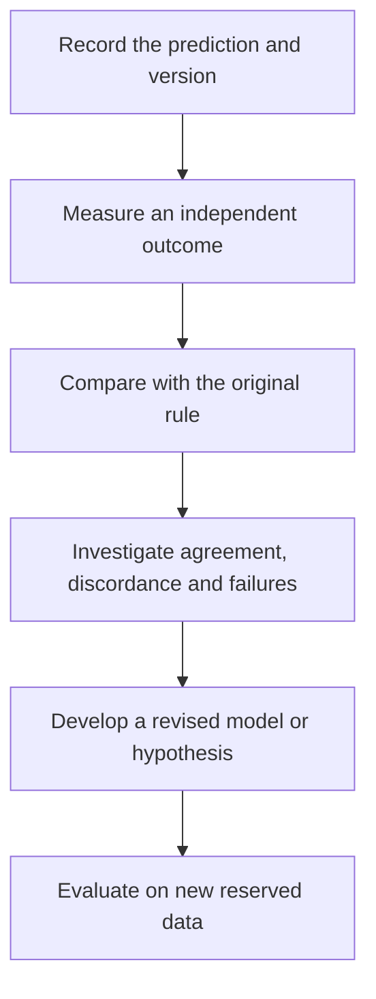

# Test clinical relevance and learn from feedback

**A model response earns a clinical prediction through independent, intended-use validation; improving care is a further question.**

**Before you start:** [Analytical validity, clinical validity and utility](/wiki/education/concepts/measurement/computational-analysis/analytical-validity-clinical-validity-and-utility) separates reliable measurement, relevant prediction and improved decisions. [Controlled perturbation](/wiki/education/concepts/evidence-and-statistics/study-design/perturbation-and-controls) supports an interpretable experiment. [Prognostic versus predictive evidence](/wiki/education/concepts/evidence-and-statistics/biomarkers/prognostic-vs-predictive) separates outcome association from treatment selection.

## Where this step sits

This is step 3 of [Predict response before treating](/wiki/education/guides/predicting-response-before-treating/index). The first lessons chose and checked a model. This final step asks what independent evidence connects its result to the proposed decision, and how later observations should update that evidence.

## Climb one claim at a time

[How a model earns trust](/wiki/education/concepts/measurement/functional-models/how-a-model-earns-trust) begins with a precise purpose. Think of a rehearsal that successfully tests one scene. It helps prepare the performance, but the audience response remains a new observation. A tumor model can also do its job well without answering every clinical question.

| Evidence rung | What it supports | What remains open |
|---|---|---|
| Characterized model and reliable readout | A trustworthy measurement in a stated preparation | Whether the intervention response is interpretable |
| Controlled perturbation | A response under the tested conditions | How closely it represents the relevant patient biology |
| Mechanistic evidence | A particular explanation within the model | Delivery, achievable exposure and normal-tissue toxicity |
| Independent clinical prediction study | Performance for the specified assay, population and endpoint | Whether acting on its result improves care |
| Appropriate study of model-guided decisions | Clinical utility for its evaluated strategy and setting | Applicability to other settings and individuals |

This is an evidence map, not a demand that every validated clinical biomarker be retested through every rung. Follow the evidence pathway for the actual intended use. Keep research discoveries and established treatment-selection tests accurately labeled.

## Match the validation to the decision

Complete **MODEL-PRACTICE-01-v1** using the [D0 experiment worksheet](/wiki/education/molecular-profiling/05-functional-drug-response). Every donor, drug, outcome and cutoff is invented. D0 and its three wells belong to development. Reserve one pre-treatment specimen from each of 30 **new donors** in a stipulated advanced-breast-cancer research setting, across all fitting, threshold and preprocessing choices; repeat wells never become extra donors.

Lock this toy assay before their outcomes are known:

- Fixed tumor-only preparation, counting procedure, drug A at 0.3 micromoles per liter, and 48-hour assessment.
- Reportability requires malignant identity, calibrated counts, three usable wells per condition, vehicle growth above its starting count and the prespecified positive-control response. Keep mechanism-control results and raw variation separately.
- For reportable cases, treated-count median divided by vehicle-count median at 48 hours at or below 0.5 predicts positive. This is an invented classification rule, **not 50% killing**.
- Independently assess the same prespecified imaging-volume measure before treatment and at week 6 after fictional drug A. A blinded assessor supplies the percentage change from that donor's pre-treatment volume. A decline of at least 20% is stipulated reference-positive; otherwise reference-negative.

The reference is a separate observation, not the culture score. For arithmetic, assume these invented labels are correct. The volume cutoff is a **toy criterion**, not standard clinical imaging-response criteria, an accepted clinical threshold or evidence of benefit. It is not a validated clinical reference standard. In actual studies, an imperfect comparator supports agreement; diagnostic accuracy terminology requires appropriate reference evidence. [FDA statistical guidance, 2007](https://www.fda.gov/regulatory-information/search-fda-guidance-documents/statistical-guidance-reporting-results-studies-evaluating-diagnostic-tests-guidance-industry-and-fda).

Clinical validation must still name disease, regimen, setting, specimen timing, version and endpoint. Imaging, pathology, blood signals and survival are different outcomes; a [surrogate endpoint](/wiki/education/concepts/evidence-and-statistics/endpoints/surrogate-endpoints) requires its own evidence bridge.

## Work through a fictional transfer

The offered group has 30 donors: 20 reportable model results and ten no-results. Reasons for the no-results are not supplied. Leave their prediction field blank; no-result does not mean negative. Their outcomes and prediction accuracy are not supplied either.

The 20 reportable cases have this complete, invented matrix. True positive (TP) and false positive (FP) have positive predictions; false negative (FN) and true negative (TN) have negative predictions. “True” refers only to the stipulated exercise labels.

| Locked v1 prediction | Reference positive | Reference negative | Total |
|---|---|---|---|
| Positive | TP: 6 | FP: 3 | 9 |
| Negative | FN: 2 | TN: 9 | 11 |
| Total | 8 | 12 | 20 |

A [denominator](/wiki/education/concepts/evidence-and-statistics/reasoning-tools/denominators-and-conditional-probability) identifies the group being counted. A [positive predictive value (PPV)](/wiki/education/concepts/evidence-and-statistics/tests-and-prediction/ppv-and-base-rates) describes the defined condition among positive predictions. Complete the answer card before interpreting a percentage:

| Question | Calculation and answer |
|---|---|
| Correct reportable classifications? | (6 + 9) / 20 = 75% |
| Of reference-positive cases, predicted positive? | 6 / (6 + 2) = 75%; toy sensitivity |
| Of reference-negative cases, predicted negative? | 9 / (9 + 3) = 75%; toy specificity |
| Of positive predictions, reference positive? | 6 / (6 + 3) = 66.7%; toy positive predictive value |
| Of everyone offered testing, got a report? | 20 / 30 = 66.7%; reportable coverage |

PPV conditions on positive predictions; it uses nine here, not eight. The ten no-results are excluded from the classification matrix and retained in coverage. There is no established accuracy for them. Neither 75% reportable accuracy nor 15/30 establishes patient-level accuracy or clinical utility. These tiny invented fractions provide no universal performance or calibrated uncertainty.

## Write the prediction before the outcome

A **prospective** evaluation fixes predictions before observing the relevant outcomes. A **retrospective** study examines already observed material and outcomes. Either needs a suitable independent comparison; its name alone establishes no utility.

Keep the original v1 record: donor/specimen and passage, assay and counting version, exposure/time, quality checks, prediction or no-result, threshold, independent reference method/window and discordances. [Model validation](/wiki/education/concepts/measurement/computational-analysis/model-validation-basics) separates development from reserved evaluation.

Suppose the team inspects the three false positives and changes the threshold. Save the new rule as **v2**. The v1 errors and all ten no-results remain in the original record. Evaluating v2 on those same 20 cases measures reuse of development information; new reserved donors are needed to test it independently.

*Learning from the test set creates a new model. That model needs another independent evaluation.*

## Treat disagreement as information

If the model responds and the patient does not, check model selection, exposure, cell composition, timing and the clinical endpoint. If a computer prediction differs from a living experiment, inspect inputs, task and portability. A disagreement need not have one simple explanation.

[Blood monitoring](/wiki/education/molecular-profiling/06-ctdna-and-mrd), imaging and clinical assessment can supply complementary observations. A changing blood signal does not identify the effect of one drug, establish that every cancer site responded or measure every surviving population. Feedback should preserve those limits.

## What can go wrong at this step

- A validated drug or disease setting is replaced by an untested one.
- A model establishes a growth response, but the report promises patient survival.
- Only successful cultures or favorable cases enter the headline.
- The prediction is changed until it matches the observed outcome.
- A revised model is evaluated on the same data used to revise it.
- One person's course is treated as proof of comparative clinical benefit.

## Try it

The team changes v1's threshold after seeing outcomes, then proposes v2 for postoperative drug B. It also says a donor's improvement after several treatments proves the model chose the best drug. What has been established?

**Answer:** The adjusted rule is development. v1's original matrix remains unchanged; v2 needs new reserved data. Drug B and the postoperative setting change the intended use, so drug A's toy evaluation does not validate them. A person's course cannot isolate causality across several treatments. Even single-arm model/outcome association does not establish a [treatment-predictive biomarker](/wiki/education/concepts/evidence-and-statistics/biomarkers/prognostic-vs-predictive) or show that model-guided decisions improve care.

## Explain it back

“The model supports ______ in ______. To use it for this decision, the missing evidence is ______. After updating it, we must ______.”

One answer: “an interpretable laboratory response; the tested model and exposure; intended-use clinical validation; evaluate on independent new data.”

## Takeaway

**Preserve the original prediction, validate the actual decision and let feedback create a new testable claim.**

**Next:** Revisit [the course map](/wiki/education/guides/predicting-response-before-treating/index), or [judge a test's validation claim](/wiki/education/guides/judging-a-test-or-vendor-claim/02-read-the-validation).

## Sources and scope

Source check: October 11, 2026. Model validation and feedback principles, rather than treatment advice. Expert and learner review remain pending.

- [Ladan et al., 2023: a specified ex vivo assay and neoadjuvant breast-cancer response study](https://pubmed.ncbi.nlm.nih.gov/37777518/).
- [Ahlmann-Eltze et al., 2025: task-specific independent perturbation evaluation](https://pmc.ncbi.nlm.nih.gov/articles/PMC12328236/).
- [NCI biomarker testing: methods, clinical context and treatment evidence](https://www.cancer.gov/about-cancer/treatment/types/biomarker-testing-cancer-treatment).

Fresh selected Ladan assay/cohort/outcome sections and Ahlmann-Eltze held-out-expression methods were checked. Ladan used a particular anthracycline-based assay and presurgical imaging comparison; its cohort and response categories are not this invented binary matrix, even though a percentage coincides. NCI and FDA sources bound clinical context and reference terminology. No full-paper, regulatory, clinical-utility or human-review certification is claimed.
