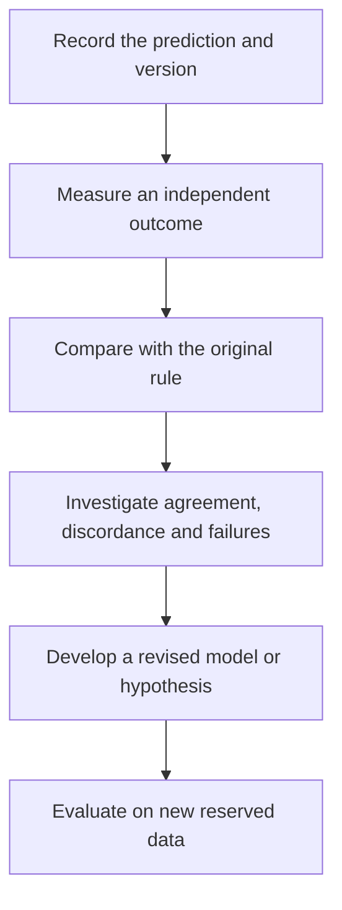

# Test clinical relevance and learn from feedback

**A model response earns a clinical prediction through independent, intended-use validation; improving care is a further question.**

**Before you start:** [Analytical validity, clinical validity and utility](/wiki/education/concepts/measurement/computational-analysis/analytical-validity-clinical-validity-and-utility) separates reliable measurement, relevant prediction and improved decisions. [Controlled perturbation](/wiki/education/concepts/evidence-and-statistics/study-design/perturbation-and-controls) supports an interpretable experiment. [Prognostic versus predictive evidence](/wiki/education/concepts/evidence-and-statistics/biomarkers/prognostic-vs-predictive) separates outcome association from treatment selection.

## Where this step sits

This is step 3 of [Predict response before treating](/wiki/education/guides/predicting-response-before-treating/index). The first lessons chose and checked a model. This final step asks what independent evidence connects its result to the proposed decision, and how later observations should update that evidence.

## Climb one claim at a time

Think of a rehearsal that successfully tests one scene. It helps prepare the performance, but the audience response remains a new observation. A tumor model can also do its job well without answering every clinical question.

| Evidence rung | What it supports | What remains open |
|---|---|---|
| Characterized model and reliable readout | A trustworthy measurement in a stated preparation | Whether the intervention response is interpretable |
| Controlled perturbation | A response under the tested conditions | How closely it represents the relevant patient biology |
| Mechanistic evidence | A particular explanation within the model | Delivery, achievable exposure and normal-tissue toxicity |
| Independent clinical prediction study | Performance for the specified assay, population and endpoint | Whether acting on its result improves care |
| Appropriate study of model-guided decisions | Clinical utility for its evaluated strategy and setting | Applicability to other settings and individuals |

This is an evidence map, not a demand that every validated clinical biomarker be retested through every rung. Follow the evidence pathway for the actual intended use. Keep research discoveries and established treatment-selection tests accurately labeled.

## Match the validation to the decision

A useful validation description names the disease, treatment setting, specimen timing, assay version, drugs, decision rule and patient outcome. “Breast cancer validation” is too broad if the experiment used a particular chemotherapy before surgery and the proposed use is a different postoperative medicine.

Separate the endpoint too. Tumor shrinkage on imaging, a pathology result, a blood signal and survival measure different outcomes. Agreement with one does not automatically validate the others. A combined regimen also complicates attributing response to a single component tested in the model.

Report how many specimens could not yield a result and why. A high agreement rate among successfully established models describes that selected group. It does not tell us how often the strategy can supply an answer for everyone offered testing.

A **prospective** evaluation fixes a prediction before observing the relevant outcome. A **retrospective** study looks back at already observed material and outcomes. Both can be informative. Independence, comparison and the intended question still matter; the label alone does not establish utility.

## Work through a fictional transfer

A laboratory's model predicts response to drug A in a defined advanced-cancer setting. Independent testing finds useful agreement with its prespecified imaging endpoint. The laboratory then proposes using the same score to choose postoperative drug B.

Several bridges changed: the drug, treatment setting, disease state and relevant outcome. The earlier validation is useful background, but it did not test that new use. The appropriate next claim is that the strategy needs evaluation in the proposed setting, rather than that one published performance number travels unchanged.

Now suppose an individual later improves after several treatments. That observation matters clinically. It cannot isolate which treatment caused the improvement or prove that the model selected the best option. A useful feedback record retains the complete treatment context.

## Write the prediction before the outcome

A disciplined feedback loop starts with a dated, versioned prediction and a defined assessment plan. Keep the following fields together:

- The specimen and model version, including culture or passage history where relevant.
- The predicted endpoint, threshold or ranking rule, and its uncertainty.
- The drug exposure and clinical treatment context being evaluated.
- The time window and independent method used to assess the outcome.
- Failed, uninterpretable and discordant results as well as apparent successes.

These are evaluation records, not a personal treatment or sampling schedule. Changing the rule after an outcome can generate a new hypothesis. It cannot rewrite the earlier prediction into a successful independent test.

*Learning from the test set creates a new model. That model needs another independent evaluation.*

## Treat disagreement as information

If the model responds and the patient does not, check model selection, exposure, cell composition, timing and the clinical endpoint. If a computer prediction differs from a living experiment, inspect inputs, task and portability. A disagreement need not have one simple explanation.

[Blood monitoring](/wiki/education/molecular-profiling/06-ctdna-and-mrd), imaging and clinical assessment can supply complementary observations. A changing blood signal does not identify the effect of one drug, establish that every cancer site responded or measure every surviving population. Feedback should preserve those limits.

## What can go wrong at this step

- A validated drug or disease setting is replaced by an untested one.
- A model establishes a growth response, but the report promises patient survival.
- Only successful cultures or favorable cases enter the headline.
- The prediction is changed until it matches the observed outcome.
- A revised model is evaluated on the same data used to revise it.
- One person's course is treated as proof of comparative clinical benefit.

## Try it

A model made an incorrect prediction. Researchers inspect the outcome, adjust the threshold and now call the prediction correct. What has the adjustment established?

**Answer:** It created a revised rule that fits this observation. The original prediction remains incorrect under its original rule. Evaluate the revision on new reserved data before claiming improved performance, and assess clinical utility separately.

## Explain it back

“The model supports ______ in ______. To use it for this decision, the missing evidence is ______. After updating it, we must ______.”

One answer: “an interpretable laboratory response; the tested model and exposure; intended-use clinical validation; evaluate on independent new data.”

## Takeaway

**Preserve the original prediction, validate the actual decision and let feedback create a new testable claim.**

**Next:** Revisit [the course map](/wiki/education/guides/predicting-response-before-treating/index), or [judge a test's validation claim](/wiki/education/guides/judging-a-test-or-vendor-claim/02-read-the-validation).

## Sources and scope

Source check: October 9, 2026. Model validation and feedback principles, rather than treatment advice. Expert and learner review remain pending.

- [Ladan et al., 2023: a specified ex vivo assay and neoadjuvant breast-cancer response study](https://pubmed.ncbi.nlm.nih.gov/37777518/).
- [Ahlmann-Eltze et al., 2025: task-specific independent perturbation evaluation](https://pmc.ncbi.nlm.nih.gov/articles/PMC12328236/).
- [NCI biomarker testing: methods, clinical context and treatment evidence](https://www.cancer.gov/about-cancer/treatment/types/biomarker-testing-cancer-treatment).
