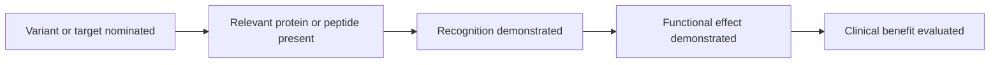

# Verification and feedback loops

**You will be able to:** Distinguish evidence for target presence, immune recognition, laboratory killing and patient benefit.

Different tests check different links in a biological chain. Agreement is useful only after we name what each test actually measured. A sequence prediction, a mass-spectrometry result, a cell-killing experiment and a PET signal are not four versions of the same measurement.

**Before starting:** [HLA](/wiki/education/concepts/immunology/antigen-presentation/hla), [modeling tumor response](/wiki/education/modeling-tumor-response/index) and [prognostic versus predictive biomarkers](/wiki/education/concepts/evidence-and-statistics/biomarkers/prognostic-vs-predictive).

## Follow the claim through the chain

*Each arrow needs evidence. Failure to detect a signal can also reflect the test's limitations.*

| Test | Supports | Does not establish alone |
|---|---|---|
| DNA or RNA sequencing | A variant or transcript in the sampled material | Surface protein abundance or immune recognition |
| Immunohistochemistry or protein assays | Protein signal in a defined specimen and compartment | Safe targeting across all normal tissues |
| Immunopeptidomics | Detection of selected peptides displayed on HLA (human leukocyte antigen) | Recognition by an effective T cell or completeness of the peptide list |
| T-cell binding, activation and killing assays | Different steps in a functional immune response | Benefit or acceptable toxicity in a person |
| Ex vivo drug testing | An effect under the assay's conditions | A validated patient-level ranking of treatments |
| Target-specific PET | Tracer uptake across detectable locations | A direct count of target molecules or the therapeutic dose delivered |
| Clinical trial | Outcomes for a population under a specified comparison | Certainty about an individual's outcome |

## Detection is not an exhaustive census

Mass spectrometry has sampling, abundance and identification limits. A peptide absent from its results may be genuinely absent or below detection. A low fraction of computational candidates detected by mass spectrometry cannot be translated directly into the fraction of all predictions that are biologically wrong.

Conversely, detecting a displayed peptide does not prove immunogenicity. T-cell receptors recognize a peptide–HLA combination, and relevant T cells must recognize, activate and kill. Specificity testing also matters: an engineered receptor can react with another peptide or tissue.

## An immune assay needs immune controls

Anti-PD-1 treatment acts through immune interactions. A tumor-only viability or mass-response score is insufficient to rank pembrolizumab versus another checkpoint inhibitor. An assay intended to compare them needs characterized immune populations, an interpretable endpoint, controls and independent validation for that intended use.

A single person's response after several therapies cannot identify the contribution of one treatment or validate an assay's clinical utility. [Confounding and predictive claims](/wiki/education/concepts/evidence-and-statistics/biomarkers/prognostic-vs-predictive) explain the distinction.

## What granzyme-B imaging can add

Granzyme B participates in cytotoxic immune responses from T cells and natural killer cells. Research PET tracers can provide a spatial readout related to this biology. The original experiments demonstrated response-associated imaging signals in tumor models; that is not a universally validated treatment-selection test.

Uptake depends on tracer design, delivery, timing and clearance. A bright location is not a direct measurement of how many cancer cells were killed. A negative scan does not exclude all immune activity. Tracers for a target protein, granzyme B and glucose metabolism answer different questions.

## Design a useful feedback loop

Write down the prediction before obtaining the outcome. Fix the intended use, threshold, time window and comparator. Record failed or uninterpretable tests as well as successes. Validate on independent patients rather than changing the prediction until it fits the observed result.

For monitoring, pair molecular measurements with clinical assessment and appropriate imaging. A falling ctDNA (circulating tumor DNA) result may support response; it does not prove that a specific clone was eradicated or that an unmeasured lesion disappeared.

## Try it

A peptide is predicted to bind HLA, detected by mass spectrometry and associated with an expanded T-cell clone. Which claim remains untested?

**Explain it back:** Direct antigen-specific recognition and killing may still be untested, as are patient benefit and safety. Clonal expansion alone does not identify what the clone recognizes.

## Explain it back

Verification should test the next biological claim, then separately establish whether acting on the result helps patients.

## Takeaway

**Verification should test the next biological claim, then separately establish whether acting on the result helps patients.**

## Sources

Checked October 8, 2026.

- [Neal et al., immune organoid experiments](https://pubmed.ncbi.nlm.nih.gov/30550791/).
- [Larimer et al., granzyme-B PET experiments](https://pmc.ncbi.nlm.nih.gov/articles/PMC5474226/) — preclinical imaging and translational observations.
- [Dijkstra et al., functional tumor–lymphocyte co-cultures](https://pubmed.ncbi.nlm.nih.gov/30100188/).
- [TCR cross-reactivity experiments](https://pubmed.ncbi.nlm.nih.gov/17559580/) — one receptor can recognize multiple peptide ligands.
