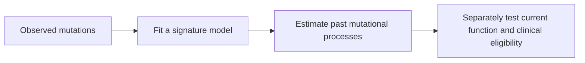

# DNA — the blueprint

DNA sequencing examines the stored sequence of the tested cells. Tumor analysis asks which changes are acquired, how many copies of each region remain, and how confidently those findings describe the cancer-cell population.

Start with [[wiki/education/multi-omics-foundations/04-copies-alleles-and-clones|Copies, alleles, and clones]] for allele, haplotype, LOH, purity, ploidy, VAF (variant allele fraction), and CCF. Use [[wiki/education/multi-omics-foundations/05-splicing-and-dna-repair|Splicing and DNA repair]] to decode BRCA1 and TP53 splice notation.

## The main classes of DNA change

| Class | What changed | What it does not establish alone |
|---|---|---|
| **SNV** | One DNA base | A damaging protein effect, driver role, or treatment response |
| **Indel** | A small insertion or deletion | A frameshift; that depends on location and coding-frame consequences |
| **Copy-number alteration (CNA/CNV)** | Number of copies of a DNA region | Which amplified gene matters or whether it is expressed |
| **Structural variant (SV)** | Arrangement of DNA segments | An expressed fusion RNA or fusion protein |
| **Mutational signature** | A statistical pattern across many mutations | A unique cause or a measured current functional state |

A **driver** contributes to cancer development or maintenance; a **passenger** accompanies the tumor without an established driving role. A predicted damaging variant is not automatically a driver. Calling a gene a driver also differs from proving a drug-sensitive dependency.

## WES, WGS, and targeted panels

| Method | Main coverage | Important limits |
|---|---|---|
| **WES — whole-exome sequencing** | Selected exonic regions, often including nearby splice boundaries | Coverage varies; many intronic rearrangements and noncoding regions are missed |
| **WGS — whole-genome sequencing** | Broader coding and noncoding sequence | Broad coverage does not mean every base or variant is detectable; depth, mapping, and analysis matter |
| **Targeted panel** | A predefined set of regions | Narrower scope, but often deeper coverage and a validated clinical workflow for its intended uses |

WGS and WES offer broader discovery. They are not automatically a strict analytical or clinical substitute for every targeted test. Clinical reporting, variant classes, sensitivity, and companion-diagnostic requirements differ. Choosing a method requires the actual question and assay specification.

**Depth / coverage** describes observations at a position or the fraction of a region adequately observed. Average depth does not guarantee coverage at every site. **Mapping** aligns short sequence reads to a reference; repeated or similar regions can create misleading alignments.

## Somatic and germline

**Germline** changes can be inherited. **Somatic** changes are acquired in a cell lineage. A tumor biopsy includes normal cells, so its DNA signal is a mixture.

A **matched-normal** sample provides that person's non-tumor baseline. It helps identify somatic candidates and inherited variants; a clinical germline panel has its own tested regions, variant classes, quality standards, and reporting rules. Some tumor assays use tumor-only analysis, so matched-normal sequencing is a design choice rather than a universal feature.

Clinical germline and tumor testing answer different questions. A research cross-check does not replace a clinical hereditary report.

## Copies, clones, and confidence

An allele-specific model estimates copy numbers from the two parental chromosome sides. **LOH** is loss of one distinguishable inherited version; total copy number can fall or remain unchanged. **Phasing** asks which chromosome copy carries a variant. **Biallelic inactivation** asks whether both functional gene copies are disabled in the relevant cells.

**VAF** is the fraction of reads carrying a variant. **CCF** estimates the fraction of cancer cells carrying it. Purity and copy number connect those quantities; one cannot be substituted for the other. A **subclone** is a genetically distinct branch within the sampled cancer population. See [[wiki/education/multi-omics-foundations/04-copies-alleles-and-clones|the worked VAF example]].

**PASS** is a software filter result. **Consensus** describes agreement under a stated calling rule. Neither automatically means the variant is real or clinically validated. Independent supporting fragments, matched-normal evidence, positive controls, mapping review, and reproducibility strengthen the call. See [[wiki/education/multi-omics-foundations/07-comparisons-and-evidence|the evidence checklist]].

## Mutational signatures and HRD scars

*An HRD (homologous recombination deficiency)-associated pattern records evidence about past processes; it is not a treatment-selection result.*

A signature estimates patterns in a mutation set. **SBS3** is associated with homologous-recombination deficiency, but its fit depends on mutation selection and analysis. Chromosome-scale **HRD scars** commonly combine LOH regions, telomeric allelic imbalance, and large-scale transitions under a specified method.

A genomic-scar fit can change with purity and ploidy assumptions. Scars describe accumulated history and do not establish current repair failure or guaranteed drug response.

Continue to [[wiki/education/molecular-profiling/hrd-parp-and-dianas-biology|HRD and PARP]] for mechanism and clinical interpretation.

## What follows a DNA finding

| DNA result | Next question |
|---|---|
| A candidate mutation | Is it authentic, acquired, and in the relevant cancer cells? |
| A splice-site variant | What RNA products are actually made? |
| A copy-number gain | Which genes are expressed, and what function matters? |
| A structural rearrangement | Is there a reproducible RNA junction and relevant protein product? |
| A possible neoantigen source | Is it expressed, processed, presented, and recognized? |
| A repair scar | Is the corresponding repair defect still present? |

**Say it back:** “DNA identifies sequence and copy changes. RNA, protein, and functional evidence test the consequences.”

Next: [[wiki/education/molecular-profiling/02-rna-the-activity-layer|RNA]]. For current patient results, use [[wiki/care/molecular-profile|Molecular profile]]; for repeated blood measurements, use [[wiki/education/molecular-profiling/06-ctdna-and-mrd|ctDNA and MRD]].

**Vocabulary:** ctDNA means circulating tumor DNA.

**Vocabulary:** MRD means molecular residual disease.

## Sources

- [NHGRI: genetic and genomic definitions](https://www.genome.gov/genetics-glossary)
- [[sources/research/syntheses/10-04-diana-multiomic-review/index|October 4 report collection]]
- [[sources/research/syntheses/10-04-diana-multiomic-review/analysis|Findings and qualifications]]
- [[wiki/education/multi-omics-foundations/index|Foundations and supporting scientific sources]]

## Try it

An assay reports a striking value. Which sample, measurement method and comparator do you need before interpreting it?

**Answer:** Identify the sampled cells, assay definition and reference group before moving from the number to a biological or treatment claim.

## Explain it back

The meaning of a measurement depends on its sample, method and comparison.

## Takeaway

**The meaning of a measurement depends on its sample, method and comparison.**

## Applied to Diana

[[wiki/care/molecular-profile|The molecular profile]] owns current DNA/RNA interpretations.
