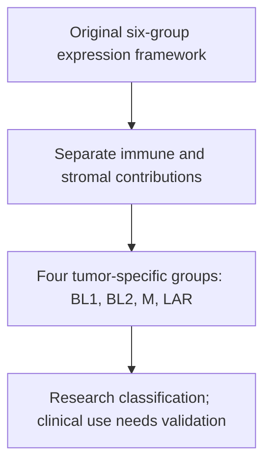

# RNA — the activity layer

RNA measurements show which messages were captured from the tested material. They can reveal gene expression, transcript processing, and cell-state patterns that DNA sequence alone cannot describe. Their interpretation depends on cell composition, preparation, and comparison.

Start with [[wiki/education/multi-omics-foundations/03-reading-rna-counts|Reading RNA counts]] for nuclei, UMIs, ambient RNA, pseudobulk, and normalization. Use [[wiki/education/multi-omics-foundations/02-cell-identity-and-state|Cell identity and state]] for epithelial, luminal, basal, and subtype vocabulary.

## What RNA adds

| Question | RNA evidence | Limit |
|---|---|---|
| Is a gene expressed? | Captured transcript abundance | Absence of detection may reflect sampling; abundance does not prove protein |
| Is the mutant sequence expressed? | Variant-supporting RNA molecules | Gene-level expression alone does not identify the mutant allele |
| Does a splice variant alter processing? | Junctions, exon skipping, or alternative splice-site use | The protein product and current function still need evaluation |
| Which cells supply a signal? | Single-cell/nucleus profiles or computational deconvolution | Cell labels and estimates depend on assumptions and data quality |
| What program do cells resemble? | Expression classifier or gene-module score | A resemblance is different from proven lineage, pathway activity, or drug dependence |

## Bulk RNA-seq — one mixed profile

Bulk RNA-seq measures RNA extracted from a tissue piece. It is a combined signal, not a simple equal-weight average of its cells. Malignant cells, normal epithelial cells, fibroblasts, and immune cells contribute different amounts of RNA.

Capture-based libraries and poly-A-selected references can have gene-specific recovery differences. A global scaling adjustment does not remove every capture bias. Compare compatible preparations before ranking targets or pathways.

A high immune-gene signal may come from immune cells. A high epithelial-gene signal may come from normal luminal cells as well as cancer. The next question is therefore **who expressed it?**

## Subtypes and cell programs

*The 2016 refinement illustrates how tissue composition can affect subtype labels.*

**PAM50** classifies tumor expression profiles into intrinsic subtypes. **TNBC** is defined by clinical receptor tests. **Luminal-progenitor-like** describes resemblance to a normal-cell expression program. These categories can coexist and should not substitute for each other.

The original Lehmann TNBC framework had six expression subtypes. The 2016 refinement identified immune and stromal contributions to the IM and MSL groups and defined four tumor-specific subtypes: BL1, BL2, M, and LAR. This is a concrete example of why cell composition matters. Neither a subtype name nor a pathway RNA score independently establishes a treatment response. [Lehmann et al., primary refinement study](https://pubmed.ncbi.nlm.nih.gov/27310713/)

**TmS**, a tumor-related mRNA expression score, and other research classifiers summarize selected aspects of the sample. They are not direct measurements of tumor-cell count, immune-cell access, or treatment benefit. Use the assay's own method, reference, and validation context.

## Single cells and single nuclei

Single-cell RNA sequencing (scRNA-seq) assigns captured RNA to individual cells; single-nucleus RNA sequencing (snRNA-seq) assigns it to nuclei. Nuclear profiles include unfinished, intron-containing RNA and should not be compared uncritically with whole-cell profiles. [10x: intronic reads](https://www.10xgenomics.com/support/software/cell-ranger/8.0/miscellaneous/cr-intron-mode-rec)

Cells are grouped using measured profiles, markers, and reference data. Copy-number patterns or tumor-specific variants can add evidence for malignancy. An epithelial marker alone cannot separate normal from malignant cells.

**Ambient RNA** and **doublets** can mix signals. A small or contaminated normal-cell comparator can make a tumor-versus-normal comparison inconclusive; absence of demonstrated enrichment does not prove identical expression.

## Preparation is part of the measurement

A **library** is the prepared material sequenced by an assay. Whole-transcriptome capture, poly-A selection, and probe-based methods recover different information. **FFPE** means formalin-fixed, paraffin-embedded tissue; fixation affects RNA quality. Suitability is assay-specific, so a universal “RIN below 7 means unusable” rule is inappropriate. Modern probe-based single-cell methods can use fixed and FFPE material; this is different from conventional live-cell workflows. [10x: fixed and FFPE preparation](https://www.10xgenomics.com/blog/planning-your-single-cell-experiment-with-flex-faqs-for-fresh-frozen-and-ffpe-samples)

## What can be carried forward

RNA can nominate expressed candidate targets, support splice mechanisms, and describe measured cell programs. Protein abundance, membrane location, functional dependence, antigen presentation, and clinical eligibility remain distinct steps.

**Say it back:** “The RNA signal is useful, but I want to know which cells supplied it, how the library was prepared, and whether the proposed protein or function was measured.”

Continue to [[wiki/education/molecular-profiling/03-protein-expression-and-activation|protein]], [[wiki/education/multi-omics-foundations/05-splicing-and-dna-repair|splicing]], or [[wiki/education/multi-omics-foundations/07-comparisons-and-evidence|the comparison checklist]].

## Try it

An assay reports a striking value. Which sample, measurement method and comparator do you need before interpreting it?

**Answer:** Identify the sampled cells, assay definition and reference group before moving from the number to a biological or treatment claim.

## Explain it back

The meaning of a measurement depends on its sample, method and comparison.

## Takeaway

**The meaning of a measurement depends on its sample, method and comparison.**

## Applied to Diana

[[wiki/care/molecular-profile|The molecular profile]] owns current integrated findings.

## Sources and scope

General RNA-assay teaching; expert and learner review pending.

- [10x Flex preparation and assay scope](https://www.10xgenomics.com/blog/planning-your-single-cell-experiment-with-flex-faqs-for-fresh-frozen-and-ffpe-samples).
- [[wiki/education/multi-omics-foundations/03-reading-rna-counts|RNA-count methods and sources]].
