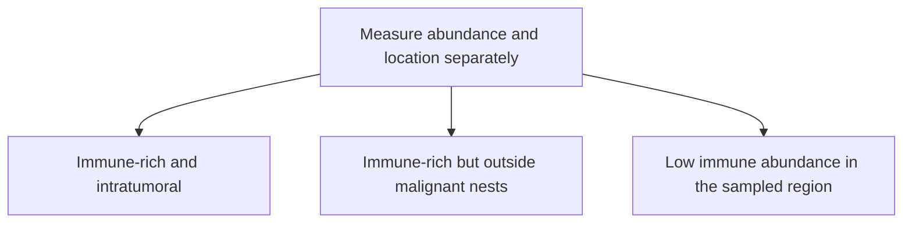

# Spatial biology: where are the cells?

**Spatial measurements preserve location so we can distinguish who is present from who reaches the tumor.** Bulk measurements blend contributions from different cells and regions.

**Before you start:** [[wiki/education/multi-omics-foundations/01-epithelial-and-breast-tissue|Tissue contains cancer and normal neighbors]]. [[wiki/education/concepts/immunology/antigen-presentation/hla|HLA]] describes peptide display. [[wiki/education/concepts/evidence-and-statistics/biomarkers/prognostic-vs-predictive|Biomarker evidence]] separates association from treatment selection.

## Count and geography are different axes

An inflamed region contains immune cells among malignant cells. An excluded region has immune cells concentrated in surrounding stroma or at a boundary. A desert region has few relevant immune cells. These are useful patterns, not three exhaustive permanent categories for every tumor.

*The first two can have similar bulk abundance; a genuine desert need not have that same abundance.*

The earlier image and diagram asserted an identical “20% T cells” for all three patterns and assigned guaranteed checkpoint outcomes. They have been replaced. Location can add information, but no pattern alone proves that pembrolizumab will work or that a stromal therapy should be added.

## Which methods answer which question?

| Method | Measured quantity | Main limit |
|---|---|---|
| H&E review and stromal TIL score | Fraction of evaluated tumor-associated stromal area occupied by mononuclear inflammatory cells | Does not type every lymphocyte or establish tumor specificity |
| Immunohistochemistry | Protein staining with morphology | Marker, localization, scoring and controls matter |
| Multiplex immunofluorescence | Several protein markers with coordinates | Segmentation, marker quality and phenotype definitions can introduce errors |
| Spatial RNA assay | Captured transcripts assigned to locations | Resolution and coverage are platform-specific; assignment may include modeling |
| Computational inference from an image | Predicted feature under a trained model | A prediction is different from measuring that molecular feature |

A stromal tumor-infiltrating lymphocyte (sTIL) score uses a stromal-area denominator. It is not the fraction of all tumor cells that are CD8 T cells. H&E cannot alone distinguish all functional subtypes. A marker-positive population also need not be tumor-reactive.

## Resolution is not one number

A spot-based measurement can combine several cells. Imaging-based transcript methods may localize individual molecules, then assign them to cells through segmentation. More precise coordinates do not guarantee correct cell boundaries, complete detection or a clinically useful report.

Ask whether layers are measured on the same physical section or adjacent sections. Neighboring sections are similar, not identical. Preserve the sampled region, treatment time, tumor mask, units and segmentation uncertainty. Dissociation-based single-cell data can describe states while losing the original geography.

## A worked interpretation

A bulk specimen has substantial immune RNA. Spatial staining finds most CD8 cells outside malignant nests. These findings can agree: immune cells are present, but location matters. The next question is whether a validated comparison links that pattern to the intended outcome. It does not establish that adding anti-CTLA-4, ablation, antihistamines or FAP-targeted treatment improves benefit.

HLA (human leukocyte antigen) staining can show tumor-cell localization and patchiness; DNA analysis addresses allele loss. Protein expression and genomic loss are different quantities. Both may help investigate a hypothesis, but neither establishes a complete vaccine-selection rule.

## Try it

A model infers a high spatial RNA value from H&E. Can the report call it a measured transcript count?

**Answer:** No. Label it a model prediction and retain its validation scope. Direct assay counts are another evidence layer.

**Explain it back:** “Abundance says how much; spatial analysis says where; function and clinical utility need further evidence.”

## Explain it back

Location adds context without becoming an automatic treatment instruction.

## Takeaway

**Location adds context without becoming an automatic treatment instruction.**

**Next:** [[wiki/education/molecular-profiling/05-functional-drug-response|Functional drug response]]. The concise immune-pattern reference is [[wiki/education/reading-a-tumor/immune-hot-vs-cold|hot, excluded and cold]].

## Sources and scope

General assay teaching, source-checked October 8, 2026; expert and learner review pending.

- [International TILs Working Group scoring recommendations](https://pubmed.ncbi.nlm.nih.gov/25214542/).
- [[sources/research/papers/biorxiv/mukund-2025-spatially-distinct-cellular-molecular/mukund-2025-spatially-distinct-cellular-molecular-analysis|Spatial TNBC research, labeled preprint]].
- [[sources/research/papers/bilous-2026-xenium-split/bilous-2026-xenium-split-analysis|Spatial transcript assignment and segmentation limitations]].
