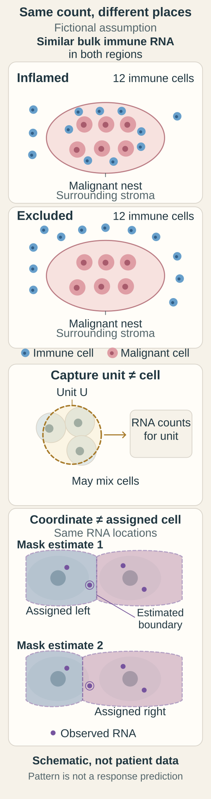

# Add the geography of cells and signals

**Spatial methods keep location attached to a measurement. They help show which cells and neighbors supplied a signal.**

**Before you start:** [[wiki/education/concepts/measurement/pathology-readouts/immunohistochemistry|Immunohistochemistry (IHC)]] preserves tissue location. [[wiki/education/concepts/measurement/pathology-readouts/stil-scoring|Stromal tumor-infiltrating lymphocyte (TIL) scoring]] defines the denominator. [[wiki/education/concepts/cancer-biology/what-cancer-is/tumor-heterogeneity|Heterogeneity]] explains regional differences. [[wiki/education/concepts/immunology/the-immune-system/immune-cell-roster|Immune-cell families]] identifies the neighbors.

## Where this step sits

This is step 12 of [[wiki/education/reading-a-tumor/omics-and-multi-omics|Understand multi-omics]]. A head count and a seating chart describe different features of the same room. Tissue measurements also need both abundance and geography. Lots of immune cells nearby do not establish that they enter the malignant nests.

## A map can answer a new question

An **inflamed** pattern has relevant immune cells among malignant cells. An **excluded** pattern has them concentrated at a boundary or surrounding stroma. A **desert** pattern has few relevant immune cells in the assessed region. These are useful descriptions, rather than exhaustive permanent labels.

An inflamed and an excluded region can have similar total immune abundance. A desert need not have that same abundance. No one pattern alone establishes that a checkpoint inhibitor will work or that another treatment should be added.

| Method | What it measures | Main interpretation issue |
|---|---|---|
| Hematoxylin and eosin (H&E) microscopy | Morphology and eligible stromal inflammatory-cell area | Does not identify every functional immune subtype |
| IHC | Selected proteins with tissue location | Antibody, scoring and cell assignment |
| Multiplex immunofluorescence | Several protein markers with coordinates | Marker quality and segmentation |
| [Spatial transcriptomics](/wiki/education/concepts/measurement/proteins-and-spatial/spatial-transcriptomics) | Captured or imaged RNA evidence at locations | Platform-specific target coverage, capture unit and resolution |
| Model inferred from an image | A predicted feature | Validation of the prediction in the intended population |

**Segmentation** assigns image regions to cells or structures. If boundaries are wrong, messages or stains can be assigned to the wrong neighbor. High coordinate precision does not guarantee a correct cell boundary.

## Resolution, section and region all matter

Sequencing-based spatial assays attach positions to captured RNA evidence. Imaging-based methods localize selected RNA targets by repeated imaging. A “spatial” label does not specify which method was used. Some capture units include several cells; assigning molecules to segmented cells adds another analysis step. Keep observed and imputed values distinct.

Two methods can use the same section, adjacent sections or different blocks. Adjacent sections are similar but not identical. A small region can miss a relevant nest or immune pocket. Tissue orientation, sampling and treatment timing must remain attached to the map.

Dissociated cell profiles can describe states while losing original geography. A reference model may suggest where those states belong, but modeled placement is a different claim from direct localization.

## A worked apparent contradiction

A fictional specimen has strong immune RNA. Spatial staining places most relevant T cells outside malignant nests. These findings can agree. The bulk profile says the cells contributed messages; the map says where many cells sat.

<em>These fictional regions assume similar bulk immune RNA independently of their equal illustrative cell counts; equal counts do not guarantee equal RNA. Capture units and estimated cell masks are different from observed RNA locations. These examples are not a patient map, an sTIL score or a treatment-response prediction.</em>

The next question might concern access, target presentation or clinical association. It should not become an automatic instruction to add a stromal treatment. A location finding gives a biological question, while benefit needs the corresponding evidence.

In another region, a protein signal appears mainly in vessels. Localization changes its interpretation as a tumor-cell delivery target. It does not erase the earlier bulk measurement; it tells us whose protein we measured.

## What can go wrong at this step

- Converting an sTIL score into a CD8-cell percentage.
- Calling image-inferred RNA a measured transcript count.
- Treating adjacent sections as exactly the same cells.
- Reading a pattern label as a treatment-response guarantee.
- Ignoring an uncertain malignant-cell mask.

## Try it

A machine-learning model predicts a high gene value from H&E. Can its report call that a direct RNA measurement?

**Answer:** No. It is a model prediction. State its training, validation and uncertainty, then distinguish it from an actual molecular assay.

## Explain it back

“Abundance tells me ______; spatial analysis tells me ______; a model adds ______.”

One answer: “how much was measured; where it was measured or assigned; an inference whose validation must be stated.”

## Takeaway

**A tissue map adds context while preserving the difference between observation, assignment and prediction.**

**Next:** [[wiki/education/molecular-profiling/05-functional-drug-response|Test a mechanism in a living model]].

## Sources and scope

Source check: October 9, 2026. The examples are fictional and teach interpretation rather than a treatment choice. Expert and learner review remain pending.

- [Salgado et al., stromal TIL-scoring recommendations](https://pubmed.ncbi.nlm.nih.gov/25214542/).
- [Kumar et al., primary spatial human breast atlas](https://www.nature.com/articles/s41586-023-06252-9).
- [Single-cell morphological and topological breast-cancer atlas](https://www.nature.com/articles/s41467-023-42504-y).
