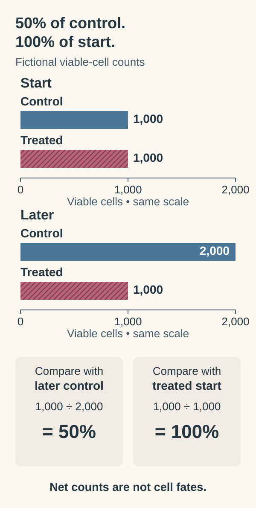

# Test a mechanism in a living model

**A functional experiment changes something and observes the response. Its meaning depends on what the model preserves and what it leaves out.**

**Before you start:** [[wiki/education/concepts/cancer-biology/what-cancer-is/oncogene-and-tumor-suppressor|Cancer-driving gene roles]] separates activation and loss. [[wiki/education/concepts/cancer-biology/what-cancer-is/tumor-heterogeneity|Heterogeneity]] explains what culture can select. [[wiki/education/concepts/evidence-and-statistics/biomarkers/actionability|Actionability]] keeps a model result separate from clinical benefit.

## Where this step sits

This is step 13 of [[wiki/education/reading-a-tumor/omics-and-multi-omics|Understand multi-omics]]. A parts list can suggest how a machine works. Changing one part tests that suggestion. A [controlled perturbation](/wiki/education/concepts/evidence-and-statistics/study-design/perturbation-and-controls) changes a defined factor and compares its response with explanatory controls. Living models can test such changes with a drug. The model must contain the components the question requires.

## Match the model to the question

An [organoid](/wiki/education/concepts/measurement/functional-models/organoid) is a three-dimensional culture that self-organizes to reproduce selected tissue features. Its current composition matters more than its name.

| Model | What researchers do | Useful feature | Main limitation |
|---|---|---|---|
| Dissociated cells or [cell lines](/wiki/education/concepts/measurement/functional-models/cell-lines) | Separate cells or maintain a selected population, then perturb them | Controlled cell measurements | Tissue interactions and population selection change |
| Organoids or spheroids | Grow cells in three dimensions | Some organization and cell diversity | Culture selects populations; immune components vary |
| [Ex vivo tumor fragments](/wiki/education/concepts/measurement/functional-models/ex-vivo-tumor-fragments) | Test pieces of the sampled tissue | Some original neighbors and structure | Viability, attribution and penetration vary |
| Patient-derived xenograft (PDX) | Grow human tumor in an animal | Whole-animal exposure and many tumor features | Host biology differs; conventional models lack an intact human immune system |

An organoid is not a promise of complete biology. A tumor-only culture cannot reproduce an immune medicine's full mechanism. Specialized [co-cultures](/wiki/education/concepts/measurement/functional-models/co-culture) or other methods can add selected immune cells. Ask which cells are present, where they came from and what endpoint was actually measured.

A PDX drug experiment is **in vivo**, inside a living animal. A culture removed from a tumor is tested **ex vivo**, outside its original organism. Growing an animal-derived organoid in a dish does not make that dish experiment in vivo.

## Design the comparison before reading the score

Bring development donor D0 from the [model-selection board](/wiki/education/modeling-tumor-response/index) into MODEL-PRACTICE-01. Its tumor-only organoid is chosen for drug A's proposed direct repair effect. Every condition and number below is invented.

| Worksheet field | Completed plan |
|---|---|
| Biological unit | One donor and one characterized preparation; verify malignant identity and retained populations |
| Replicate unit | Three wells per condition; retain each well's value and layout |
| Exposure | Drug A at 0.1, 0.3 and 1 micromoles per liter for 48 hours; matched carrier and handling |
| Primary measurement | Viable tumor-cell count at the start and 48 hours, with calibrated counting and tumor attribution |
| Controls | Vehicle without A; a positive control with a prespecified response; a target perturbation or rescue to examine mechanism |
| Missing components | No detected immune cells, full human metabolism or healthy-organ toxicity measurement |

Vehicle controls separate the carrier from A. Positive controls check that the system can produce the expected measured response. Mechanism controls help distinguish target-related effects from nonspecific injury. Document their results; this worksheet's illustrative counts alone do not show that every control passed.

Three wells estimate variation within this preparation. They remain **one donor**, not three independent people. Genetic loss and drug exposure are different interventions. A dish exposure may be unachievable safely in a person.

Some tests ask narrower questions. [BH3 profiling](/wiki/education/concepts/measurement/functional-models/bh3-profiling) probes mitochondrial readiness for apoptosis under stated conditions; it does not measure whole-drug benefit.

The diagram uses illustrative **per-well** counts, not totals across three wells. The later worksheet summarizes replicate wells by their medians.

## Compare with the starting cells as well as the control

Imagine a fictional experiment begins with 1,000 viable cells in each condition. Later, the vehicle control contains 2,000 cells and the treated condition contains 1,000. The treated count is half the control, yet it is unchanged from the start.

Half the later control can equal the full starting count. These fictional counts show no net increase under treatment, not 50% cell killing; division and death still need separate measurements.

[Reduction is not regression](/wiki/education/concepts/evidence-and-statistics/reasoning-tools/reduction-is-not-regression): that endpoint does not show that half the original cells died. It shows no net increase under treatment. Reduced division is one possible explanation; division balanced by cell death is another. Measuring the start and following the time course helps separate those possibilities. Growth-rate methods address this control-growth problem under their stated assumptions. [Hafner et al., 2016](https://pmc.ncbi.nlm.nih.gov/articles/PMC4887336/).

[Apoptosis and its B-cell lymphoma 2 (BCL-2) family control](/wiki/education/concepts/cancer-biology/cell-death-and-survival/apoptosis-and-bcl2-family), [necrosis](/wiki/education/concepts/cancer-biology/cell-death-and-survival/necrosis) and [senescence](/wiki/education/concepts/cancer-biology/cell-death-and-survival/senescence) also need different evidence. A lower endpoint signal cannot assign a death mechanism or establish senescence. Combine suitable viability, division and cell-state measurements with controls. A single marker should not carry the whole interpretation.

**Try the denominator:** In that fictional experiment, does “50% of control” mean “50% cell killing”?

**Answer:** No. The reference is the later growing control. The treated population remained at its starting size, and the underlying division and death processes still need measurement.

## A worked repair experiment

D0's proposed repair mechanism has assumed supporting [deoxyribonucleic acid (DNA) and ribonucleic acid (RNA)](/wiki/education/concepts/biology-basics/genetics/central-dogma) and protein evidence. [Genetic dependency mapping](/wiki/education/concepts/measurement/functional-models/dependency-mapping-crispr) could test a related genetic intervention. These premises establish no patient mechanism or treatment.

Here are invented illustrative summaries at the middle exposure, 0.3 micromoles per liter. Counts are the medians of three wells; mass and metabolic measurements use matched parallel aliquots, not tracked original-cell lineages.

| Quantity | Start, both groups | Vehicle at 48 hours | Treated at 48 hours |
|---|---|---|---|
| Viable tumor-cell count per well | 1,000 | 2,000 | 1,000 |
| Mean buoyant mass | 20 picograms per measured cell | 21 | 16 |
| Metabolic signal | 100 arbitrary units | 190 | 70 |

[Single-cell mass assays](/wiki/education/concepts/measurement/functional-models/single-cell-mass-assays) measure a cell relative to displaced fluid. Buoyant mass depends on cell volume and cell-versus-fluid density. It is not a counted living-cell fraction. This is a population mean, not same-cell growth or dry mass. Density, fluid conditions and cell selection matter. Keep calibration, fluid and identified cell population with the measurement. [Godin et al., 2010](https://pmc.ncbi.nlm.nih.gov/articles/PMC2862099/).

**Resolve the disagreement:** Do these measurements establish 50%, 20% or 63.2% killing?

**Answer:** None does. The count is 50% of later control and 100% of treated start. Mean mass is 80% of its starting value; the metabolic signal is 36.8% of later control. Those are three different quantities and denominators. Raw well variation, independent division/death measurements and cell attribution are needed; a metabolic readout called “viability” is not automatically a live-cell count.

A controlled response can support a laboratory hypothesis without establishing achievable exposure or patient benefit. Two immune-class drugs scoring differently in one well likewise do not establish superiority or justify a regimen switch. Carry D0's measurement definitions, rather than a ranked drug list, into the [locked evaluation packet](/wiki/education/modeling-tumor-response/verification-and-feedback-loops).

## Ask how models that failed were counted

A study may report agreement only among models that successfully grew. The failed specimens matter too: they may differ systematically. A reported agreement rate should keep its population, model-establishment rule, endpoint and prospective or retrospective design attached.

Agreement with past outcomes is useful validation. Demonstrating that model-guided decisions improve outcomes is a further question, requiring an appropriate clinical study. Neither the word “personalized” nor a ranked drug list supplies that evidence.

## What can go wrong at this step

- Missing the immune cells needed for the treatment's mechanism.
- Culture selecting an easier-growing subset of clones.
- Using unrealistic exposure or an ambiguous viability endpoint.
- Excluding failed cultures from a flattering headline without disclosure.
- Turning a model effect into an approved indication.

## Try it

A tumor-only organoid does not respond to a checkpoint-blocking antibody. Has the experiment proved that the patient's immune system cannot respond?

**Answer:** No. The model may omit the required immune components. Even a more suitable co-culture still needs controls and clinical validation.

## Explain it back

“The model responded under ______. To connect that with patient benefit, I need ______.”

One answer: “defined cells, exposure and readout; model relevance, reproducibility, achievable exposure and clinical evidence.”

## Takeaway

**A controlled model response tests a mechanism within the model's scope; translation is the next evidence question.**

**Next:** [[wiki/education/molecular-profiling/06-ctdna-and-mrd|Read blood measurements as a time series]].

## Sources and scope

Source check: October 11, 2026. The examples are fictional and teach interpretation rather than a treatment choice. Expert and learner review remain pending.

The starting-count exercise and cell-fate links were source-checked October 10, 2026. This is a model-interpretation example, rather than a response prediction for a patient.

- [Neal et al., primary organoid immune-microenvironment experiment](https://doi.org/10.1016/j.cell.2018.11.021).
- [Primary breast-tumor graft study](https://pmc.ncbi.nlm.nih.gov/articles/PMC3553601/).
- [Hafner et al., 2016: growth-rate inhibition metrics](https://pmc.ncbi.nlm.nih.gov/articles/PMC4887336/) — primary simulations and cell-line experiments; control growth can confound endpoint drug-response scores.
- [[wiki/education/guides/from-variant-to-drug/07-reading-a-functional-experiment|Controls and combination experiments]].

Fresh selected Hafner starting-count/control-growth sections and Godin physical-method sections support the measurement distinctions. All worksheet values are invented. No commercial input specification, disease-wide accuracy or clinical utility is inferred.
