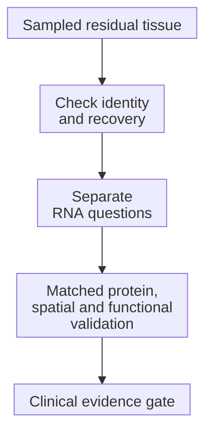
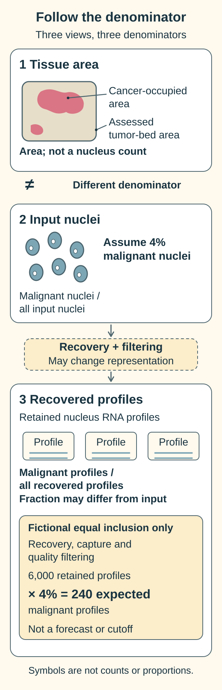

# Read single-cell data after treatment

**Cell-resolved RNA profiling can describe the sampled cells that remain after treatment. It helps choose the next validation question; it does not prove why cells survived or which treatment will work.**

**Before you start:** [Single-cell RNA sequencing (scRNA-seq) and single-nucleus RNA sequencing (snRNA-seq)](/wiki/education/concepts/measurement/transcriptomics/single-cell-and-single-nucleus-rna-seq) assign captured ribonucleic acid (RNA) messages to cells or nuclei. [Antigen-processing machinery](/wiki/education/concepts/immunology/antigen-presentation/antigen-processing-machinery) prepares fragments for immune display. [Tumor heterogeneity](/wiki/education/concepts/cancer-biology/what-cancer-is/tumor-heterogeneity) explains why cancer cells can differ.

## Where this step sits

This supplementary lesson extends [Understand multi-omics](/wiki/education/reading-a-tumor/omics-and-multi-omics) to residual tumor: cancer remaining in sampled tissue after treatment.

*Each claim needs its corresponding evidence.*

Imagine interviewing workers after a factory change. Some are unavailable. Without earlier interviews, you cannot reconstruct every change. Tissue profiling adds RNA capture biases to this sampling problem.

## Ask five questions before interpreting the map

| Question | What RNA can contribute | What still needs evidence |
|---|---|---|
| Which malignant states remain? | Programs within supported cancer-cell assignments | Reliable identity and representation |
| Is presentation machinery expressed? | Messages for processing and display components | Assembled complexes and relevant peptide display |
| Are candidate targets shared? | Distribution across recovered malignant profiles | Protein abundance and accessible surface location |
| Which immune cells and states appear? | Recovered cell types and expression programs | Tissue access, specific recognition and killing |
| Is the comparison credible? | Differences in suitably matched profiles | Recovery, quality, region, time and biological replication |

### Which malignant cell states remain?

First establish [cell identity separately from cell state](/wiki/education/multi-omics-foundations/02-cell-identity-and-state). Epithelial markers alone do not prove malignancy. Pathology, suitable normal references and tumor-associated genetic evidence can support assignment. RNA-inferred chromosome changes need corroboration and have limits.

Then compare programs within supported malignant cells. A stress or division program describes activity; it does not establish a genetic clone or a resistance mechanism. Kim and colleagues combined longitudinal RNA and deoxyribonucleic acid (DNA) measurements in chemotherapy-treated triple-negative breast cancer to investigate these distinctions. [Kim et al., 2018](https://pubmed.ncbi.nlm.nih.gov/29681456/).

### Is presentation machinery expressed?

Look within malignant profiles rather than treating immune-cell messages as tumor expression. Messages for [human leukocyte antigen (HLA)](/wiki/education/concepts/immunology/antigen-presentation/hla), [beta-2-microglobulin (B2M)](/wiki/education/concepts/immunology/antigen-presentation/b2m) and processing components can flag questions to investigate.

High RNA does not establish working machinery, surface complexes or a particular displayed peptide. Low capture does not prove a broken pathway. [Immunopeptidomics](/wiki/education/concepts/measurement/proteins-and-spatial/immunopeptidomics) adds peptide-presentation evidence, with sampling and cell-attribution limits. Tumor recognition remains another step.

### Are candidate targets shared across cancer cells?

An average can hide a target concentrated in one recovered population. Examine its distribution with sparse capture in mind. A zero count is not automatically a target-negative cell.

For a therapy requiring a surface target, follow with [protein abundance and location evidence](/wiki/education/molecular-profiling/03-protein-expression-and-activation). RNA cannot establish accessible surface density, uniform coverage or drug sensitivity. Normal-cell expression also matters when evaluating selectivity.

### What do immune presence and state establish?

Immune programs can suggest activation or suppression to investigate. Labels do not directly measure function. Dissociated profiles lose their original geography. Use [spatial evidence](/wiki/education/molecular-profiling/04-spatial-biology) to ask whether relevant cells reach cancer nests, and keep [presence, presentation and recognition](/wiki/education/multi-omics-foundations/06-immune-presence-and-recognition) separate.

### Is the tissue and comparison suitable?

Whole-cell and nuclear methods recover different compartments and populations. Tumor workflow experiments show preparation affects recovery. [Slyper et al., 2020](https://www.nature.com/articles/s41591-020-0844-1).

[Formalin-fixed, paraffin-embedded (FFPE) tissue](/wiki/education/concepts/measurement/specimens/ffpe-vs-fresh-frozen-vs-viable) needs compatible chemistry. Some fixed-material methods sequence ligated probes; their gene counts cannot supply the original transcript's variant sequence. Ask which chemistry addresses the intended question. [Official fixed-RNA documentation, version 7.2](https://www.10xgenomics.com/support/software/cell-ranger/7.2/getting-started/cr-flex-what-is-frp).

## A worked example: the denominator changes

In a **fictional arithmetic exercise**, suppose an input suspension truly contains 4% malignant nuclei. If 6,000 nuclei are recovered, the expectation is 0.04 × 6,000 = 240 malignant profiles, **only under an unrealistic equal-recovery assumption**.

A [tumor-bed cellularity percentage](/wiki/education/concepts/breast-cancer/surgery-and-pathology-results/tumor-bed-cellularity) uses assessed tissue area; it is **not** the recovered malignant-nucleus fraction. Its denominator and sampled region differ, and preparation or filtering can preferentially lose cells. The arithmetic illustrates dilution; it is not a laboratory yield forecast or adequacy threshold.

*Area, input nuclei and retained nucleus RNA profiles have different denominators. The fictional 240 expectation from 6,000 retained profiles assumes equal inclusion of malignant and other nuclei through recovery, capture and quality filtering; the recovered fraction may differ in practice. This is not a yield forecast or adequacy cutoff.*

## What can go wrong at this step

- **A missing cluster becomes “eliminated.”** Region, recovery, low counts or changed clustering can explain non-detection.
- **Background correction becomes proof.** Ambient RNA is released material captured alongside a cell's own messages. Correction can also remove real low-level signal; inspect consequential changes. [Young and Behjati, 2020](https://pmc.ncbi.nlm.nih.gov/articles/PMC7763177/).
- **Technical libraries become biological replicates.** Two libraries from one specimen remain one biological sample. Replicate-aware analysis matters. [Squair et al., 2021](https://www.nature.com/articles/s41467-021-25960-2).
- **After-treatment becomes treatment-caused.** Matched region, collection time, preservation, quality and analysis context are needed. Even a matched pair may mix selection, state change and sampling differences.

## Try it

A fictional after-treatment sample has high presentation-component RNA and many T cells. Its earlier sample used another preparation and region. What can you claim?

**Answer:** Those messages and immune profiles were recovered afterward. Working display, recognition and treatment-induced change remain unproven; inspect the comparison and choose appropriate validation.

## Explain it back

“This profile supports ______ in ______; the next measurement should test ______.”

One answer: “a candidate target's RNA in supported malignant profiles; its accessible surface protein across relevant regions.”

## Takeaway

**Use residual-tumor RNA to sharpen five questions, while keeping identity, recovery, protein display and function attached to each claim.**

**Next:** [Build an integrated claim](/wiki/education/molecular-profiling/07-from-data-to-care-plan).

## Sources and scope

Source check: October 10, 2026. Examples are fictional. This lesson teaches research interpretation, not specimen-specific feasibility or treatment selection. Expert and learner review remain pending.

- [Kim et al., chemotherapy-treated breast cancer (2018)](https://pubmed.ncbi.nlm.nih.gov/29681456/) — longitudinal research, not a universal resistance rule.
- [Slyper et al., tumor workflows (2020)](https://www.nature.com/articles/s41591-020-0844-1) — preparation and recovery.
- [Young and Behjati, SoupX (2020)](https://pmc.ncbi.nlm.nih.gov/articles/PMC7763177/) — ambient RNA correction tradeoffs.
- [Squair et al., differential-expression benchmarks (2021)](https://www.nature.com/articles/s41467-021-25960-2) — biological replication.
- [Official fixed-RNA documentation, version 7.2](https://www.10xgenomics.com/support/software/cell-ranger/7.2/getting-started/cr-flex-what-is-frp) — probe limitations, not clinical validation.
