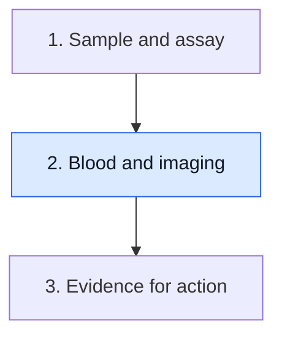
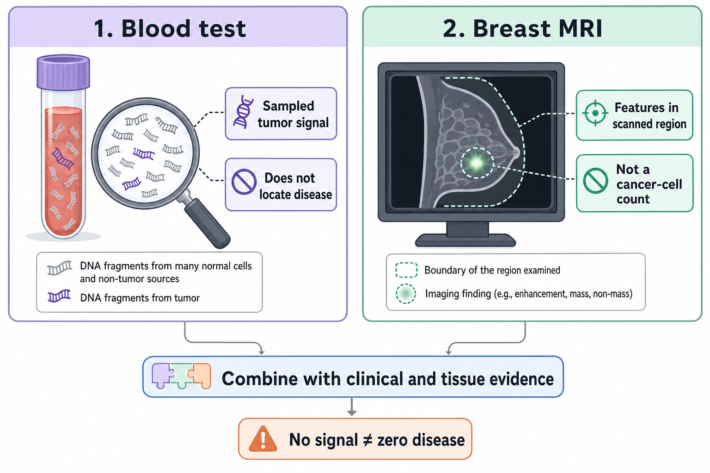

# Compare blood results with imaging

**Blood testing asks whether qualifying tumor material reached a sampled tube. Imaging asks what a scan shows in the region it examines. Different answers can coexist.**

**Before you start:** [[wiki/education/concepts/measurement/liquid-biopsy/cfdna-vs-ctdna|Circulating tumor DNA (ctDNA)]] names tumor-derived fragments. [[wiki/education/concepts/measurement/liquid-biopsy/ctdna-units|ctDNA units and detection limits]] keeps report quantities distinct. [[wiki/education/concepts/breast-cancer/surgery-and-pathology-results/pcr|Pathologic complete response (pCR)]] is a tissue finding after treatment, not a blood or scan label.

## Where this step sits

This is step 2 of [[wiki/education/guides/monitoring-residual-disease/index|Understand blood tests and imaging after treatment]]. After reading the blood report, align it with imaging and tissue evidence before making a combined claim.

## Two windows onto different evidence

*Blood and imaging observe different evidence. The green symbol is a schematic imaging finding, not an individual cell; neither window is a complete disease census.*

Imagine looking at a garden through a camera while also sampling material carried away in its stream. The camera shows a region. The sample contains material that reached the collection point. Neither is a full census.

The analogy is only about scope. Tumor DNA is not a guaranteed runoff signal, and a scan is not a direct picture of every living cancer cell. The absence of one signal cannot automatically erase evidence from the other window.

A [breast magnetic resonance imaging (MRI)](/wiki/education/concepts/measurement/imaging/breast-mri) examination shows anatomical and sequence-dependent features within its field of view. Contrast enhancement reflects how contrast behaves in tissue, including vascular properties. It can help assess a lesion, but enhancement is not a one-to-one count of viable cancer cells. A breast scan also does not answer every question about disease elsewhere.

Blood testing detects selected molecular features under an assay's rules. It may collect tumor DNA from more than one site, yet it does not tell you where the fragments originated. Low shedding and limited input can leave a real tumor without a qualifying blood signal.

## Align the clocks and questions

Before calling results concordant or discordant, compare collection and examination dates, treatment timing, regions examined and assay scope. A blood draw before treatment and a scan several weeks later are not simultaneous observations. A trend needs its own uncertainty, not only an arrow.

The [ctDNA–imaging discordance concept](/wiki/education/concepts/measurement/liquid-biopsy/ctdna-imaging-discordance) keeps the recurring interpretation rules in one place. The examples below practice applying them to particular observations.

| Pattern | What the two observations support | What they do not settle |
|---|---|---|
| Smaller measured lesion, lower detectable blood signal | Both recorded measures moved downward in their own units | Exact tumor-cell reduction, pCR or elimination of distant disease |
| Residual imaging finding, blood not detected | Imaging still shows a finding; the sample lacked a qualifying signal | Whether the finding is viable tumor, treatment change or another process |
| No suspicious finding in the scanned region, blood detected | The scan did not identify a suspicious finding there; the assay found qualifying signal | Disease location, its full extent or the best intervention |
| Neither shows qualifying evidence | Neither method identified its target under those conditions | Zero microscopic disease or permission to omit indicated treatment |

The table is an interpretation aid, not a clinical algorithm. Suspicion, confirmation and urgency depend on the full clinical context. A new finding belongs in a clinical review even if another measurement seems reassuring.

Keep the imaging method visible too. [Mammography](/wiki/education/concepts/measurement/imaging/mammography) uses X-rays, [breast ultrasound](/wiki/education/concepts/measurement/imaging/breast-ultrasound) uses sound waves, and [positron emission tomography with computed tomography (PET/CT)](/wiki/education/concepts/measurement/imaging/pet-ct) pairs tracer distribution with anatomical imaging. They do not measure one interchangeable “tumor number.” For a formal response category, read the [response criteria](/wiki/education/concepts/measurement/imaging/response-criteria), comparison timepoint and all required disease observations.

## A worked disagreement

In a fictional example, a breast lesion becomes less enhancing during treatment. A blood assay changes from detectable to not detected. Later surgery still finds residual invasive cancer.

There is no mathematical contradiction. The scan tracked imaging features, and the assay tracked molecular signal in a finite sample. Surgical pathology examined removed tissue. Only that tissue finding establishes the residual invasive disease described here.

Now change the example: blood becomes detectably positive while breast imaging has no suspicious finding. The blood result does not establish distant metastasis. Nor can a breast scan exclude all sources. Appropriate review asks about assay qualification, origin, timing and clinical evaluation; it does not assign a location from the number alone.

## Read combined studies carefully

A 2021 I-SPY2 pilot studied 84 patients with high-risk early breast cancer receiving neoadjuvant treatment. It examined serial ctDNA and MRI **functional tumor volume (FTV)**, a protocol-defined volume based on contrast-enhancement behavior. FTV is an imaging measure, rather than a direct viable-cell count. These were correlated measurements, with possible additional prognostic information from ctDNA. The study did not establish a universal formula converting a blood result into MRI volume or show that changing treatment using the pair improved survival. [Primary paper](https://doi.org/10.1038/s41523-021-00239-3).

A 2025 I-SPY2 analysis examined ctDNA with residual cancer burden in a larger high-risk cohort. It supports studying combined risk information; it does not turn a negative presurgical draw into a tissue pCR or establish a treatment-omission rule. [Primary paper](https://www.nature.com/articles/s41467-025-65432-5).

## What can go wrong at this step

- Declaring a residual scan finding dead tissue solely because blood is negative.
- Calling a positive blood result a map of disease.
- Treating less enhancement as an exact count of cancer cells killed.
- Calling discordance proof of pseudoprogression.
- Treating combined prognostic information as proven benefit from a new treatment strategy.

## Try it

A fictional scan shows a smaller lesion and the blood report says “not detected.” Which statement is best supported: “pCR is confirmed” or “these are favorable observations with different limits”?

**Answer:** The second. pCR requires the specified pathological assessment. The blood result and scan can add useful information without replacing it.

## Explain it back

“Imaging tells us ______, blood testing tells us ______, and tissue can answer ______.”

One answer: “what appears in an examined region; whether qualifying tumor material reached this sample; whether the removed tissue contains residual invasive cancer.”

## Takeaway

**Combine observations while keeping each method's question and blind spots visible.**

**Next:** [[wiki/education/guides/monitoring-residual-disease/03-ask-what-a-result-should-change|Ask what a result should change]].

## Sources and scope

Source check: October 10, 2026. Examples are fictional; this lesson does not choose a scan schedule or treatment. Expert and learner review pending.

- [Magbanua et al. 2021, MRI and ctDNA](https://doi.org/10.1038/s41523-021-00239-3) — I-SPY2 pilot; [full text at UCSF](https://escholarship.org/content/qt18n94421/qt18n94421.pdf).
- [Magbanua et al. 2025, ctDNA and residual burden](https://www.nature.com/articles/s41467-025-65432-5) — defined high-risk neoadjuvant cohort.
- [FDA 2024 ctDNA guidance](https://www.fda.gov/media/183874/download) — assay context and study design.
