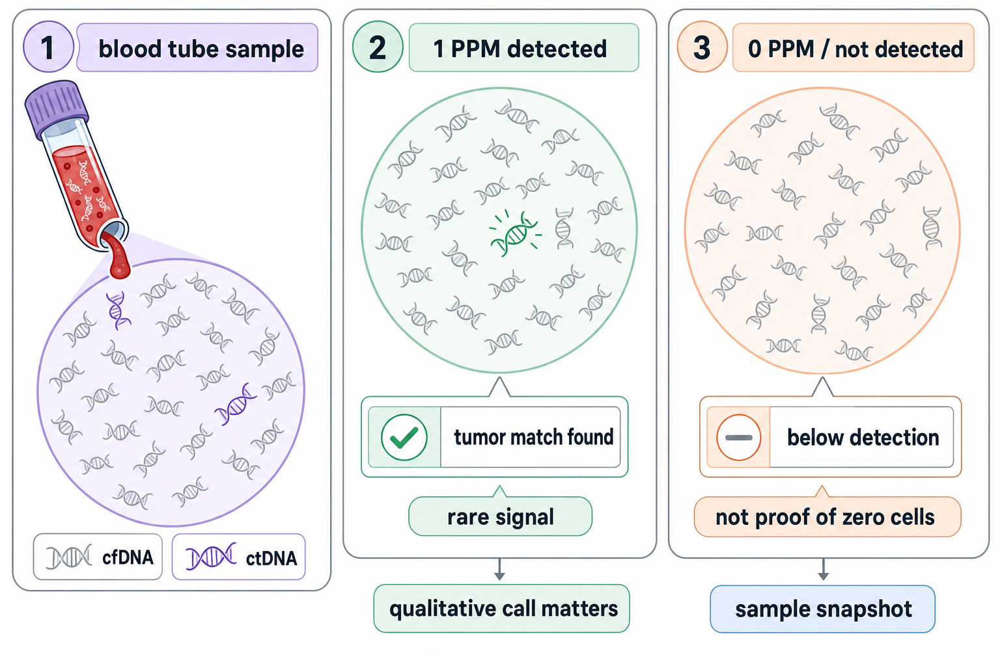
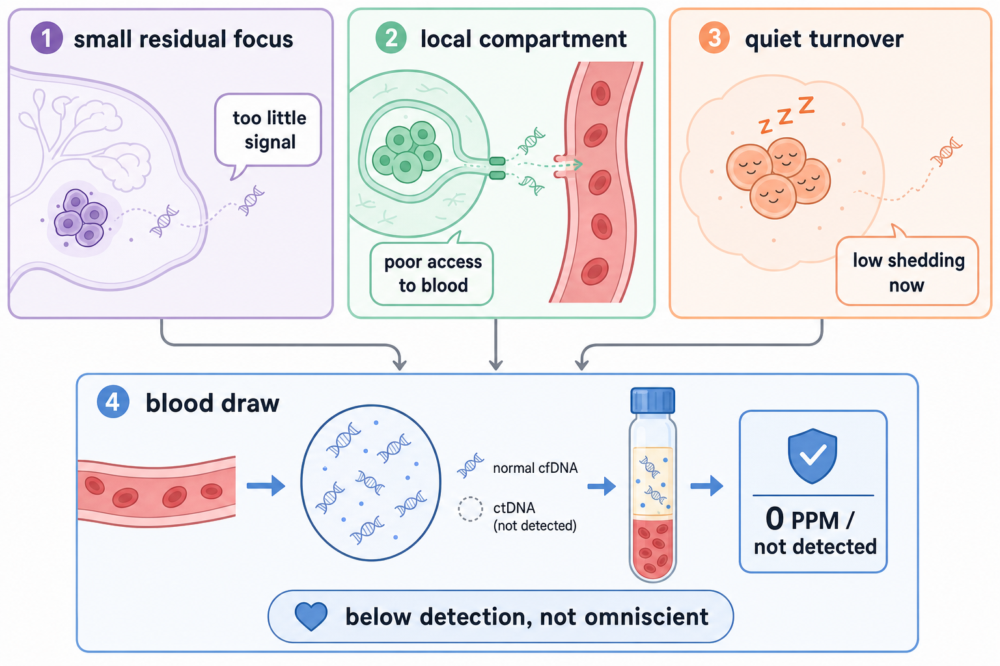
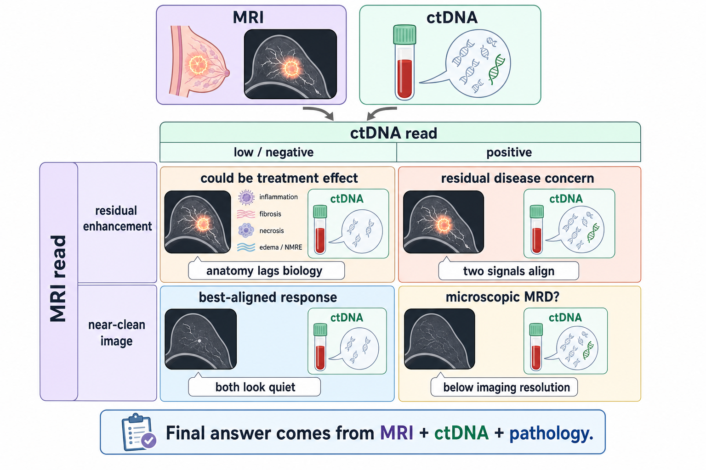

# ctDNA PPM and MRI reads

ctDNA and MRI answer different questions. A blood test asks, **"Did this plasma tube contain tumor-matching DNA fragments above the assay's detection floor?"** MRI asks, **"What tissue still enhances, shrinks, persists, or looks structurally abnormal?"**

Those questions overlap, but they are not the same measurement. The hardest part is that both can be true at once: a tumor can be present but not shedding enough ctDNA to detect, and ctDNA can be detectable when MRI cannot localize anything.

For Diana's current moment, the useful frame is:

- **Personalis 304 PPM -> 1 PPM** means the shedding signal collapsed.
- **1 PPM detected** means molecular response, not molecular clearance.
- **0 PPM / not detected** would mean below detection in that draw, not proof that every tumor cell is gone.
- **MRI** will translate that molecular response into an anatomic read: how much breast enhancement, nodal abnormality, and treatment-effect signal remains.

This page is an educational mental model. Diana's live result trend stays in [[wiki/care/results]] and the operational MRD evidence stack stays in [[wiki/diagnostics/ctdna-mrd]].

---

## 1 PPM is a sparse blood-sample signal

`1 PPM` means the assay found tumor-matching fragments at roughly **one part per million cell-free DNA molecules**. It does not mean one tumor cell was floating in the blood.

The tube contains mostly normal cell-free DNA. The tumor-derived fragments are the rare marked pieces in that background. At very low levels, the qualitative call carries more weight than the exact number: **detected** versus **not detected** is sturdier than arguing whether `1 PPM` is exactly half or twice some nearby value.

That is why Personalis' own low-PPM caution matters for Diana's June 9 result. `1 PPM` should be read as **very-low-positive**, not a precise body-wide tumor-volume estimate.

## 0 PPM is not the same as zero tumor cells

`0 PPM` or `not detected` means the assay did not find enough tumor-derived DNA in that blood draw. It does **not** prove there is no residual tumor anywhere.

A tumor can be present but under-shed into plasma for several reasons:

- **Tiny remaining volume**: too few cells are turning over to cross the detection floor.
- **Local compartment**: a residual breast or nodal focus may not release much DNA into systemic blood.
- **Quiet biology**: treatment can leave lower-turnover viable cells or dormant microscopic disease.
- **Sampling limits**: the tube captures a finite slice of a fast-moving blood compartment.
- **Clearance is fast**: ctDNA fragments are short-lived, so a draw reflects recent shedding, not a permanent archive.

This is the clean way to say the paradox: **ctDNA negativity is reassuring, but it is not omniscient.**

## MRI sees anatomy; ctDNA sees shedding

MRI and ctDNA can land in four broad patterns:

| Pattern | What it can mean |
|---|---|
| **MRI smaller + ctDNA falling/clearing** | Best-aligned response pattern. Tumor burden is falling by both anatomy and shedding. |
| **MRI abnormal + ctDNA low/negative** | Could be residual tumor, but also treatment effect, fibrosis, necrosis, edema, or non-mass enhancement. |
| **MRI clean + ctDNA positive** | Could be microscopic residual disease below imaging resolution or outside the MRI field. |
| **MRI abnormal + ctDNA positive** | Higher concern for viable residual disease, especially if both are persistent at later gates. |

MRI is especially tricky after neoadjuvant therapy because enhancement is not pure tumor. Treated tissue can still enhance, and non-mass enhancement can overstate residual viable disease. The opposite is also possible: microscopic tumor can be below MRI resolution while ctDNA still detects molecular activity.

## What this means for Friday's MRI

Diana's Personalis result makes a **strong anatomic response** more likely than stable or progressive disease. The current result is not "molecularly clean," though, so a Friday MRI that still shows residual enhancement or residual nodal abnormality would not contradict the blood trend.

The most coherent expectation is:

- **Marked response** would fit the `304 -> 1 PPM` collapse.
- **Near-complete MRI response** would be excellent, but still not the same as pCR or MRD clearance.
- **Residual MRI abnormality** would remain plausible because MRI sees anatomy and treatment effect, not just living tumor.
- **Clear progression** would be more surprising and would deserve careful reconciliation against the molecular response.

The final risk interpretation will come from the combined matrix: **MRI response now, late-June / post-NAT ctDNA status, and surgical pathology / RCB later.**

## Cross-links

- [[wiki/care/results]] — Diana's actual result trend
- [[wiki/diagnostics/ctdna-mrd]] — operational MRD evidence and schedule
- [[wiki/education/molecular-profiling/06-ctdna-and-mrd]] — ctDNA as the temporal axis
- [[wiki/care/ctdna-monitoring]] — draw timing and interpretation gates
- [[sources/diagnostics/06-09-personalis-next-personal-mrd/06-09-personalis-next-personal-mrd]] — June 9 Personalis NeXT Personal Dx report
