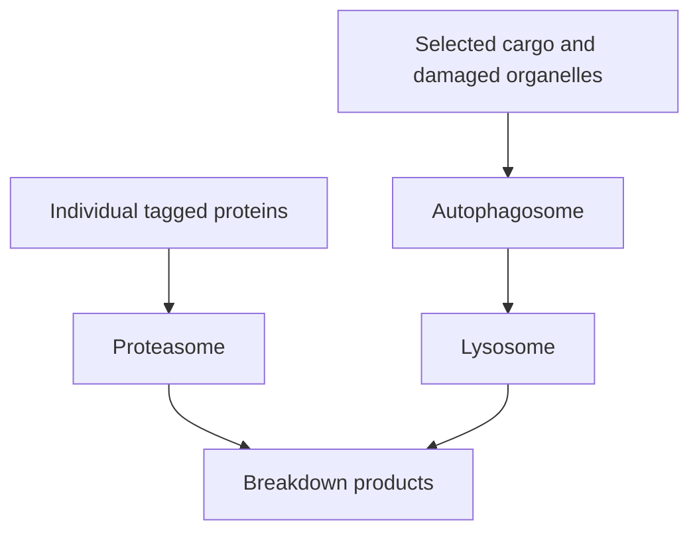

# Autophagy and proteostasis — two cleanup systems

**Autophagy and the proteasome both help maintain a cell, but their abundance does not establish which system the cell depends on.**

**Before you start:** [[wiki/education/molecular-profiling/parp-and-cell-survival/02-autophagy-flux-and-dependence|Flux and dependence]] explains why a snapshot differs from a moving process.

## Two routes for cellular cleanup

The proteasome breaks down many individual proteins marked with ubiquitin. Autophagy encloses selected cargo in a membrane compartment, which joins a lysosome for breakdown and recycling. The systems overlap, compensate and respond to stress. Losing one route does not invariably make a cell sensitive to a drug blocking the other.

## Why the direction matters

ATG13 and RB1CC1/FIP200 help initiate an autophagosome through the ULK machinery. ATG4B processes LC3-family proteins. A predicted damaging change in one gene does not prove that pathway flow has collapsed: the change must be authentic, expressed and consequential in the relevant cells.

High LC3-II or many autophagosomes can reflect increased formation or impaired clearance. The same crowded-road photograph can show productive deliveries or a blocked warehouse. The analogy ends at measurement: a dynamic assay, such as comparison with and without lysosomal blockade, is needed to distinguish those states.

## What can go wrong

Bulk RNA reflects captured transcripts from a tissue mixture. A high pathway score can reflect preparation, cell composition or a reference mismatch. A rank does not measure flux. A drug response can also have several causes; it does not independently validate the proposed genotype-to-dependence story.

Bortezomib blocks proteasome function. Chloroquine-related compounds disrupt lysosomal processes. Which perturbation is informative depends on the observed state and exposure. Preclinical evidence for compensation or stress responses does not establish a clinical combination or postoperative benefit.

## A worked experiment

Compare a specified perturbation with appropriate controls in a tumor-relevant model. Measure flux, viability and the relevant molecular consequence. Where feasible, restoring the affected function can test whether the proposed mechanism accounts for the result. A response that persists after rescue weakens that causal explanation.

## Try it

A sample has high LC3-II. Does adding a late autophagy blocker test a proven dependence?

**Answer:** No. First distinguish increased formation from failed clearance, then test whether the process supports survival under the specified conditions.

## Explain it back

“RNA abundance describes captured messages; flux describes movement through a pathway; dependence requires a perturbation that changes survival.”

## Applied to Diana

The source-specific history and withdrawal of the earlier variant/rank premises are retained in [[wiki/omics/evee-report-overview|the report overview]] and [[sources/research/syntheses/10-04-diana-multiomic-review/analysis|the qualified research review]]. They do not establish a current autophagy treatment priority.

## Takeaway

**Measure pathway flow and causal dependence before interpreting a gene list or RNA rank as a drug strategy.**

**Next:** [[wiki/education/molecular-profiling/evee-pathways/02-lipid-and-mtor|Lipid metabolism and mTOR]].

## Sources and scope

Updated October 8, 2026; general pathway teaching; expert and learner review pending.

- [ATG4B and autophagy in experimental cancer models](https://pmc.ncbi.nlm.nih.gov/articles/PMC4502682/).
- [ATG13 and autophagy initiation](https://pmc.ncbi.nlm.nih.gov/articles/PMC6070014/).
- [Immunoproteasome, tumor immunity and treatment-context limits](https://doi.org/10.26508/lsa.201900562).
