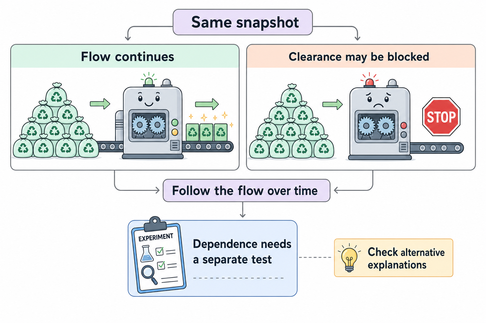

# Autophagy and proteostasis: amount, flow, and dependence

**A large pile of recycling material can mean fast collection or failed clearance. To test a vulnerability, measure the route's flow and then ask what happens when a defined function is disrupted.**

**Before you start:** [Autophagy](/wiki/education/concepts/cancer-biology/cell-death-and-survival/autophagy) delivers cargo to lysosomes for breakdown. [Ubiquitin and the proteasome](/wiki/education/concepts/cancer-biology/cell-death-and-survival/ubiquitin-and-proteasome) explains regulated protein turnover through another route.

## Where this step sits

This is the first lesson in [the pathway library](/wiki/education/molecular-profiling/evee-proposed-pathways). Use it at the measured-consequence step of [From a variant to a drug claim](/wiki/education/guides/from-variant-to-drug/index), when a hypothesis involves protein handling.

## The recycling photograph needs a time axis

Imagine arriving at a recycling center and seeing bags stacked to the ceiling. You would want to know whether trucks are arriving quickly, whether the processing machine has stopped, and whether the center can function without that machine. These are three different questions.

In cells, **proteostasis** means maintaining a workable balance of protein production, folding, and removal. Folding is the process by which a protein adopts its working structure. Both damaged proteins and ordinary working proteins can require controlled removal.

The **proteasome** cuts suitable protein cargo into small pieces. Ubiquitin tags help control which proteins reach it, but not all ubiquitin signals mean destruction. **Autophagy** can deliver proteins and larger cargo, including damaged organelles, to a **lysosome**, a compartment containing breakdown enzymes. The routes have different machinery and can interact. Their overlap does not prove that blocking both will selectively harm cancer cells.

## Separate three measurements

| Question | Helpful measurement | Tempting overread |
|---|---|---|
| How much material is present? | A marker or compartment count at a specified time | “The route must be flowing quickly.” |
| Is material moving through the route? | Turnover with controlled clearance blockade and complementary cargo tracking | “The cell must depend on this route.” |
| Does survival depend on a defined function? | Perturbation, target engagement, viability, and specificity controls | “The intervention will benefit patients.” |

[Target engagement](/wiki/education/concepts/therapeutics/how-drugs-work/chemical-probe-vs-drug-and-target-engagement) asks whether the intervention reaches and interacts with its intended molecular target. A changed downstream process is a separate readout. Neither alone establishes survival dependence or clinical benefit.

For autophagy, the membrane-associated LC3-II marker can accumulate through increased formation or slowed clearance. **Flux** means throughput over time. Comparing conditions with and without a short, verified lysosomal block can help estimate turnover. A tandem fluorescent reporter can provide a complementary view of compartment maturation. No single marker settles every interpretation. [Kimura 2007](https://pubmed.ncbi.nlm.nih.gov/17534139/), [assay guidance](https://pubmed.ncbi.nlm.nih.gov/33634751/).

## A worked example: the same pile, two stories

*This recycling-center analogy separates amount from flow. A blocked route remains an interpretation to test, and survival dependence needs its own experiment.*

Two fictional cultures show high LC3-II before treatment. A researcher applies a short lysosomal block in parallel cultures and follows a reporter and cargo marker.

| Observation | Culture A | Culture B |
|---|---|---|
| LC3-II after the additional block | Rises substantially | Changes little |
| Complementary cargo tracking | Cargo reaches degradative compartments | Cargo accumulates before adequate degradation |
| Initial interpretation | Ongoing flux is supported | A late clearance problem is plausible |
| Survival dependence | Still untested | Still untested |

Culture B's interpretation needs controls. Little extra accumulation could also reflect low formation, an incomplete inhibitor effect, or an unsuitable time window. Calling it a block is a hypothesis until those alternatives are checked.

The next experiment targets a defined recycling function in culture A. It verifies that flux changes and measures survival. A matched nonmalignant culture helps assess selectivity. Restoring the disrupted component can strengthen causal attribution if expression and other conditions are controlled.

Even a convincing result would apply to that model and intervention. It would not show that any broad lysosomal compound reproduces the same effect. A broad compound can affect several functions besides the proposed cargo route.

## What can go wrong at this step

One error is substituting a gene name for a measured process. ATG13 and FIP200 (the protein encoded by RB1CC1) help regulate autophagy initiation. Their involvement does not establish that every alteration increases or decreases completed recycling. [Ganley 2009](https://pubmed.ncbi.nlm.nih.gov/19258318/).

Another error is assuming that more cell death with two interventions proves a shared mechanism. The interventions could have independent toxic effects. A controlled combination analysis, dose and time series, individual-agent conditions, and mechanistic readouts are needed. [Reading a functional experiment](/wiki/education/guides/from-variant-to-drug/07-reading-a-functional-experiment) develops that reasoning.

A final error is measuring only surviving cells after a long exposure. Death itself can alter markers. Early biochemical measurements help establish whether the proposed change happened before the outcome.

## Try it

A culture has high LC3-II and dies after a broad lysosomal compound. The compound's effect on flux was never measured. Which statements are supported: high marker abundance, high flux, autophagy dependence, or clinical benefit?

Show the answer

High marker abundance and cell death under the tested condition are observations. High flux remains unmeasured. Autophagy dependence needs evidence that the relevant route was changed and caused the survival effect. Clinical benefit requires separate patient evidence.

## Explain it back

“A snapshot measures ___; a time-based comparison measures ___; a controlled survival experiment tests ___.”

One possible answer: “amount; flow through a defined route; dependence under the tested conditions.”

## Takeaway

**Amount, completed recycling, and dependence are separate claims with separate experiments.**

**Next:** [Lipid supply and growth signals](/wiki/education/molecular-profiling/evee-pathways/02-lipid-and-mtor).

## Sources and scope

Source check: 2026-10-09. General education; all worked scenarios and numerical examples are fictional. Mechanistic experiments describe their tested systems, not a treatment-selection rule. Expert and learner review pending.

- [Kimura 2007: tracking autophagosome maturation](https://pubmed.ncbi.nlm.nih.gov/17534139/).
- [Ganley 2009: the ULK1–ATG13–FIP200 initiation complex](https://pubmed.ncbi.nlm.nih.gov/19258318/).
- [Hershko 1983: ubiquitin-ligase components](https://pubmed.ncbi.nlm.nih.gov/6305978/).
- [Klionsky 2021: autophagy assay interpretation, fourth edition](https://pubmed.ncbi.nlm.nih.gov/33634751/).

Target-engagement wording checked October 10, 2026, against the [CETSA primary study](https://pubmed.ncbi.nlm.nih.gov/23828940/). This bounded terminology correction does not refresh the other study or treatment claims above.
