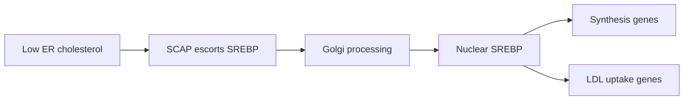

# Lipid metabolism and mTOR — two nutrient systems, two direction traps

**October 4 evidence correction:** the EVEE headline variants did not reproduce, and earlier bulk-RNA ranks are confounded by capture chemistry and cell composition. This lesson teaches general pathway biology and preserves the historical hypotheses; it does not establish a current dependency in Diana. [[wiki/education/molecular-profiling/evee-proposed-pathways|Course context and current qualifications]].

**Report hub:** [[wiki/omics/evee-report-overview]]

**Course index:** [[wiki/education/molecular-profiling/evee-proposed-pathways]]

**RNA pathway comparison:** [[sources/research/syntheses/08-20-all-10-hypotheses-rank-based-ssgsea-vs-tcga-brca|All 10 hypotheses versus TCGA-BRCA Basal/TNBC]]

## Part 1: SCAP–SREBP is a cholesterol thermostat

Cells need cholesterol for membranes and signaling. When ER cholesterol is low, SCAP escorts SREBP to the Golgi, where SREBP is cut into an active transcription factor. Active SREBP enters the nucleus and raises cholesterol synthesis and uptake.

The report groups `SCAP p.Trp633Ter`, `RXRA p.Ser96Ter`, and `PPARD p.Gln415His` and proposes cholesterol dependence plus pitavastatin sensitivity. RXRA and PPARD are lipid-responsive nuclear receptors, but they are not interchangeable parts of the SCAP–SREBP sensor.

### The direction trap

A statin blocks the mevalonate/cholesterol-synthesis pathway. That is most coherent when a tumor **depends on active synthesis**. A true SCAP loss could instead reduce SREBP activation and synthesis, shift the cell toward imported lipid, or be tolerated through the other allele. The same gene name can therefore support opposite predictions depending on the allele's effect.

Cancer studies showing that SCAP/SREBP is targetable generally involve an active or stabilized pathway. They do not show that `SCAP W633*` predicts statin benefit.

### What TNBC evidence adds

TNBC models do show cholesterol biology worth studying. A 2024 study found that pitavastatin plus AKT inhibition killed TNBC cells, mouse xenografts, and patient-derived ER-negative organoids; the mechanism involved impaired SREBP2 compensation. Paperclip independently retrieved a breast-cancer study showing the opposite pressure: statin exposure activated SREBP2 and raised HMGCR in resistant cells, while disrupting that feedback restored sensitivity. This is direct evidence that adaptive pathway direction—not simply the presence of a lipid-pathway variant—must be measured.

Elicit also identified PARP–statin synergy in ovarian models/organoids. That does not establish pitavastatin plus a PARP inhibitor in BRCA1-loss TNBC, and the implicated polypharmacology may not generalize across PARP inhibitors.

### The decisive lipid experiment

Use corrected and mutant tumor models to measure:

- SCAP transcript/protein and allele state;
- nuclear SREBP1/2 and target genes;
- cellular sterols and lipid uptake;
- growth in lipid-replete versus lipid-depleted media;
- pitavastatin response with LDL, cholesterol, and mevalonate rescue.

If mevalonate rescue does not reverse the drug effect, the killing may not be driven by the intended pathway. If the variant does not predict sensitivity relative to corrected controls, it is not a useful biomarker.

## Part 2: mTOR is a growth dial

**Illustrated extension:** [[wiki/education/molecular-profiling/parp-and-cell-survival/03-pi3k-akt-mtor-and-repair|PI3K, AKT, and mTOR: competing effects]] shows why repair sensitization and a recycling response can pull a PARP combination in different directions.

mTOR integrates growth factors, amino acids, energy, oxygen, and stress. In simplified form:

- **mTORC1 high:** protein/lipid synthesis and growth rise; autophagy initiation falls.
- **mTORC1 low:** biosynthesis slows and conservation/recycling rises.

The report lists `MTOR p.Gly98Ser` and `PIKFYVE p.Ile1548Thr`, notes intact `TSC1/TSC2`, and proposes everolimus or temsirolimus if `MTOR G98S` is activating.

### The new RNA clue: one dial, two opposing readouts

The August 20 comparison does not show uniformly high mTOR activity:

- **Hallmark PI3K/AKT/mTOR signaling:** 83.1st Basal percentile and 84.6th TNBC percentile.
- **Hallmark mTORC1 signaling:** 0.0th percentile in both comparator groups.

The report averages these into a roughly 42nd-percentile “mTOR” summary, but the disagreement is more informative than the average. Upstream growth-factor/AKT wiring can be prominent while downstream mTORC1 transcriptional output is suppressed by energy stress, feedback, treatment context, cell composition, or technical effects. The RNA result weakens a simple “mTOR is activated, therefore use everolimus” story.

The shortest bridge to the biology is direct output: p-S6, p-4EBP1, p-AKT, and repeat RNA scoring with the exact matrices and gene sets. If mTORC1 output remains low, an activating-`MTOR` interpretation becomes harder to sustain even if an upstream PI3K/AKT module is high.

### The entire claim rests on “if activating”

Known activating MTOR mutations can create rapamycin sensitivity, but characterized mutations cluster in defined regulatory and catalytic regions. `G98S` lies near the N-terminal HEAT-repeat region and was not an established activating allele in the literature reviewed. Mechanistic work has warned that some cancer-associated HEAT-repeat MTOR variants may be passengers.

Intact `TSC1/TSC2` is not proof that mTOR is active. It only says two negative regulators were not reported as altered. `PIKFYVE` mainly governs endolysosomal phosphoinositide signaling and lysosome function; it is not interchangeable with canonical class I PI3K activation.

### What human TNBC trials say

Rapalogs have real human experience, but not as a `G98S`-selected treatment:

- In 145 patients with stage II/III TNBC, adding everolimus to cisplatin/paclitaxel produced **36% [[about/Terminology#pcr|pCR]] versus 49% with placebo** and more adverse events.
- A small metastatic TNBC gemcitabine/cisplatin/everolimus study was stopped early and found no synergistic effect.
- A 2025 randomized metastatic study reported PFS of **4.7 versus 4.2 months** with carboplatin/everolimus versus carboplatin, with HR 0.49 but no overall-survival improvement; it did not select `MTOR G98S`.
- In 17 metaplastic/mesenchymal TNBC patients with poor response to prior anthracycline treatment, a doxorubicin/bevacizumab/mTOR-inhibitor regimen produced **no [[about/Terminology#pcr|pCR]]**.

These mixed studies show why “the drug class has been used in TNBC” is not the same as “this variant predicts benefit.”

### The decisive mTOR experiment

1. Measure p-S6, p-4EBP1, p-AKT, and pathway output in tumor cells.
2. Express or correct `MTOR G98S` in an isogenic model.
3. Test rapalog response with biochemical target engagement.
4. Require the variant to raise pathway output and create selective, reversible drug sensitivity.

## Relevance for Diana

The October 4 audit withdraws the variant-specific premise and qualifies the earlier bulk-RNA comparisons. This general pathway biology does not establish a current dependency or priority for Diana. Any renewed hypothesis needs tumor-cell evidence, appropriate comparators, and functional testing tied to a concrete clinical question. [[sources/research/syntheses/10-04-diana-multiomic-review/analysis|Current findings and qualifications]].

## Teach it back

1. Why can SCAP loss weaken rather than strengthen a statin hypothesis?
2. What does mevalonate rescue tell you?
3. Why does intact `TSC1/TSC2` not prove mTOR activation?
4. Why can an approved drug still be a poor match for an uncharacterized variant?

**One-sentence answer:** A cholesterol or mTOR gene can be altered without the tumor depending on excessive activity of that pathway; direction, pathway output, and genotype-linked drug response must agree.

## Sources

- [SCAP/SREBP and cholesterol addiction in tumor models](https://pmc.ncbi.nlm.nih.gov/articles/PMC10719313/)
- [SCAP/SREBP requirement in pancreatic tumor models](https://pmc.ncbi.nlm.nih.gov/articles/PMC11444119/)
- [Pitavastatin plus AKT inhibition in TNBC models](https://pubmed.ncbi.nlm.nih.gov/39024548/)
- [SREBP2–HMGCR feedback and statin resistance in breast-cancer cells](https://doi.org/10.1038/s41419-019-1322-x)
- [Functionally characterized activating MTOR mutations](https://pmc.ncbi.nlm.nih.gov/articles/PMC4012430/)
- [Mechanistic mTOR variant mapping](https://pmc.ncbi.nlm.nih.gov/articles/PMC5004947/)
- [Randomized neoadjuvant everolimus study in TNBC](https://pubmed.ncbi.nlm.nih.gov/28270498/)
- [Randomized metastatic carboplatin ± everolimus study](https://pubmed.ncbi.nlm.nih.gov/40817986/)
- [Elicit autophagy, lipid, and mTOR review](https://elicit.com/agent/a22a07d3-a163-4bef-8fe5-95595b53cbf1)
- [[sources/research/syntheses/08-20-all-10-hypotheses-rank-based-ssgsea-vs-tcga-brca]]

## Continue

Previous: [[wiki/education/molecular-profiling/evee-pathways/01-autophagy-and-proteostasis|Autophagy and proteostasis]]

Next: [[wiki/education/molecular-profiling/evee-pathways/03-notch-wnt-and-fgfr|Notch, Wnt, and FGFR4 — messages are not dependencies]]
