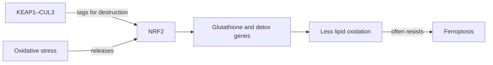

# CUL3, NRF2, ferroptosis, and BET — defenses and transcription

**October 4 evidence correction:** the EVEE headline variants did not reproduce, and earlier bulk-RNA ranks are confounded by capture chemistry and cell composition. This lesson teaches general pathway biology and preserves the historical hypotheses; it does not establish a current dependency in Diana. [[wiki/education/molecular-profiling/evee-proposed-pathways|Course context and current qualifications]].

**Report hub:** [[wiki/omics/evee-report-overview]]

**Course index:** [[wiki/education/molecular-profiling/evee-proposed-pathways]]

**RNA pathway comparison:** [[sources/research/syntheses/08-20-all-10-hypotheses-rank-based-ssgsea-vs-tcga-brca|All 10 hypotheses versus TCGA-BRCA Basal/TNBC]]

## Part 1: CUL3–KEAP1–NRF2 is a stress shield

CUL3 is a scaffold for many ubiquitin-ligase complexes. With the adaptor KEAP1, it helps tag NRF2 for proteasomal destruction. Oxidative stress interrupts that turnover, allowing NRF2 to enter the nucleus and activate antioxidant, detoxification, glutathione, and metabolic programs.

This temporary shield protects normal cells. A cancer cell with chronically active NRF2 can become resistant to oxidative damage and some treatments.

The report lists `CUL3 p.Arg354Cys` plus in-frame changes in `CBL` and `ARIH2`, then proposes CUL3 loss, NRF2 activation, proteostasis stress, and ferroptosis sensitivity.

## Do not merge H10 oxidative stress with H5 NRF2/ferroptosis

The August 20 RNA report separates two hypotheses that sound similar:

- **H10 oxidative metabolism/stress** ranks at the **79.9th Basal** and **78.5th TNBC percentiles**, driven by oxidative phosphorylation plus ROS detoxification.
- **H5 NRF2/ferroptosis** ranks at the **23.9th Basal** and **22.0th TNBC percentiles**.

These results can coexist. Oxidative phosphorylation describes mitochondrial energy production; ROS detoxification describes handling of reactive byproducts; NRF2 is one antioxidant control program; ferroptosis is iron-dependent lipid-membrane damage when protective systems fail. High mitochondrial/ROS-handling RNA does not prove high NRF2, and neither one proves ferroptosis sensitivity. See [[wiki/education/molecular-profiling/evee-pathways/05-oxidative-metabolism-and-stress|Oxidative metabolism and stress — engine, sparks, and shields]].

## The three hidden leaps

1. **`CUL3 R354C` causes loss of CUL3 function.** Elicit found no exact-variant cancer functional study.
2. **The loss affects the KEAP1–NRF2 complex.** CUL3 has many adaptors and substrates; not every CUL3 defect has the same output.
3. **NRF2 activation creates ferroptosis sensitivity.** NRF2 usually strengthens antioxidant and glutathione defenses, which can cause ferroptosis resistance. A vulnerability may emerge if the cell becomes addicted to GPX4, system xC−, or another defense, but that conditional dependency must be measured.

`CBL` and `ARIH2` are also ubiquitin-ligase genes, but a shared category label does not mean a shared substrate or one coherent defect.

## What the proposed compounds really are

### Brusatol

Brusatol was described as an NRF2 inhibitor, but proteomic and translation studies showed that it broadly suppresses protein synthesis. NRF2 falls partly because it is short-lived, not because brusatol selectively blocks an NRF2 target. It is therefore a poor precision probe and not a clinically established NRF2 therapy.

### RSL3 and erastin

RSL3 inhibits GPX4; erastin disrupts cystine uptake/system xC− and related metabolism. Both are widely used **experimental ferroptosis-inducing compounds**. They are valuable tools for asking whether death has ferroptosis features, especially when ferrostatin-1 or liproxstatin rescues the cells. They are not patient-ready TNBC drugs.

## The decisive redox experiment

1. Confirm CUL3 protein and the variant's effect on KEAP1–CUL3 complex activity.
2. Measure nuclear NRF2 and targets such as `NQO1`, `GCLC`, `GCLM`, and `SLC7A11`.
3. Measure glutathione and lipid peroxidation.
4. Perturb GPX4/system xC− and require rescue by a ferroptosis-specific inhibitor.
5. Correct or restore CUL3 and show that the dependency changes.

The rescue step distinguishes ferroptosis from generic toxicity. If NRF2 targets are not elevated, the first half of the report's chain fails. If cells resist rather than depend on ferroptosis defenses, the proposed direction must change.

## Part 2: BRD3 and BET proteins read chromatin

DNA is wrapped around histones. Acetyl marks on those histones help define active regulatory regions. BET-family proteins—BRD2, BRD3, BRD4, and BRDT—use bromodomains to recognize acetylated lysines and help assemble transcriptional machinery.

BET inhibitors occupy those bromodomains. They do not repair BRD3; they prevent several BET proteins from reading acetyl marks.

The report lists `BRD3 p.Ser676Gly`, groups it with other chromatin-gene variants, and proposes JQ1 or birabresib.

### The target-damage trap

If a variant truly reduces BRD3 function, inhibiting BET proteins again is not automatically useful. The tumor might depend on residual BRD3, compensate through BRD2/BRD4, or be unaffected. Elicit found no exact `BRD3 S676G` functional, cohort, or drug-response evidence.

Some TNBC models are sensitive to BET inhibition, but resistance work implicates broader transcriptional rewiring and wild-type BRD4—not `BRD3 S676G` as a biomarker. Paperclip's independent search retrieved a mechanistic study in which BRD4 inhibition reduced BRCA1/RAD51 and induced “BRCAness” in **BRCA1-wild-type** TNBC cells. That starting state matters: inducing HR deficiency in BRCA1-wild-type cells is not evidence that BET inhibition will help a tumor with apparent BRCA1 loss.

The broader BET/PARP question has more evidence than the report's allele claim. BRD4 inhibition can reduce homologous-recombination machinery and sensitize preclinical models to PARP inhibition. In a single-arm phase 1b/2 TNBC study without germline BRCA1/2 mutations, ZEN-3694 plus talazoparib produced a reported **22% objective-response rate overall** and 32% among patients diagnosed as TNBC. The study was not selected by `BRD3 S676G` or somatic BRCA1, thrombocytopenia was substantial, and later expansion cohorts were discontinued after an interim futility analysis. This makes BET/PARP an adjacent investigational signal—not a validation of the report.

### JQ1 and birabresib

- **JQ1** is a laboratory chemical probe, not an approved treatment.
- **Birabresib/OTX015** is investigational. In a phase I solid-tumor study, partial responses occurred in three patients with NUT midline carcinoma, not a BRD3-selected TNBC cohort. TNBC development did not establish the variant as a predictive biomarker and later work was terminated for limited efficacy signals.

## The decisive BET experiment

- Measure BRD2/3/4 abundance and the transcriptional program suspected to depend on BET proteins.
- Compare genetic depletion of each paralog with a pharmacologic BET inhibitor.
- Correct or introduce `BRD3 S676G` and test whether it changes the response.
- Require selective transcriptional collapse and growth inhibition at on-target exposure.

## Relevance for Diana

The October 4 audit withdraws the variant-specific premise and qualifies the earlier bulk-RNA comparisons. This general pathway biology does not establish a current dependency or priority for Diana. Any renewed hypothesis needs tumor-cell evidence, appropriate comparators, and functional testing tied to a concrete clinical question. [[sources/research/syntheses/10-04-diana-multiomic-review/analysis|Current findings and qualifications]].

## Teach it back

1. How does KEAP1–CUL3 normally control NRF2?
2. Why can NRF2 activation cause ferroptosis resistance?
3. What does ferrostatin rescue prove?
4. Why is brusatol not a clean NRF2 test?
5. Why does a BRD3 variant not automatically predict response to a pan-BET inhibitor?

**One-sentence answer:** A CUL3 variant may or may not create an NRF2 shield, and a BRD3 variant may or may not create BET dependence; measured pathway state and reversible functional response must bridge both gaps.

## Sources

- [KEAP1–CUL3 control of NRF2](https://pmc.ncbi.nlm.nih.gov/articles/PMC516753/)
- [CUL3 depletion, NRF2, and treatment resistance in breast-cancer models](https://pubmed.ncbi.nlm.nih.gov/19638449/)
- [Brusatol broadly inhibits protein synthesis](https://pubmed.ncbi.nlm.nih.gov/26711467/)
- [RSL3 and erastin as experimental ferroptosis compounds](https://pubmed.ncbi.nlm.nih.gov/34648917/)
- [BET-inhibitor sensitivity and resistance in TNBC models](https://pmc.ncbi.nlm.nih.gov/articles/PMC7306005/)
- [Birabresib phase I study](https://pubmed.ncbi.nlm.nih.gov/29733771/)
- [BRD4 inhibition and preclinical PARP sensitization](https://pubmed.ncbi.nlm.nih.gov/29533782/)
- [ZEN-3694 plus talazoparib early TNBC analysis](https://ascopubs.org/doi/abs/10.1200/JCO.2022.40.16_suppl.1023)
- [ZEN-3694/talazoparib trial status and interim-futility boundary](https://clinicaltrials.gov/study/NCT03901469)
- [Elicit exact-variant audit](https://elicit.com/agent/aee2fc7a-df98-4904-8fea-60b4b16f402e)
- [Elicit Notch/Wnt, FGFR4, and BET review](https://elicit.com/agent/a4de7f47-2056-4bc8-8c16-3c3988aeffd9)
- [[sources/research/syntheses/08-20-all-10-hypotheses-rank-based-ssgsea-vs-tcga-brca]]

## Continue

Previous: [[wiki/education/molecular-profiling/evee-pathways/03-notch-wnt-and-fgfr|Notch, Wnt, and FGFR4]]

Next: [[wiki/education/molecular-profiling/evee-pathways/05-oxidative-metabolism-and-stress|Oxidative metabolism and stress — engine, sparks, and shields]]
