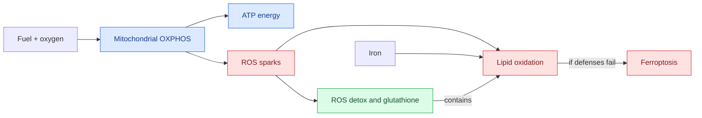

# Oxidative metabolism and stress — engine, sparks, and shields

**October 4 evidence correction:** the EVEE headline variants did not reproduce, and earlier bulk-RNA ranks are confounded by capture chemistry and cell composition. This lesson teaches general pathway biology and preserves the historical hypotheses; it does not establish a current dependency in Diana. [[wiki/education/molecular-profiling/evee-proposed-pathways|Course context and current qualifications]].

**Course index:** [[wiki/education/molecular-profiling/evee-proposed-pathways]]

**RNA pathway comparison:** [[sources/research/syntheses/08-20-all-10-hypotheses-rank-based-ssgsea-vs-tcga-brca|All 10 hypotheses versus TCGA-BRCA Basal/TNBC]]

## The plain-language model

Think of a cell as a workshop:

- **Oxidative phosphorylation (OXPHOS)** is the mitochondrial engine that uses fuel and oxygen to make ATP.
- **Reactive oxygen species (ROS)** are sparks that can leak from the engine and also arise elsewhere.
- **Antioxidant and detox systems** are the ventilation, fire alarms, and cleanup crew that contain those sparks.
- **Ferroptosis** is a particular iron-dependent membrane fire caused by runaway lipid oxidation when protective systems such as glutathione and GPX4 cannot keep up.

These systems interact, but they are not synonyms.

## What the August 20 comparison reported — historical

| Module | Basal percentile | TNBC percentile | What it measures |
|---|---:|---:|---|
| Hallmark oxidative phosphorylation | 87.3% | 83.7% | Mitochondrial electron transport and ATP-production program |
| Reactome detoxification of ROS | 72.5% | 73.2% | Enzymes that handle reactive oxygen byproducts |
| **H10 average** | **79.9%** | **78.5%** | A combined oxidative-metabolism/stress clue |
| H5 NRF2/ferroptosis summary | 23.9% | 22.0% | A separate antioxidant/lipid-death hypothesis |

H10 is the second-highest RNA-ranked hypothesis in the report. H5 remains low. That is not a contradiction: a tumor can use mitochondrial respiration and ROS-detox programs without having a dominant NRF2/ferroptosis signature.

## Three ways to read a high OXPHOS rank

1. **A real fuel dependency:** the malignant cells may rely more heavily on mitochondrial ATP production.
2. **A stress adaptation:** surviving cells may raise both energy production and ROS defenses without becoming selectively vulnerable to either.
3. **A composition or technical signal:** mitochondrial content, stromal/immune admixture, FFPE degradation, gene detection, or patient-versus-TCGA processing differences may shift the rank.

RNA tells us which engine instructions are prominent. It does not show how much oxygen the engine consumes, which fuel it needs, or whether blocking it selectively harms tumor cells.

## Why this is not automatically a ferroptosis result

High OXPHOS can increase electron leakage and ROS, but ferroptosis specifically requires iron-dependent lipid peroxidation that escapes GPX4/glutathione and related defenses. A cell with high ROS-detox capacity may be **more resistant**, not more sensitive. Conversely, a cell can become dependent on those defenses and reveal a vulnerability only when they are perturbed.

The deciding evidence is reversible function: lipid peroxidation and cell death that are rescued by a ferroptosis-specific inhibitor, not general toxicity from a metabolic compound.

## The decisive metabolic experiment

Use a tumor-relevant model and separate the layers:

1. repeat the RNA ranking with the frozen patient/TCGA matrices and canonical GSVA/ssGSEA or another validated pathway model;
2. measure oxygen-consumption and glycolytic rates with a mitochondrial stress test;
3. measure mitochondrial mass, electron-transport-chain proteins, ATP, ROS, glutathione, and lipid peroxidation;
4. perturb specific respiratory complexes, fuels, GPX4, or system xC− at on-target exposures; and
5. require biochemical target engagement plus rescue by the matched metabolite, gene correction, or pathway-specific rescue compound.

If the RNA rank does not reproduce, respiration is not elevated, or the effect cannot be rescued, the dependency story weakens.

## Relevance for Diana

The October 4 audit withdraws the variant-specific premise and qualifies the earlier bulk-RNA comparisons. This general pathway biology does not establish a current dependency or priority for Diana. Any renewed hypothesis needs tumor-cell evidence, appropriate comparators, and functional testing tied to a concrete clinical question. [[sources/research/syntheses/10-04-diana-multiomic-review/analysis|Current findings and qualifications]].

## Teach it back

1. Why are OXPHOS, ROS detoxification, NRF2, and ferroptosis related but different?
2. How can high ROS-detox activity produce either resistance or dependency?
3. What does oxygen-consumption testing add beyond RNA?
4. Why is ferroptosis rescue more informative than cell death alone?

**One-sentence answer:** The RNA report suggests a relatively busy mitochondrial engine and ROS cleanup crew, but only direct respiration, redox, perturbation, and rescue experiments can show whether that state is a selective vulnerability.

## Related reading

- [[wiki/education/molecular-profiling/evee-pathways/01-autophagy-and-proteostasis]] — the higher-ranked recycling/flux hypothesis.
- [[wiki/education/molecular-profiling/evee-pathways/04-cul3-nrf2-ferroptosis-and-bet]] — the separate NRF2/ferroptosis hypothesis.
- [[wiki/education/molecular-profiling/03-protein-expression-and-activation]] — why RNA rank and pathway activation are different evidence layers.
- [[wiki/education/molecular-profiling/05-functional-drug-response]] — how perturbation and rescue test dependence.
- [[sources/research/syntheses/08-20-all-10-hypotheses-rank-based-ssgsea-vs-tcga-brca]] — source report and method boundary.

## Continue

Previous: [[wiki/education/molecular-profiling/evee-pathways/04-cul3-nrf2-ferroptosis-and-bet|CUL3, NRF2, ferroptosis, and BET]]

Return to: [[wiki/education/molecular-profiling/evee-proposed-pathways|EVEE pathway course index]]
