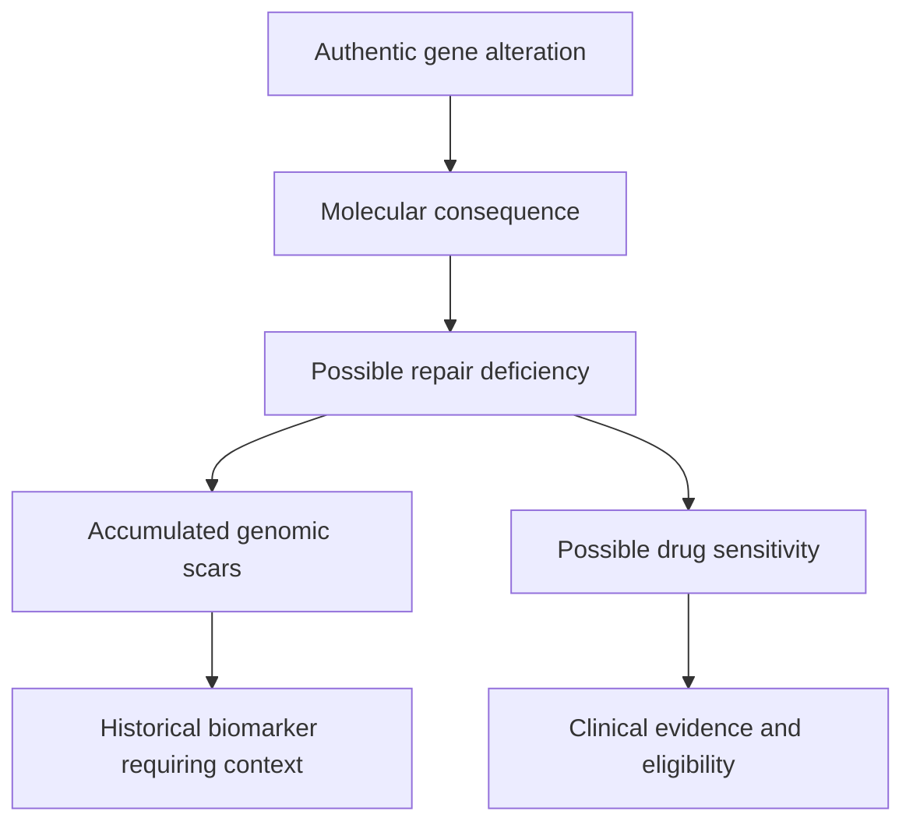

# Understand HRD and PARP biology

**Separate repair deficiency, a genomic scar, drug sensitivity and clinical eligibility.**

## The big ideas

1. Homologous recombination is a DNA-repair pathway, not one gene.
2. A genomic scar records accumulated damage rather than current repair capacity.
3. PARP inhibitors inhibit enzyme activity and can trap PARP–DNA complexes.
4. Biological plausibility does not satisfy a drug label or trial's eligibility criteria.

## The map

## Lessons

| Lesson | Question | Minutes |
|---|---|---|
| [Copies and alleles](/wiki/education/multi-omics-foundations/04-copies-alleles-and-clones) | What would disabling both copies mean? | 10 |
| [Splicing and repair](/wiki/education/multi-omics-foundations/05-splicing-and-dna-repair) | How could a DNA change alter a usable message? | 10 |
| [PARP trapping](/wiki/education/molecular-profiling/parp-and-cell-survival/01-parp-trapping-and-recycling) | What obstacle does a PARP inhibitor create? | 10 |
| [Functional experiments](/wiki/education/molecular-profiling/parp-and-cell-survival/04-reading-a-functional-experiment) | What could establish a current dependence? | 12 |

## Repair is a cooperative pathway

Homologous recombination (HR) uses a matching DNA template to repair certain lesions. BRCA1, PALB2, BRCA2 and RAD51 cooperate in that process. Disrupting an essential component can impair HR; this does not mean that every other component was deleted. Homologous-recombination deficiency (HRD (homologous recombination deficiency)) names a biological state rather than one mutation.

Most cells carry two copies of BRCA1. A variant in one copy can coexist with a functioning second copy. Evidence of biallelic inactivation needs to establish the consequence of each event in the relevant cancer cells. Purity, copy number, clone composition and mapping can affect that interpretation.

A genomic scar summarizes accumulated chromosome damage under a specified method. Loss of heterozygosity, telomeric allelic imbalance and large-scale transitions are common components. A cutoff validated for one assay does not automatically validate another pipeline. A tumor can restore repair while retaining the old scar, for example through a BRCA reversion.

## Drug mechanism is another evidence layer

Poly(ADP-ribose) polymerase (PARP) proteins help coordinate responses to DNA damage and replication stress. Inhibitors can reduce PARP activity and trap PARP–DNA complexes. Those complexes can obstruct DNA copying, creating lesions that require other repair functions for survival.

Synthetic lethality describes a combination of defects that is more harmful than either alone under specified conditions. HR deficiency can make PARP inhibition selectively stressful in some tumors. It is not perfect tumor selectivity: normal tissues can still be injured, and resistance mechanisms can change the response.

## What the measurements establish

| Evidence | Supports | Does not establish alone |
|---|---|---|
| Variant and copy number | A possible genetic cause | Protein consequence or current repair failure |
| RNA processing | A transcript consequence | Protein abundance, function or drug response |
| Genomic scar or signature | A compatible history | Current repair state or guaranteed sensitivity |
| Functional perturbation | A response under model conditions | Clinical benefit at a safe exposure |
| Clinical trial and label | Evidence and eligibility in a specified setting | Automatic applicability to another biomarker or disease |

## Concepts you will use

[[wiki/education/concepts/evidence-and-statistics/biomarkers/actionability|Clinical actionability]] and [[wiki/education/concepts/evidence-and-statistics/biomarkers/prognostic-vs-predictive|biomarker evidence]] explain why a biological match and a treatment-selection rule differ.

## Applied to Diana

[[wiki/care/molecular-profile|The molecular profile]] owns the qualified research findings and [[wiki/questions/adjuvant-treatment|the postoperative question]] owns treatment decisions. Source-specific measurements remain in [[sources/research/syntheses/10-04-diana-multiomic-review/analysis|the research review]].

## What is still uncertain

For any proposed use, ask whether repair is currently impaired, which validated test supports the intended decision and whether the study accepts the actual biomarker. Somatic-BRCA responses in metastatic studies do not establish adjuvant benefit in somatic-only early breast cancer. The U.S. adjuvant olaparib indication requires a qualifying germline BRCA variant; a scar alone cannot meet that gate.

## Try it

A tumor has an HRD-associated scar. Does that prove it remains HR-deficient and qualifies for adjuvant olaparib?

**Answer:** No. Current function and the indication's germline eligibility are separate questions.

**Takeaway:** A scar supports a history, a mechanism supports a hypothesis, and clinical evidence supports a specified use.

## Sources and scope

Updated October 8, 2026; general teaching; expert and learner review pending.

- [NCI BRCA genes and repair](https://www.cancer.gov/about-cancer/causes-prevention/genetics/brca-fact-sheet).
- [FDA olaparib prescribing information](https://www.accessdata.fda.gov/drugsatfda_docs/label/2025/208558s031lbl.pdf).
- [TBCRC 048 metastatic-breast-cancer study](https://pubmed.ncbi.nlm.nih.gov/33119476/).
- [OlympiA overall-survival analysis](https://pubmed.ncbi.nlm.nih.gov/36228963/).
