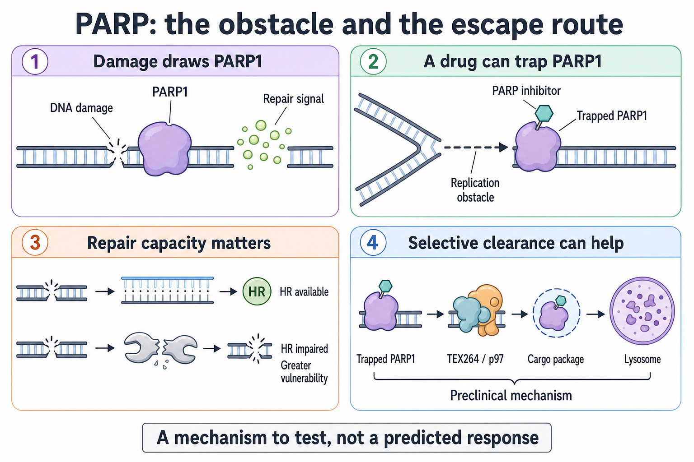

# PARP trapping and recycling

**A poly(ADP-ribose) polymerase (PARP) inhibitor can both block an enzyme and leave a protein stuck to DNA. The cell's repair and clearance systems help determine what happens next.**

**Before you start:** [Homologous recombination (HR)](/wiki/education/concepts/cancer-biology/genome-instability-and-repair/homologous-recombination-and-hrd) is template-based repair of deoxyribonucleic acid (DNA); [synthetic lethality](/wiki/education/concepts/therapeutics/how-drugs-work/synthetic-lethality) describes two impairments that become lethal together. ADP-ribose is a chemical unit that PARP enzymes use to build signals at DNA damage.

## Where this step sits

Start by identifying the obstacle. In [the guide's map](/wiki/education/molecular-profiling/parp-and-cell-survival/index#the-map), this comes before measuring recycling, following growth signals, and reading the experiment.

## The repair worker can become an obstacle

Imagine a repair worker who normally spots damage, calls for help, and moves on. A drug may silence the call and also leave the worker stuck in the doorway. Those are related effects, but they are not the same effect.

PARP1 is a protein that responds to DNA damage. It adds chains of ADP-ribose that help organize the response. **Catalytic inhibition** means blocking this chemical activity. **PARP trapping** means stabilizing a PARP–DNA complex so the protein stays bound longer. A **replication fork**, the moving machinery that copies DNA, can run into that obstacle. The collision can generate stress and damage the cell must resolve.

Trapping strength differs between compounds in a defined assay. Murai and colleagues found stronger trapping with niraparib and olaparib than with veliparib in their experimental comparisons, despite all inhibiting PARP activity. This is a laboratory distinction. It does not rank the best drug for a person: exposure, toxicity, dose, resistance, and the clinical setting also matter. [Murai 2012](https://pmc.ncbi.nlm.nih.gov/articles/PMC3528345/).

*Creating an obstacle, repairing its damage, and removing it are separate parts of the response.*

## A repair weakness changes the consequences

A cell with **homologous recombination deficiency (HRD)** has impaired HR repair. Some damage produced during PARP inhibition can then be harder to tolerate. This is the paired vulnerability explained by the synthetic-lethality concept. It is more useful to ask “which repair function is missing?” than to treat every repair-gene variant as the same defect.

Present function also matters. A **genomic scar** records accumulated chromosome damage. It can remain after repair is partly restored. A **BRCA reversion** is a later alteration that restores function of a previously disrupted repair protein. Selected metastatic breast cancers have shown this mechanism after resistance; that observation is not a prevalence estimate for all tumors. [Waks 2020](https://pubmed.ncbi.nlm.nih.gov/32245699/).

## A clearance route is a specific hypothesis

**Autophagy** is cellular recycling that delivers material to a lysosome, a compartment where it is broken down. **Nucleophagy** is autophagic handling of nuclear material. A preclinical study identified a route involving TEX264, a cargo-recognition protein, and p97, a protein-remodeling enzyme, that helps remove trapped PARP1. Disrupting this machinery increased trapping and drug sensitivity in the studied models. [Hoslett 2026](https://www.nature.com/articles/s41556-026-01961-5).

That finding does not show that a high recycling-related gene-expression score predicts resistance. Nor does it show that chloroquine or hydroxychloroquine selectively blocks this route. These drugs alter lysosomal functions more broadly. To attribute a response to trapped-PARP clearance, an experiment needs measurements of that cargo and pathway, alongside cell survival.

## A worked example: similar scars, different repair

Consider two fictional tumor models with similar historical scar patterns. These are teaching cases, not clinical predictions.

| Question | Model A | Model B |
|---|---|---|
| What happened earlier? | Repair failure left chromosome scars. | Repair failure left chromosome scars. |
| What do adequate current repair measurements suggest? | HR remains impaired. | HR function has partly returned. |
| What hypothesis follows? | A repair-related PARP vulnerability remains plausible. | The old scar may overstate the present vulnerability. |
| What remains unknown? | Drug exposure, other resistance routes, and survival response. | The degree of restoration and the actual drug response. |

One possible present-function readout is **RAD51 foci**, visible assemblies of a repair protein. Enough damaged, cycling tumor cells must be present for a low-foci result to mean much. Some assays use fixed tissue; a functional repair readout does not always require a living drug culture. [Cruz 2018](https://pmc.ncbi.nlm.nih.gov/articles/PMC5961353/).

## What can go wrong at this step

A mechanism can be mistaken for a treatment indication. [Germline and somatic variants](/wiki/education/concepts/biology-basics/genetics/germline-vs-somatic) describe different origins. The U.S. Food and Drug Administration (FDA) olaparib label's early breast cancer indication requires a qualifying **germline BRCA mutation**, high-risk disease without human epidermal growth factor receptor 2 (HER2) overexpression, and prior chemotherapy, among its criteria. A somatic BRCA alteration or high genomic-scar score does not replace that germline requirement. Broader HRD-based use remains a separate treatment hypothesis needing evidence for its specific setting. [FDA label, section 1.4](https://www.accessdata.fda.gov/drugsatfda_docs/label/2025/208558s031lbl.pdf).

A second error is treating broad lysosomal disruption as proof of selective PARP clearance. The same drug can change several processes. Measuring only survival cannot identify which one caused the effect.

## Try it

A researcher reports high scars, few RAD51 foci, and greater cell death with a PARP inhibitor plus a lysosomal drug. The sample had few cycling cells. Can the researcher conclude that current HRD and trapped-PARP clearance caused the combination response?

Show the answer

No. Few cycling cells make the repair result potentially uninformative. The combination response is an observation in that model. It needs adequate repair controls and direct evidence about trapping and clearance before the proposed causal explanation is supported.

## Explain it back

“A PARP inhibitor can create ___; its consequences depend partly on ___; a scar tells us ___.”

One possible answer: “a protein obstacle on DNA; current repair and other survival responses; what damage accumulated in the past.”

## Takeaway

**The obstacle, present repair capacity, and proposed clearance route each need their own evidence.**

**Next:** [Separate recycling amount, flow, and dependence](./02-autophagy-flux-and-dependence).

## Sources and scope

Source check: 2026-10-09. General mechanism education; expert and learner review pending. Clearance experiments are preclinical; the worked models are fictional. This lesson does not select a drug or infer individual benefit.

- [Murai 2012: differential PARP trapping](https://pmc.ncbi.nlm.nih.gov/articles/PMC3528345/).
- [Hoslett 2026: nucleophagy of trapped PARP1](https://www.nature.com/articles/s41556-026-01961-5).
- [Waks 2020: repair restoration after resistance in selected breast cancers](https://pubmed.ncbi.nlm.nih.gov/32245699/).
- [Cruz 2018: RAD51 foci as a functional repair readout](https://pmc.ncbi.nlm.nih.gov/articles/PMC5961353/).
- [FDA olaparib prescribing information, 2025 label](https://www.accessdata.fda.gov/drugsatfda_docs/label/2025/208558s031lbl.pdf).
