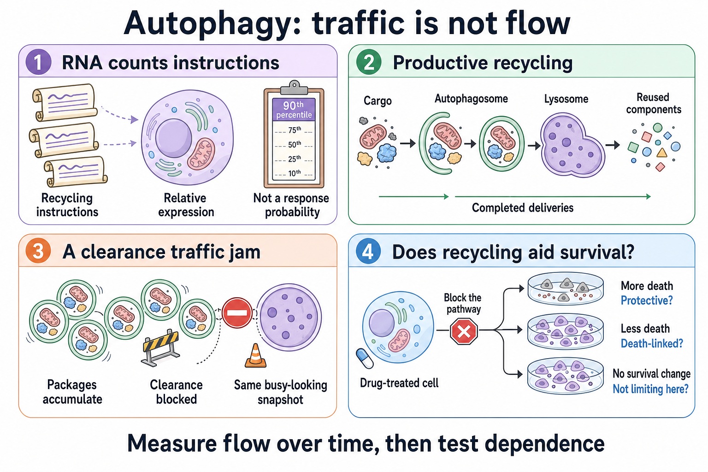

# Autophagy: traffic, flow, and dependence

**A busy-looking recycling system can be productive, blocked, or irrelevant to drug resistance.** Three questions have to be separated: how much machinery is present, whether cargo completes the trip, and whether that trip helps the cancer cell survive.

[[wiki/education/molecular-profiling/parp-and-cell-survival/index|Guide]] · Previous: [[wiki/education/molecular-profiling/parp-and-cell-survival/01-parp-trapping-and-recycling|PARP trapping]] · Next: [[wiki/education/molecular-profiling/parp-and-cell-survival/03-pi3k-akt-mtor-and-repair|PI3K, AKT, and mTOR]]

## Count the packages, then watch the deliveries

*Measure completed flow over time, then test whether changing it alters survival.*

Autophagy encloses cargo in a membrane package, an **autophagosome**, and delivers it to a **lysosome** for breakdown. The resulting components can be reused. This is part of normal cell maintenance as well as cancer biology.

A photograph of many packages has two possible explanations: packages are arriving rapidly, or deliveries have stopped. Likewise, increased LC3-II or many autophagosomes can reflect increased formation **or** impaired clearance. A high RNA pathway score is one step further removed: it measures relative expression of selected instructions, not packages completing the trip.

The laboratory therefore follows the process **over time**, often comparing conditions with and without lysosomal blockade. LC3 processing, p62/SQSTM1 turnover, lysosome function, and dual-color reporters can provide complementary information. None is self-interpreting: p62 production can change, and a reporter requires appropriate controls. These are examples of experimental approaches, not a universal clinical test panel. [Bellare 2021](https://pubmed.ncbi.nlm.nih.gov/33473172/).

## A worked example: one snapshot, two different systems

These are imaginary delivery counts, **not patient measurements or assay cutoffs**.

| Observation over one hour | System A | System B |
|---|---:|---:|
| Packages initially waiting | 20 | 20 |
| New packages arriving | 30 | 5 |
| Packages processed | 30 | 0 |
| Packages left waiting | 20 | 25 |

Both systems started with 20 packages. A single starting photograph could not distinguish A's productive flow from B's blockage. Measuring change and completion makes the difference visible. The biological analogy has limits: autophagy cargo, synthesis, and degradation are more complex than identical packages on a belt.

## Flow still does not establish dependence

Suppose a tumor has high, productive autophagy during PARP treatment. There are at least three experimentally distinguishable possibilities:

| Perturbation result | What it would suggest | What still needs checking |
|---|---|---|
| Blocking the pathway increases cancer-cell death | Autophagy may have been protective in that setting | Was the effect actually due to autophagy, and were exposures relevant? |
| Blocking it reduces drug-induced death | The pathway may have contributed to the death response | Is the observation reproducible with a separate perturbation? |
| Blocking it changes flux but not survival | The measured pathway may not limit survival under those conditions | Could timing, compensation, or the model conceal an effect? |

Both directions have published precedents. In HR-proficient breast models, autophagy disruption or chloroquine increased talazoparib sensitivity. In a different experiment using BRCA2-mutant HCC-1428 cells, ATG5 knockdown reduced olaparib-induced apoptosis. These were different models and perturbations; neither establishes an individual treatment effect. [Bellare 2021](https://pubmed.ncbi.nlm.nih.gov/33473172/) and its [2025 correction](https://pubmed.ncbi.nlm.nih.gov/40527957/); [Arun 2015](https://pubmed.ncbi.nlm.nih.gov/25975349/).

The Bellare correction replaced an incorrectly assembled representative liver-histology image in Figure 6f. It should be read with the original report.

This is why “protective or cytotoxic?” is a useful experimental question but an incomplete binary label for an entire tumor. Timing, cell population, and the particular drug can change the answer.

## What the 90th percentile means

A percentile near 90 places a specified RNA score near the upper end of a particular comparison group. It does **not** mean “90% of cells use autophagy,” “90% pathway activity,” or “90% probability that HCQ works.” Tumor purity, immune/stromal cells, gene-set choice, and measurement differences can affect the rank.

A percentile can inform a hypothesis only if the inputs and comparator are appropriate. A confounded RNA rank cannot prioritize a dependency. For a combination experiment, pair survival with evidence that the intended process changed.

## Explain it back

**Can RNA and a drug screen replace a flux measurement?** They answer useful adjacent questions, but neither directly shows the rate of autophagic cargo clearance.

**If blocking autophagy harms a tumor cell, is adding HCQ settled?** No. The result still has to survive checks of mechanism, exposure, normal-tissue effects, and evidence in the relevant clinical setting.

## Try it

An assay reports a striking value. Which sample, measurement method and comparator do you need before interpreting it?

**Answer:** Identify the sampled cells, assay definition and reference group before moving from the number to a biological or treatment claim.

## Takeaway

**The meaning of a measurement depends on its sample, method and comparison.**

## Applied to Diana

[[wiki/care/molecular-profile|The molecular profile]] owns current qualified findings.

## Sources and scope

General teaching; expert and learner review pending.

- [Bellare 2021](https://pubmed.ncbi.nlm.nih.gov/33473172/) and [2025 correction](https://pubmed.ncbi.nlm.nih.gov/40527957/).
- [Arun 2015](https://pubmed.ncbi.nlm.nih.gov/25975349/).
