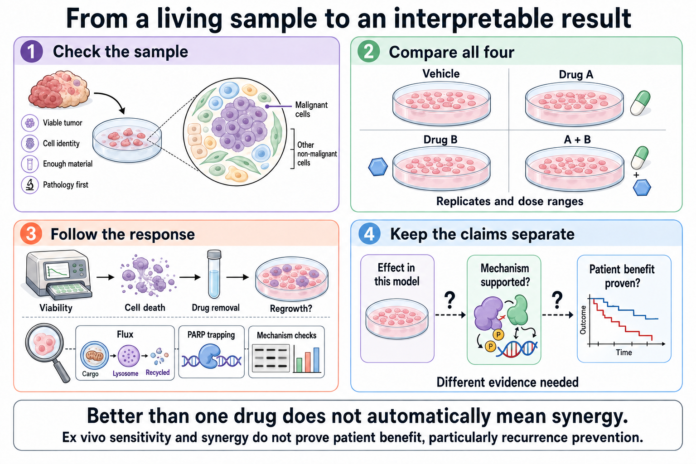

# Reading a functional experiment

**A combination experiment earns its claim by showing what changed, compared with what, and under which conditions. A lower laboratory signal is the start of that explanation.**

**Before you start:** [Synthetic lethality](/wiki/education/concepts/therapeutics/how-drugs-work/synthetic-lethality) describes a lethal interaction between two impairments; [analytical validity, clinical validity, and utility](/wiki/education/concepts/measurement/computational-analysis/analytical-validity-clinical-validity-and-utility) separates a reliable measurement from a useful medical decision.

## Where this step sits

The preceding lessons identified an obstacle, recycling responses, and competing growth signals. This final step asks whether an experiment actually tests that story. Keep [the guide's map](/wiki/education/molecular-profiling/parp-and-cell-survival/index#the-map) nearby if you want to trace a measurement back to its proposed mechanism.

## Compare the full set of conditions

A **functional experiment** measures what cells do after an intervention. It can ask about growth, death, repair, or recycling. First name the outcome, sampled cells, concentration, and time point. “The drug worked” is too broad to be an interpretable result.

For a two-drug experiment, the basic comparison has four conditions:

| Condition | What it contributes |
|---|---|
| Vehicle control | The carrier or solvent without active drug establishes the baseline. |
| Drug A alone | Shows the effect of A at its tested exposure. |
| Drug B alone | Shows the effect of B at its tested exposure. |
| A plus B | Shows the combined response at that dose pair and schedule. |

A positive control helps establish that the assay can detect a response. Replicates show variation. A range of concentrations and suitable time points helps distinguish a consistent result from a narrow exposure artifact. The intended human exposure and schedule still need a separate comparison.

*Controls define the comparison; additional evidence defines how far its conclusion can travel.*

## A worked example: stronger than either drug

These are **invented percentages for teaching**, normalized to vehicle at one time point. Treat them as an illustrative viability readout, where a lower value means a larger measured effect. They are not clinical response rates.

| Condition | Remaining viability |
|---|---:|
| Vehicle | 100% |
| A alone | 70% |
| B alone | 80% |
| A plus B, example 1 | 56% |
| A plus B, example 2 | 30% |

**Synergy** means exceeding the effect expected under a stated reference model. Different models use different assumptions:

- **Highest single agent (HSA)** uses the better single-drug effect at the tested doses. Here, its remaining-viability reference is 70%. Both combinations do better than that reference.
- **Bliss independence** models independent effects. Here, expected remaining viability is `0.70 × 0.80 = 0.56`, or 56%. Example 1 matches that expectation. Example 2 shows a greater effect at this dose pair.
- **Loewe additivity** asks about equivalent doses of the individual drugs that produce the same effect. It needs adequate single-drug dose-response curves; this one-point table is insufficient.

The reference model is part of the claim, rather than a technical detail to omit. The same result can exceed one expectation while matching another. A robust analysis also reports variation and the pattern across dose pairs. These models quantify interaction; they do not identify the causal biological mechanism. [Yadav 2015](https://pmc.ncbi.nlm.nih.gov/articles/PMC4759128/), [Ianevski 2017](https://academic.oup.com/bioinformatics/article/33/15/2413/3100330).

## Ask what the readout actually measures

An assay based on **adenosine triphosphate (ATP)**, a cellular energy molecule, or another metabolic signal can fall because there are fewer cells or because their metabolism changed. It cannot alone establish irreversible death.

A cell-death assay asks a different question. **Apoptosis** is one regulated death process. Regrowth after drug removal tests whether survivors can recover under the culture conditions. Measuring tumor-cell identity and composition helps establish which cells supplied the signal. A mixed culture may include nonmalignant cells, and culture can favor only some tumor populations.

Mechanism measurements are another layer. **Autophagic flux** measures completed recycling over time. **Poly(ADP-ribose) polymerase (PARP)** trapping measures a protein obstacle on [deoxyribonucleic acid (DNA)](/wiki/education/concepts/biology-basics/genetics/central-dogma). **RAD51 foci** are repair-protein assemblies that need adequate damage and cycling-cell controls to inform present [homologous recombination (HR)](/wiki/education/concepts/cancer-biology/genome-instability-and-repair/homologous-recombination-and-hrd) function. Each readout should be matched to the exact proposed explanation.

A genetic perturbation that independently disrupts the proposed function can strengthen a causal claim. Restoring that function in a **rescue experiment** can add further support. These are research methods, not features guaranteed by every drug screen. Autophagy assay guidelines are especially clear about combining appropriate measurements and controls. [Klionsky 2021](https://pubmed.ncbi.nlm.nih.gov/33634751/).

## Separate response, mechanism, and benefit

Suppose a fictional culture shows more death with a PARP inhibitor and a lysosomal drug. The first justified claim is a response in that culture at those exposures. If trapping, clearance, and controlled perturbation support the explanation, the lab may then argue for a mechanism in that model.

Clinical utility is a further question. A model cannot measure human drug metabolism, organ toxicity, or whether using its result improves an outcome in the relevant treatment setting. A breast cancer proof-of-concept study compared a specific ex vivo chemotherapy assay with response during treatment before surgery. **Ex vivo** means outside the body using a collected specimen. That type of validation is tied to its assay, drugs, and setting; it does not validate every functional test or postoperative combination. [Ladan 2023](https://pubmed.ncbi.nlm.nih.gov/37777518/).

## What can go wrong at this step

A combination that beats both single drugs can be called synergistic without naming the model. A metabolic change can be called cell death. Two correlated measurements can be called a causal mechanism. A response in sampled cells can be called a proven benefit in patients.

Sample adequacy also matters. A living drug culture requires viable material collected and handled for that assay. Fixed tissue cannot be turned into a living culture. Ordinary snap-freezing and validated viable cryopreservation preserve different properties. An uninterpretable sample should yield an honest “no result,” rather than a forced biological conclusion.

## Try it

Use the fictional single-drug values above: A leaves 70% viability and B leaves 80%. A new combination leaves 65%. Does it exceed HSA? Does it exceed Bliss? Can it establish a treatment choice?

Show the answer

It exceeds the HSA effect because 65% is below the better single-drug reference of 70%. It does not exceed the Bliss effect: 65% is above the 56% independence expectation. Neither comparison selects treatment. Replication, dose-response behavior, mechanism, relevant exposures, safety, and clinical validation remain separate questions.

## Explain it back

“The experiment measured ___ in ___, compared with ___, so it supports ___.”

One possible answer: “a viability response; a specified culture at stated exposures; vehicle and both single drugs; a model-specific combination result, with interaction defined by a named reference.”

## Takeaway

**Name the control, reference model, readout, and evidence boundary before turning a laboratory response into a claim.**

**Next:** [Judge a test or vendor claim](/wiki/education/guides/judging-a-test-or-vendor-claim/index), or revisit [the course map](./index).

## Sources and scope

Source check: 2026-10-09. Experiment-reading education; expert and learner review pending. All arithmetic examples are fictional. No laboratory result here establishes individual benefit or a safe combination.

- [Yadav 2015: HSA, Bliss, and Loewe reference models](https://pmc.ncbi.nlm.nih.gov/articles/PMC4759128/).
- [Ianevski 2017: analyzing dose-response combination matrices](https://academic.oup.com/bioinformatics/article/33/15/2413/3100330).
- [Klionsky 2021: interpreting autophagy assays with suitable controls](https://pubmed.ncbi.nlm.nih.gov/33634751/).
- [Ladan 2023: breast cancer functional testing proof of concept](https://pubmed.ncbi.nlm.nih.gov/37777518/).
