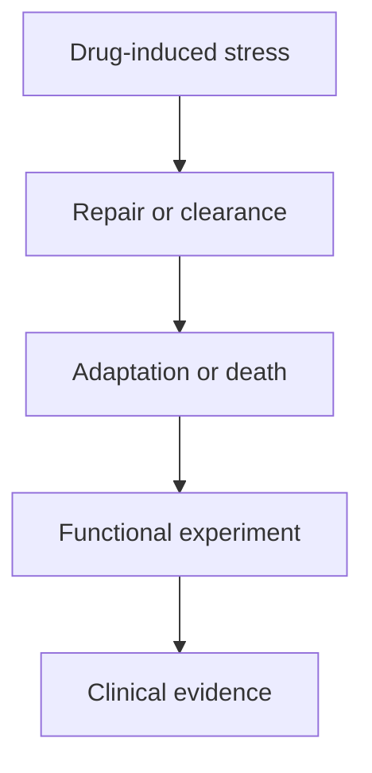

# PARP, recycling, and cell survival

**A drug creates stress. A cancer cell may repair the damage, clear the obstacle, or adapt to survive.** That is the connection between DNA repair, autophagy, and PI3K–AKT–mTOR signaling. The same cell uses all three systems, so changing one can change the effect of another.

One research question connects these systems: can a repair weakness be exploited while blocking an escape route? This illustrated walkthrough explains why that is worth testing—and why the biology cannot pick the combination by itself. The illustrations show simplified mechanisms, not tumor measurements.

## The big ideas

1. A drug can create a physical obstacle as well as block an enzyme.
2. Recycling-related expression, flux and dependence are different claims.
3. A combination can have competing effects.
4. A laboratory response needs clinical translation.

## The map

## Lessons

1. **[PARP trapping and recycling](./01-parp-trapping-and-recycling).** What obstacle does the drug create, and how might a cell remove it? Learn about synthetic lethality, trapped PARP1, selective nuclear recycling, and resistance.
2. **[Autophagy: traffic, flow, and dependence](./02-autophagy-flux-and-dependence).** Does a busy recycling system help the cancer survive? Learn why a percentile, a snapshot, and a functional experiment answer different questions.
3. **[PI3K, AKT, and mTOR](./03-pi3k-akt-mtor-and-repair).** Can a second drug both help and undermine PARP inhibition? Follow the growth signal, the autophagy brake, and competing effects on DNA repair.
4. **[Reading a functional experiment](./04-reading-a-functional-experiment).** What would a convincing combination result look like? Examine controls, synergy, regrowth, specimen limits, and the gap between a dish and clinical benefit.

New to HRD (homologous recombination deficiency) or BRCA? Start with [[wiki/education/molecular-profiling/hrd-parp-and-dianas-biology|the illustrated HRD/PARP primer]]. It explains repair machinery and the distinction between somatic and germline BRCA.

## Three clues, three missing answers

| Clue | A useful hypothesis | The missing answer |
|---|---|---|
| BRCA1 disruption and a high genomic-scar score | Accurate DNA repair may be impaired | Is repair still impaired in the surviving cancer cells? |
| A reliable autophagy expression signal in an appropriate comparison | Recycling-related instructions may be prominent | Is material being recycled, and does that help survival? A confounded comparison cannot establish the starting signal. |
| A PI3K/AKT or mTOR expression signal | Growth and nutrient signaling may matter | Which proteins are active, and what does a specific drug do to the whole system? |

These are hypothetical evidence layers, not three demonstrated drug dependencies. A confounded expression comparison cannot establish the starting premise.

## A vocabulary card

| Term | Plain meaning |
|---|---|
| **HR / HRD** | Homologous recombination is template-based DNA repair; HR deficiency means this repair is impaired. |
| **PARP trapping** | A PARP protein remains bound to DNA, creating an obstacle during DNA copying. |
| **Autophagosome / lysosome** | The cargo package / the compartment that breaks down its contents. |
| **Flux** | Material completing a process over time, rather than the amount visible at one moment. |
| **Dependency** | A function the cell needs to survive in a defined situation. Being active does not establish being essential. |
| **Nucleophagy** | Selective autophagic handling of nuclear material; trapped PARP1 is one experimentally studied cargo. |
| **mTORC1** | A nutrient- and growth-responsive protein complex that promotes biosynthesis and restrains autophagy initiation. |
| **Ex vivo** | Tested outside the body using a collected specimen. |
| **Synergy** | A combination effect greater than a specified model predicts from the individual drugs. |
| **Clinical benefit** | An outcome that matters in patients; it requires evidence beyond a laboratory response. |

## Two ways to use this guide

For a quick explanation, read the opening paragraph and cartoon in each chapter. For a laboratory or tumor-board discussion, also work through the examples and the experiment checklist in chapter 4.

The teaching material explains the biology. The [[wiki/research/parp-autophagy-pi3k-evidence|evidence review]] maintains the study-by-study findings, and the [[sources/research/elicit/2026-09-09-parp-autophagy-pi3k/search-record|research source record]] links the primary evidence and dated trial review. Current treatment decisions remain in [[wiki/questions/adjuvant-treatment|the postoperative decision page]].

## Applied to Diana

[[wiki/care/molecular-profile|The molecular profile]] owns current findings, and [[wiki/questions/adjuvant-treatment|the postoperative question]] owns treatment decisions.

## What is still uncertain

The direction and clinical relevance of each interaction depend on model, exposure and treatment setting. No gene list or expression rank determines a safe combination.

## Concepts you will use

- [[wiki/education/concepts/evidence-and-statistics/biomarkers/actionability|Clinical actionability]]
- [[wiki/education/concepts/breast-cancer/surgery-and-pathology-results/pcr|Pathologic complete response (pCR)]]
