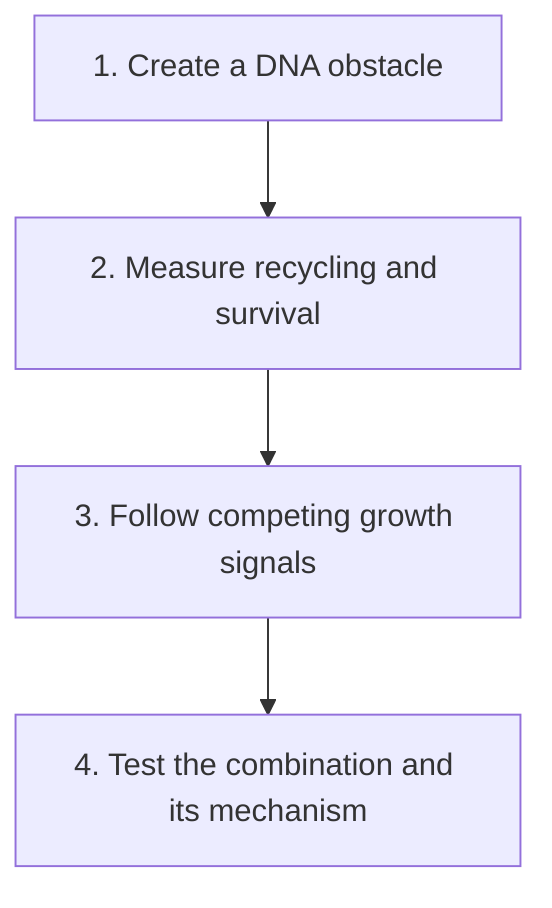

# PARP, recycling, and cell survival

**Learn how a drug creates stress, how a cell copes with it, and what an experiment can establish about the result.**

This guide follows one connected story: a damaged DNA copy, an obstacle left by a drug, and a cell trying to keep going. You do not need to memorize a long pathway. Instead, keep asking three questions: what changed, what was measured, and what conclusion follows?

The central example is a **poly(ADP-ribose) polymerase (PARP)** inhibitor. PARP enzymes build chemical signals at damage in [deoxyribonucleic acid (DNA)](/wiki/education/concepts/biology-basics/genetics/central-dogma). ADP-ribose is the chemical unit in those signals. Blocking the enzyme can also leave PARP stuck to DNA, creating a physical obstacle.

## The big ideas

1. **A repair weakness is a context, rather than a promised response.** [Homologous recombination deficiency (HRD)](/wiki/education/concepts/cancer-biology/genome-instability-and-repair/homologous-recombination-and-hrd) can make DNA damage harder to tolerate. A historical scar and present repair function still answer different questions.
2. **Amount, flow, and dependence are separate.** Autophagy is a cellular recycling process. Having more machinery, completing more recycling, and needing it to survive are three distinct claims.
3. **A second drug can have competing effects.** Growth signals can affect both repair and stress responses. A simple pathway arrow cannot tell us which effect will dominate.
4. **A laboratory response has a defined boundary.** An experiment can support a mechanism in its model. Clinical benefit needs evidence in patients and the relevant treatment setting.

## The map

## Lessons

| Step | Lesson | The question it answers | Minutes | Learning aid |
|---|---|---|---:|---|
| 1 | [PARP trapping and recycling](./01-parp-trapping-and-recycling) | What obstacle does a PARP inhibitor create, and what might remove it? | 12 | Obstacle cartoon and two hypothetical tumors |
| 2 | [Autophagy: traffic, flow, and dependence](./02-autophagy-flux-and-dependence) | Does a busy-looking recycling system help a cell survive? | 12 | Delivery analogy and a snapshot exercise |
| 3 | [Growth signals, repair, and recycling](./03-pi3k-akt-mtor-and-repair) | How can one intervention push survival in different directions? | 12 | Pathway cartoon and a feedback example |
| 4 | [Reading a functional experiment](./04-reading-a-functional-experiment) | What would a convincing combination result establish? | 12 | Control table and interaction arithmetic |

Each lesson includes a worked example, a short practice question with an answer, and an “explain it back” prompt. The examples are fictional teaching cases. Read the cartoon captions first if you want a quick orientation, then return to the exercises.

## Concepts you will use

Start with [DNA, RNA, and protein](/wiki/education/concepts/biology-basics/genetics/central-dogma), [germline versus somatic variants](/wiki/education/concepts/biology-basics/genetics/germline-vs-somatic), and [ligands and receptors](/wiki/education/concepts/biology-basics/signaling/ligand-and-receptor). They explain genetic instructions, where a variant belongs, and how cells receive signals.

For this guide, read [homologous recombination and HRD](/wiki/education/concepts/cancer-biology/genome-instability-and-repair/homologous-recombination-and-hrd) and [synthetic lethality](/wiki/education/concepts/therapeutics/how-drugs-work/synthetic-lethality). For the final step, [analytical validity, clinical validity, and utility](/wiki/education/concepts/measurement/computational-analysis/analytical-validity-clinical-validity-and-utility) explain why a reliable laboratory measurement does not by itself show that using it improves patient outcomes.

## Applied to Diana

[The molecular profile](/wiki/care/molecular-profile) owns current findings. [The postoperative treatment question](/wiki/questions/adjuvant-treatment) owns their treatment implications, and [the diagnostic workplan](/project-management/projects/research/diagnostics) owns practical specimen and testing arrangements. This guide supplies reusable biology for those discussions.

## What is still uncertain

Selective removal of trapped PARP is an active research area. Results in cell and mouse models do not establish that a broad recycling drug reproduces that mechanism in patients. The clinical value of a combination depends on its exact drugs, schedule, exposures, safety, and disease setting.

A useful outcome from this guide is a precise experimental question: “If we change this process in this model, does the intended mechanism change, and do the cells survive differently?” The experiment then earns its conclusion one measurement at a time.

## Sources and scope

Source check: 2026-10-09. General mechanism and experiment-reading education; expert and learner review pending. Reading times are estimates.

- [Murai 2012: distinct catalytic and trapping effects of PARP inhibitors](https://pmc.ncbi.nlm.nih.gov/articles/PMC3528345/).
- [Hoslett 2026: selective removal of trapped PARP1 in preclinical models](https://www.nature.com/articles/s41556-026-01961-5).
- [Yadav 2015: interpreting drug-combination interactions](https://pmc.ncbi.nlm.nih.gov/articles/PMC4759128/).
