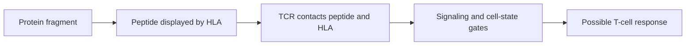

# T-cell receptors and TCR sequencing

**A T-cell receptor recognizes a peptide together with the HLA molecule displaying it; sequencing identifies receptor sequences, rather than proving what they recognize.**

**Before you start:** [[wiki/education/concepts/immunology/antigen-presentation/hla|HLA]] is the display system. A peptide is a short protein fragment. This lesson explains what a receptor readout adds to those two pieces.

## Recognition is a three-part contact

Most conventional T cells use a receptor made from an alpha and a beta chain. The receptor contacts both the peptide and its human leukocyte antigen (HLA) molecule. The **peptide sits in the HLA binding groove**; the TCR does not hold it in a separate peptide pocket. The receptor works with CD3 signaling proteins and, often, a CD4 or CD8 co-receptor.

A receptor can cross-recognize multiple peptide–HLA complexes. A clone means cells descended from the same T cell, usually carrying the same receptor sequence. Neither a sequence match nor binding alone proves safe tumor killing. Receptor affinity, peptide density, cell state and signaling all matter.

*Display, recognition and response are separate steps.*

## Diversity continues to change in adults

Developing T cells rearrange receptor gene segments in the thymus. Selection removes many cells that strongly react to self or cannot use HLA. The thymus produces fewer new cells with age, but it does not switch off at age 20. Existing naive T cells also maintain themselves through homeostatic proliferation.

A vaccine mainly selects and expands pre-existing antigen-reactive clones. Expansion changes their frequency; it does not mean the vaccine rewrote their receptors. Infection, chemotherapy, aging and sampling can also alter the measured repertoire. A pre-dose sample offers a comparison point, not a complete archive of every receptor in the body.

## What each assay measures

| Assay | Output | Main limit |
|---|---|---|
| Bulk TCR sequencing | Receptor sequences and relative abundance in the sample | Read counts depend on method; they are not always exact cell counts |
| Paired single-cell TCR sequencing | Alpha/beta pairs assigned to individual sampled cells | Requires a compatible preparation and adequate sampling |
| Paired TCR and gene-expression profiling | Receptor identity alongside cell-state features | State markers do not independently prove antigen specificity |
| Peptide stimulation, multimers or killing assays | A response or binding under defined conditions | Controls, HLA restriction, specificity and safety still need testing |

Blood and tumor are different compartments. A clone abundant in blood might respond to a virus. A clone in tumor might be a bystander. Detecting the same clone in both establishes overlap, rather than its target.

## A worked example

A clone rises from 0.1% to 2% of sampled blood receptors after vaccination. That is evidence of expansion in that compartment. It could reflect vaccine response, another immune event, or sampling variation. A paired functional assay against the intended peptide can strengthen the response claim. Tumor-cell killing and clinical benefit require further evidence.

Extracting and expanding native antigen-reactive T cells is **adoptive transfer of selected cells**. Engineering cells to express a selected receptor is **engineered TCR-T**. They can share discovery assays, but differ in manufacturing, safety checks and regulatory requirements. Banking is neither a universal prerequisite nor a guarantee that a future product can be made. See [[wiki/questions/should-we-bank-leukopak|the collection decision]].

## Try it

A clone expands after dosing but fails the intended-peptide stimulation test. Can its sequence be called a tumor-specific therapeutic receptor?

**Answer:** No. Expansion identifies a candidate; failed or inconclusive specificity testing leaves its target unresolved.

## Explain it back

“Sequencing tells me ___; a functional experiment is needed to establish ___.” One answer: “which receptors were sampled; what they recognize and do.”

## Takeaway

**Receptor identity, expansion, antigen recognition and clinical effect are four different claims.**

**Next:** [[wiki/education/cellular-therapies/02-car-tcr-til-comparison|Compare CAR-T, TCR-T and TIL therapy]].

**Vocabulary:** CAR means chimeric antigen receptor.

**Vocabulary:** TIL means tumor-infiltrating lymphocyte.

## Sources and scope

Source check: October 8, 2026; this is a general assay lesson. Expert and learner review remain pending.

- [Adult thymic output measured with receptor-excision circles](https://pubmed.ncbi.nlm.nih.gov/9872319/).
- [Primary study of TCR cross-reactivity](https://pubmed.ncbi.nlm.nih.gov/17559580/).
- [[wiki/education/cellular-therapies/09-reading-cell-therapy-evidence|Cell-therapy evidence ladder]].
