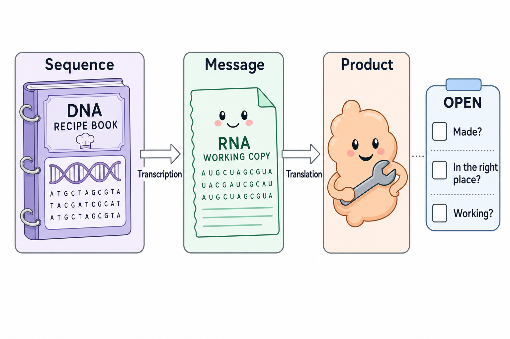

# Start with genes, RNA and protein

**DNA, RNA and protein are different things to measure. A change in one layer starts a question about the next.**

**Before you start:** [[wiki/education/concepts/biology-basics/genetics/central-dogma|Central dogma]] explains information flow from a protein-coding gene to its message and product. No other biology is assumed.

## Where this step sits

This is step 1 of [[wiki/education/reading-a-tumor/omics-and-multi-omics|Understand multi-omics]]. Start here if a report's long words make it hard to see the story. You do not need to memorize every gene. You need a few sturdy distinctions.

## Three layers, three questions

[DNA (deoxyribonucleic acid)](/wiki/education/concepts/biology-basics/molecules/dna) stores the sequence of a [gene](/wiki/education/concepts/biology-basics/molecules/gene); a sequence finding leaves its use open.

[RNA (ribonucleic acid) and messenger RNA (mRNA)](/wiki/education/concepts/biology-basics/molecules/rna-and-mrna) describe captured messages and other RNA products, rather than a count of finished tools.

A [protein](/wiki/education/concepts/biology-basics/molecules/protein-and-peptide) is the product whose form, location and function need their own measurements.

The recipe analogy helps: DNA is the stored recipe, RNA a working copy and protein a tool or product made from the instructions. A cell is more than a kitchen, though. It controls which recipes are copied, which messages persist and which products are used.

*This cartoon follows a protein-coding gene. The arrows show information flow; each product and its function still need their own evidence.*

| Layer | A good first question | A question it leaves open |
|---|---|---|
| DNA | Is this sequence or copy change present? | Was its message made? |
| RNA | Which messages or transcript forms were captured? | Was the relevant protein made? |
| Protein | Is this product present in the relevant cells and place? | Is it working, and does it matter? |

*The useful chain is sequence → message → product; each arrow needs evidence when the consequence matters.*

## Words that describe a measurement

**Expression** means a gene's information is being used to produce an RNA or protein product. A report must say which product it measured. “The gene is high” is not enough.

A **transcript** is an RNA product. An **isoform** is a particular version of a transcript or protein. A gene can produce several versions through different processing. A gene-level count can conceal that difference.

**Activity** means a process is doing something. **Abundance** means how much of something is present. A full toolbox does not tell us which tool is in use. For the same reason, protein abundance and function need different readouts.

## Follow a fictional receptor

Imagine a laboratory studying receptor R. The DNA sequence contains the receptor gene. RNA measurement finds many messages. A tissue stain finds protein mostly inside cells. The proposed treatment needs to bind the receptor on the outer surface.

The first two findings are useful, but the location question remains. Intracellular protein is not equivalent to an accessible surface target. The next experiment should inspect the relevant cells and membrane location under a suitable assay.

Now suppose a different protein controls cell division. Finding it on the surface is not the main question. Researchers may need to test its activation and whether blocking it changes survival. The right next assay follows the proposed mechanism.

## What can go wrong at this step

- Calling a DNA change “active” when no consequence was measured.
- Reading “high expression” without checking whether it means RNA or protein.
- Treating every RNA molecule as a protein-coding message.
- Assuming a detectable protein is intact, correctly located or essential.

You can avoid these errors with a small habit: name the physical object after every measurement. Say “RNA messages,” “membrane stain” or “repair response,” rather than just “signal.”

## Try it

A report detects many messages for enzyme E. Which claim is supported: abundant captured RNA, abundant protein, or a high rate of the enzyme's reaction?

**Answer:** Abundant captured RNA, under that assay's conditions. Protein measurement and a functional readout address the other claims. The RNA result gives a reason to investigate them.

## Explain it back

“DNA tells us about ______. RNA tells us about ______. Protein testing asks ______.”

One answer: “stored sequence; captured messages; what product was made, where it is and what it does.”

## Takeaway

**Always name the layer you measured before naming the consequence you hope it explains.**

**Next:** [[wiki/education/multi-omics-foundations/01-epithelial-and-breast-tissue|See what is inside a tissue sample]].

## Sources and scope

Source check: October 9, 2026. The examples are fictional and teach interpretation rather than a treatment choice. Expert and learner review remain pending.

- [NHGRI RNA fact sheet](https://www.genome.gov/about-genomics/educational-resources/fact-sheets/ribonucleic-acid-fact-sheet).
- [NHGRI transcription](https://www.genome.gov/genetics-glossary/Transcription).
