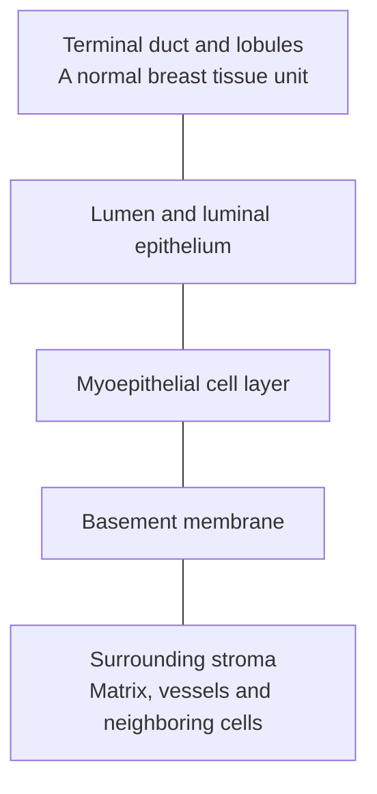

# See what is inside a tissue sample

**A tumor specimen is a piece of tissue, not a jar of pure cancer cells. Know the neighbors before interpreting its signal.**

**Before you start:** [[wiki/education/concepts/biology-basics/genetics/central-dogma|Genes, messages and products]] separates the measured layers. [[wiki/education/concepts/cancer-biology/what-cancer-is/tumor-heterogeneity|Tumor heterogeneity]] explains why one sampled region may not represent every cancer cell.

## Where this step sits

This is step 2 of [[wiki/education/reading-a-tumor/omics-and-multi-omics|Understand multi-omics]]. Start with [epithelium and stroma](/wiki/education/concepts/biology-basics/cells/epithelium-and-stroma): an epithelial cell family can include normal cells as well as cancer cells. Carcinoma names a cancer of epithelial origin; an epithelial label alone cannot establish malignancy.

## Picture the breast duct from the inside out

In [breast anatomy](/wiki/education/concepts/breast-cancer/anatomy-and-histology/breast-anatomy), small milk-producing lobules and their terminal duct form a **terminal duct lobular unit (TDLU)**. A lumen is an inner space; luminal cells face it. [Myoepithelial cells and the basement membrane](/wiki/education/concepts/breast-cancer/anatomy-and-histology/myoepithelial-cells-and-basement-membrane) help define normal compartments. Surrounding stroma contains cells, vessels and [extracellular matrix](/wiki/education/concepts/cancer-biology/tumor-microenvironment/extracellular-matrix).

*This map shows neighboring compartments in a simplified normal breast unit. It is not a diagnostic image or a path of invasion.*

These are normal architectural descriptions. A tumor can disrupt the organization. A pathologist interprets whether malignant cells have invaded surrounding tissue; a molecular epithelial label alone cannot answer that question.

## The sample is a neighborhood

| Component | What it can contribute to a molecular report |
|---|---|
| Malignant epithelial cells | Cancer-cell messages, proteins and acquired DNA changes |
| Normal epithelial cells | Many of the same lineage markers and normal tissue functions |
| Fibroblasts and other supporting cells | Matrix, signaling and connective-tissue programs |
| Vessel cells | Vascular markers and proteins |
| Immune cells | Antibody, inflammation and immune-response messages |

A bulk assay combines contributions from the piece it receives. The amount of RNA contributed need not be proportional to the number of cells. A small population with abundant messages can make a visible contribution.

An analyst may try to enrich malignant cells or assign individual cells to groups. Those steps can help, but the resulting label needs evidence. Cell appearance, multiple markers, acquired DNA changes and copy patterns can support malignancy. One epithelial marker cannot distinguish normal lining cells from cancer.

## A worked example: choose the normal neighbor

A fictional gene is high in cancer cells and low in fibroblasts. The first interpretation is “higher than fibroblasts.” That is an accurate comparison if the measurements are sound.

Now measure normal luminal epithelial cells. The gene is similarly high there. The stronger statement “cancer-selective” no longer follows. The original contrast mainly captured an epithelial-versus-supporting-cell difference.

If the normal epithelial group is tiny or contaminated, the result becomes less certain. We should say the normal comparison is unresolved, rather than declaring either selectivity or perfect equality. A useful next step is a better matched comparator, with compatible preparation and clear cell labels.

## What can go wrong at this step

- Treating “tumor sample” as meaning every measured cell is malignant.
- Using fibroblasts as the only normal comparison for an epithelial target.
- Reading a basement-membrane drawing as a diagnostic image of an individual tumor.
- Assuming a computational tumor mask cannot include normal epithelium.

A **tumor mask** is an image-based assignment of a region or cells to the malignant compartment. It is an analysis aid, not a substitute for validating that assignment.

## Try it

A tissue profile contains a strong antibody-production signal. Does that establish that the cancer cells produce antibodies?

**Answer:** No. [Plasma cells](/wiki/education/concepts/immunology/antibodies-and-b-cells/b-cells-and-plasma-cells) and other immune populations can supply that RNA. The next question is which cells produced the signal, using a suitable cell-specific or spatial measurement.

## Explain it back

“Epithelial describes a ______. To call a cell malignant, I need ______. To interpret a bulk signal, I need ______.”

One answer: “normal cell family; additional evidence of cancer; the sample's cell mixture.”

## Takeaway

**The right molecular question starts with the right cells and the right normal comparison.**

**Next:** [[wiki/education/multi-omics-foundations/02-cell-identity-and-state|Separate cell identity from cell state]].

## Sources and scope

Source check: October 10, 2026. The examples are fictional and teach interpretation rather than a treatment choice. Expert and learner review remain pending.

- [Kumar et al., primary human breast atlas](https://www.nature.com/articles/s41586-023-06252-9).
- [NCI SEER epithelial tissue](https://training.seer.cancer.gov/anatomy/cells_tissues_membranes/tissues/epithelial.html).
- [NCI stroma](https://www.cancer.gov/publications/dictionaries/cancer-terms/def/stroma).
