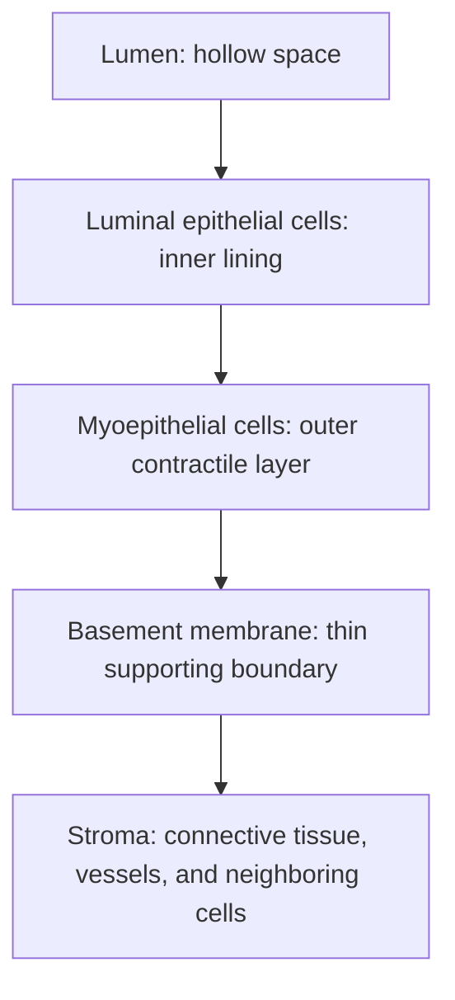

# Epithelial cells and breast tissue

**Epithelial** is pronounced *eh-pih-THEE-lee-ul*. It describes cells that form linings and glands. **Epithelium** is the tissue they form. Skin, the gut lining, and breast ducts contain different kinds of epithelial cells. **Carcinoma** means a cancer arising from epithelial cells. Epithelial is a normal biological category; it does not itself mean malignant. [NCI: carcinoma and epithelial tissue](https://www.cancer.gov/about-cancer/understanding/what-is-cancer)

## Picture a breast duct from the inside out

<!-- Cartoon source: [generation prompt](/api/file?path=wiki%2Feducation%2Fimages%2Fprompts%2Fepithelial-duct-and-tissue-mixture.txt) -->

<!-- Theme asset: [dark variant](/api/file?path=wiki%2Feducation%2Fmulti-omics-foundations%2Fimages%2Fepithelial-duct-and-tissue-mixture-dark.png) -->

*Conceptual illustration of normal duct layers and the cell families that can share a biopsy. Epithelial identity alone does not establish malignancy.*

The **lumen** is the hollow space. **Luminal** means facing that space. Around it sit luminal epithelial cells, an outer myoepithelial layer, and a basement membrane. Outside is supporting tissue. This simplified cross-section describes normal organization; a tumor can disrupt it. [Normal human breast atlas](https://pmc.ncbi.nlm.nih.gov/articles/PMC11443819/)

| Word | What to picture |
|---|---|
| **Duct** | A passage carrying milk toward the nipple |
| **Lobule / alveolus** | Milk-producing glandular structures; alveoli are small secretory units within lobules |
| **Luminal epithelial cell** | A cell on the inner side of a duct or gland; different luminal states have different hormone-response or secretory programs |
| **Myoepithelial cell** | An epithelial cell with contractile features around ducts and glands; “myo” refers to those muscle-like features |
| **Basement membrane** | A thin extracellular support layer beneath epithelium; invasion beyond this boundary is a pathology question |
| **Stroma** | The supporting tissue surrounding the epithelial structures |

The **stroma** includes connective tissue and vessels. **Fibroblasts** help build and remodel its extracellular matrix; **endothelial cells** line blood vessels. Immune cells can occupy this surrounding tissue too. **Extracellular matrix (ECM)** means material outside cells, including structural proteins such as collagen. [NCI: stroma](https://www.cancer.gov/publications/dictionaries/cancer-terms/def/stroma)

## Why a “tumor sample” contains normal cells

A biopsy takes a piece of tissue. It can contain malignant epithelial cells, normal epithelial cells, fibroblasts, endothelial cells, and immune cells. A gene measured in that piece might come from any of them.

“Tumor versus normal epithelial” therefore compares two groups within the same broad cell family. It asks whether the cancer cells differ from an appropriate normal lining-cell population. Comparing cancer cells only with fibroblasts could make an ordinary epithelial marker look highly enriched.

In the October 4 [tumor-versus-normal report](https://github.com/jasonLaster/oncoomics/blob/6c4e5438ca135835f0d5196df6f1fea42c243036/results/diana_multiomic_review_20261004/step18-tumor-vs-normal-epi/tumor_vs_normal_report.md), the small normal luminal comparison group may contain tumor nuclei and background RNA. Its result raises a selectivity question; it does not establish a clean normal reference or quantify treatment toxicity.

## Say it in your own words

**“Epithelial means lining or gland-forming cells. Breast cancer cells come from that family, but normal breast lining cells are epithelial too. I need to know which group produced the signal.”**

**Check yourself:** If a report says “epithelial cluster,” does that prove the cells are cancerous? **No.** Malignancy needs additional evidence. Continue to [[wiki/education/multi-omics-foundations/02-cell-identity-and-state|cell identity and state]].
