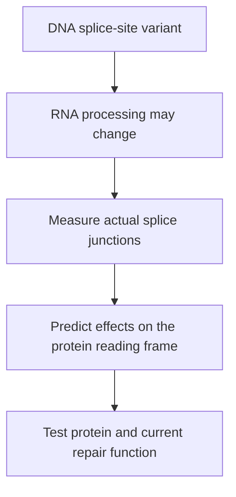

# Splicing and DNA repair

A gene can still produce RNA even when that RNA cannot produce a normal protein. This is why the reports examine BRCA1 sequence, splice junctions, chromosome copies, and repair scars separately.

## Splicing edits the RNA message

<!-- Cartoon source: [generation prompt](/api/file?path=wiki%2Feducation%2Fimages%2Fprompts%2Fsplicing-edits-the-rna-message.txt) -->

<!-- Theme asset: [dark variant](/api/file?path=wiki%2Feducation%2Fmulti-omics-foundations%2Fimages%2Fsplicing-edits-the-rna-message-dark.png) -->

*Exon skipping is one possible abnormal splice product. Its protein consequence depends on the precise transcript; detecting RNA does not prove normal function.*

**Exons** are transcript segments retained after splicing; some exon sequence is untranslated. **Introns** are intervening segments removed from pre-mRNA. A **splice donor** marks the start of an intron and a **splice acceptor** its end. A **junction read** crosses the join between retained segments and supplies evidence about the RNA product.

A damaged splice site can cause **exon skipping**, **intron retention**, or use of a **cryptic splice site**, an alternative site the processing machinery recognizes. Different products can arise from the same DNA variant. [HGVS: splice-variant examples](https://hgvs-nomenclature.org/main/recommendations/RNA/splicing/)

## Decode the variant names

| Example | What the notation says |
|---|---|
| **BRCA1 c.81-1G>A** | In coding-DNA numbering, G changes to A one intronic base before the exon position numbered 81; it lies at the acceptor boundary |
| **TP53 c.559+2T>G** | T changes to G two intronic bases after exon position 559; it lies at the donor boundary |
| **p.S382\*** | At protein position 382, serine is replaced by a stop signal; this is a nonsense change, not automatically a frameshift |

These abbreviated names require a **reference transcript and version** for exact interpretation. A **genome build** such as GRCh37 or GRCh38 defines genomic coordinates; chromosome positions should never be compared without checking that reference. [HGVS: sequence numbering](https://archive.hgvs-nomenclature.org/bg-material/numbering/)

Proteins are read in groups of three RNA bases. A **frameshift** changes that grouping. A **premature termination codon**, or early stop, can lead to shortened protein or **nonsense-mediated decay (NMD)**, a process that removes certain transcripts. NMD depends on transcript context; an early-stop prediction does not prove decay occurred. [RNA-surveillance explanation](https://www.ncbi.nlm.nih.gov/books/NBK2334/pdf/Bookshelf_NBK2334.pdf)

## What HRD records

**Homologous recombination (HR)** repairs DNA using a matching template. **HRD** means deficiency in that repair system. BRCA1/BRCA2 disruption can cause it, but the gene name, a genomic scar, and measured current repair function are different evidence layers.

| Report term | What it describes |
|---|---|
| **Genomic scar** | Persistent DNA/chromosome patterns accumulated during tumor evolution |
| **LST** | Large-scale transitions: boundaries between large chromosome segments under the method's rules |
| **TAI** | Telomeric allelic imbalance: unequal parental contributions in regions extending toward chromosome ends |
| **LOH scar component** | Selected broad regions that have lost one inherited version; distinct from a single gene's copy state |
| **SBS3** | A fitted single-base-substitution pattern associated with HRD; the mutation set and fitting choices affect its estimate |
| **RAD51 foci** | Clusters of repair protein used in functional research assays; interpretation requires suitable cells, damage, and assay controls |

The October 4 analysis reports scar sums of **67–99 across plausible copy-number fits**. Earlier 62/72 values should not be carried forward as current validated scores. Scars can remain after repair function changes. [October 4 copy-number report](https://github.com/jasonLaster/oncoomics/blob/6c4e5438ca135835f0d5196df6f1fea42c243036/results/diana_multiomic_review_20261004/step5-ascn/ascn_report.md), [RAD51 primary study](https://pubmed.ncbi.nlm.nih.gov/29635390/)

**Microhomology** is a short matching DNA sequence at joined break ends. **POLQ** encodes polymerase theta, involved in a backup end-joining route. Experiments show HR-deficient models can depend on this route; high POLQ RNA alone does not demonstrate that dependence. **Replication stress** means difficulty copying DNA; **ATR** helps coordinate the response to that stress. These are mechanistic research questions, not interchangeable HRD tests. [Ceccaldi et al.](https://www.nature.com/articles/nature14184), [Mateos-Gomez et al.](https://www.nature.com/articles/nature14157)

## Say it in your own words

**“The splice evidence helps explain how BRCA1 RNA may be disrupted. The scars record the tumor's repair history. Protein and functional testing answer whether the repair defect is still present.”**

**Check yourself:** Does detectable BRCA1 RNA prove intact BRCA1 function? **No.** Its sequence, processing, protein product, and function matter. Next: [[wiki/education/multi-omics-foundations/06-immune-presence-and-recognition|immune recognition]].
